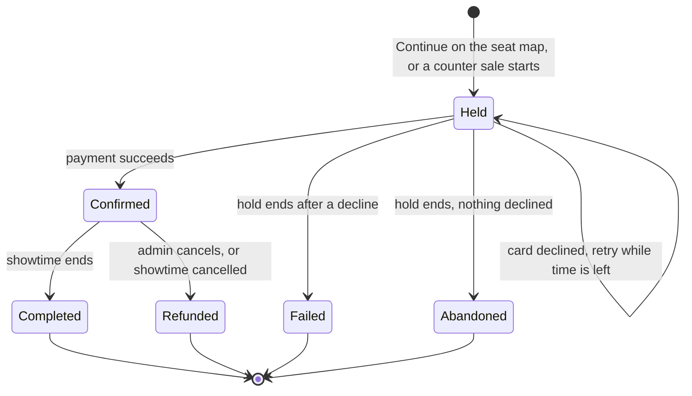

# Maqady PRD v2.0

> Markdown copy of the shared PRD doc
> (https://claude.ai/code/artifact/00a28804-1fbf-44b1-b614-65c6406ed363), exported on
> 2026-10-19 so repo sessions and kit agents can read it. The shared doc is the editable
> original: re-export this copy whenever the doc changes. PRD v2.0 supersedes PRD v1.0
> (`docs/reference/prd.md`). How the backend meets it is in `docs/system-design.md`.

## What changed since v1.0

Version 2.0 keeps the goals of PRD v1.0 and all 20 designed screens, but changes 18 rules, settled while planning the backend. Where this PRD and the design prototypes disagree, this PRD wins.

| Area | v1.0 and the prototypes | v2.0 |
| --- | --- | --- |
| Paying at checkout | Card, Apple Pay / Google Pay, or pay at the cinema | Card or wallet only. Pay at the cinema is removed. |
| Box office sales | Sell, or reserve with "Pay later" | Sell and take payment on the spot (cash or card terminal). No reservations. |
| Payment provider | Stripe | A simulated provider that behaves like a real one. No real money moves. |
| Booking fee | EGP 12 per seat | None |
| Hall formats | 2D, 3D, IMAX, 4DX, Dolby Atmos, VIP recliners | None. Every hall is a standard hall. |
| Ticket prices | Several conflicting models (by format, by zone, a format × zone grid) | By row zone: Front, Middle, Back. Each theater sets defaults; a showtime can override them. |
| Seat maps | One 12 × 16 grid for every hall | Each hall has its own grid, up to 15 rows × 20 seats |
| Movie scores | "Maqady rating" with votes, sort by rating | Removed |
| Videos | Uploads up to 2 GB, or YouTube links | YouTube links only. Photos are still uploaded. |
| Cancelling | Separate Cancel and Refund; "tickets only" refunds | Cancelling a paid booking always refunds it in full |
| Staff | One hard-coded admin | Staff accounts with two roles: Admin and Box office |
| Booking reference | Old prefix plus 5 characters | `MQ-` plus 6 characters, for example `MQ-7Q2K9X` |
| Booking statuses | Included Reserved and Cancelled; unclear what an expired hold becomes | Held, Confirmed, Completed, Refunded, Failed, Abandoned |
| Seat hold | 5 minutes from "Continue", owner unclear before sign-in | Same 5 minutes and 8 seats. A guest's hold is claimed when they sign in. |
| Time | Local strings, no time zone | Cairo time. A cinema day runs until 06:00 the next morning. |
| Dashboard numbers | Made-up sample data | Defined in this PRD. Revenue counts on the day of the show. |
| Email and SMS | Listed as a future feature | In v1. Email is really sent, through Resend's free plan; SMS is simulated. Admins can read every message in the Message log. |
| Implied screens | Not drawn | Added: staff sign-in, forgot password, email verification, standalone sign-in, search results, ticket scanning, notifications, CSV exports, ticket downloads |

## Product overview

Maqady is a responsive website where people find a movie, pick a showtime and exact seats, and pay online for an e-ticket. Cinema staff run the chain's theaters, schedule and box office from an admin dashboard on the same platform.

Maqady is a practice project built to production quality. It runs on free hosting, and no real money moves: payments and SMS go through simulated providers, and email is sent through Resend's free plan.

**Problem.** Booking a cinema seat often means visiting or calling the cinema to learn what is on, when, and which seats are free. Maqady puts the choice and the booking in one place.

**Vision.** Booking is easy, fast and safe, from discovering a movie to holding a confirmed e-ticket, in as few steps as possible.

**Goals**

- Make it easy to discover movies now showing and coming soon.
- Let people search and filter movies quickly.
- Show showtimes by theater and date.
- Let people pick exact seats on a live seat map.
- Take payment online and show the result clearly.
- Give customers one place to see their bookings and tickets.
- Give staff one dashboard for the catalog, theaters, schedule, box office, payments and customers.

**Success metrics.** Each one can be computed from v1 data.

| Metric | How it is measured |
| --- | --- |
| Booking completion rate | Confirmed online bookings ÷ seat holds started |
| Abandonment rate | Abandoned holds ÷ seat holds started |
| Payment success rate | Approved online payment attempts ÷ all online payment attempts |
| Time to book | Median time from hold to confirmation |
| Seat conflict rate | Hold requests refused because a seat was taken ÷ all hold requests |

## Users and roles

Four kinds of people use Maqady. Customers and staff have separate accounts, and every permission is checked by the server, never only by the UI.

| Role | Who | Can |
| --- | --- | --- |
| Guest | Anyone not signed in | Browse and search movies and theaters, see showtimes and live seat maps, and hold seats for 5 minutes before signing in |
| Customer | A person with a customer account | Everything a guest can, plus pay, see their own bookings and tickets, download tickets, and manage their profile |
| Box office | Counter staff | Sell tickets at the counter (cash or card terminal), look up bookings and customers, scan tickets at the entrance, and resend tickets |
| Admin | Managers | Everything a box office user can, plus movies, people, theaters, halls, prices, showtimes, refunds, booking edits, customers, staff accounts, analytics, the activity log, the message log and CSV exports |

- A staff login can't book tickets, and a customer login can't open the dashboard. A staff member who wants to see a movie uses a normal customer account.
- The first admin is created by a one-time setup command. After that, admins invite staff from the dashboard.
- Every staff action that changes data is recorded in the activity log with who did it and when.

## Scope

v1 delivers all 20 designed screens working on real data, updated by this PRD, plus 13 screens the designs imply but never drew.

**Designed screens, updated by this PRD**

- Customer site (12): Home, Movies, Movie Details, Theaters, Theater Details, Seat Selection, Sign In, Checkout, Booking Confirmation, My Bookings, Booking Details, Profile.
- Admin dashboard (8): Overview, Movies, People, Theaters & halls, Showtimes, Bookings, Payments, Customers.

**New screens to design**

| Screen | Site | Why it is needed |
| --- | --- | --- |
| Sign in and Create account (standalone) | Customer | Today's only sign-in page sits inside the booking flow |
| Forgot password, then Set a new password | Customer | "Forgot password?" has no destination |
| Verify email (link landing page) | Customer | Profile shows "Verified" but nothing verifies |
| Search results | Customer | The nav search has no results page |
| Session expired and Account blocked messages | Customer | PRD requires both states |
| Staff sign-in | Admin | The dashboard has no sign-in |
| Set your password (from an invite) | Admin | New staff need a first password |
| Staff | Admin | Admins manage staff accounts and roles |
| Scan tickets | Admin | QR codes say "Scan at the entrance" but nothing scans |
| Search results | Admin | The admin search has no results page |
| Notifications panel (bell) | Admin | The bell has no panel |
| Activity log | Admin | Who did what, across the dashboard |
| Message log | Admin | Every email and SMS sent, with its delivery status, readable by admins |

**Out of scope for v1**

- Pay at the cinema and unpaid reservations
- Promo codes, discounts, gift cards and loyalty points
- Movie ratings, reviews and watchlists
- Video uploads (videos are YouTube links)
- Saved cards (see Calls open for veto)
- Social sign-in, phone sign-in, guest checkout without an account
- Multiple languages or currencies (English UI, EGP only), including Arabic names and titles
- Food and drink ordering, seat upgrades, waitlists
- Person pages for actors and crew
- A real payment gateway and real SMS delivery

## Business rules

The server enforces every rule below; the UI only explains them. Anything that expires (a hold, a link) is judged from its stored time whenever it is read, so correctness never depends on a background job.

### Seats and holds

1. A seat belongs to at most one active booking per showtime. The server checks this atomically, so two people can never confirm the same seat.
2. "Continue" on the seat map holds up to 8 seats for 5 minutes. One clock runs through sign-in and checkout; signing in does not restart it.
3. A guest's hold comes with a private hold code. Signing in or creating an account claims the hold for that customer.
4. Picking new seats replaces the browser's previous hold, and its seats are released at once.
5. If the customer taps Pay with time left, the seats stay theirs until the payment returns, even if the clock reaches 0:00 meanwhile.
6. A showtime that has started can't be held or booked.
7. Holds are rate-limited per IP address. A blocked customer can't hold or book.

### Prices

1. Every hall row belongs to one of three zones: Front, Middle or Back. Wheelchair spaces cost their row's zone price.
2. Each theater sets default zone prices. A new showtime copies them when it is created, and an admin can change one showtime's prices.
3. The price is fixed when the hold is created; checkout charges exactly that total. A booking keeps the price it was sold at.
4. A showtime's "from" price is its cheapest zone.
5. No booking fee, no discounts, no tax lines. Prices are in EGP and may include piastres.

### Payments

1. On the website, customers pay by card or wallet (Apple Pay / Google Pay) through the simulated provider. There is no paying later.
2. At the counter, box office staff take cash or a card-terminal payment and record it. Card terminals aren't connected: staff type the terminal's receipt reference.
3. A booking is Confirmed only after the server records a successful payment. Pressing Pay twice never charges twice.
4. A declined payment leaves the seats held until the timer ends, so the customer can try again.

### Cancellations, refunds and edits

1. Customers can't cancel or refund a paid booking. The page tells them to contact the cinema before the showtime.
2. Only admins cancel bookings. Cancelling a paid booking always refunds it in full and releases the seats immediately.
3. Online payments are refunded through the simulated provider. Cash and card-terminal sales are refunded at the counter, and the refund stays Pending until an admin records it as paid out.
4. Cancelling a showtime refunds every confirmed booking and emails and texts each customer.
5. An admin can edit a booking's showtime (same movie), seats or contact details. A lower total is refunded automatically; a higher total is collected at the counter as part of the edit.
6. Completed, Refunded, Failed and Abandoned bookings can't be edited.

### Showtimes

1. A showtime is a movie in a hall at a start time. It ends after the movie's runtime.
2. Two showtimes in the same hall need at least 20 minutes between them for cleaning.
3. A showtime must start and end within the theater's opening hours for that cinema day. A special date's hours replace the weekly hours.
4. Only Now showing movies can be scheduled. A new showtime is on sale immediately if its theater is selling.
5. Moving a start time re-checks these rules and notifies every ticket holder by email and SMS.
6. Cancelling needs a reason: Technical issue, Print not delivered, Low sales or Private event.

### Halls and seat maps

1. A hall is a grid of 4 to 15 rows and 8 to 20 seats per row. Rows are lettered A to P, skipping I.
2. Each row gets a zone. Any seat can be marked as a wheelchair space or as "no seat" (a gap).
3. Aisles fall after seat 4 and 4 seats before the end of each row.
4. A hall's layout is locked while any upcoming showtime in it has an active booking. The editor names the showtimes that block it.
5. A hall that has never had a showtime can be deleted. Otherwise it is retired: kept for history, hidden from scheduling.

### Theaters and movies

1. A theater is Draft (being set up, hidden), Active (on the site and selling) or Sales paused (hidden from customers; existing tickets stay valid). An admin publishes a draft to make it Active.
2. Only a Draft theater with no showtimes can be deleted. Any other theater is paused instead.
3. A movie is Draft (admins only), Coming soon (listed, no sales), Now showing (bookable) or Archived (hidden, history kept).
4. A movie that has ever had a booking can't be deleted, only archived.
5. Up to 5 featured movies appear in the home carousel, in an order the admin sets. Each needs a hero trailer.

### Time

1. All times are Cairo time, and summer-time changes are handled correctly.
2. A cinema day runs from 06:00 to 06:00. A show at 00:30 on Saturday morning is listed under Friday, with its real date and time shown.
3. "This weekend" means Friday and Saturday.

### Accounts

1. Customers sign up with name, email and password. Passwords need at least 8 characters including a number, everywhere.
2. A verification email is sent at sign-up (link valid 24 hours). Verification blocks nothing; Profile shows Verified or offers to resend the link.
3. "Forgot password" emails a reset link, valid 1 hour and usable once.
4. When a session expires, the customer sees a clear message, signs in again and returns to where they were.
5. Blocking a customer signs them out everywhere immediately. Their paid tickets stay valid.
6. Deleting a customer removes their name and contact details. Their past bookings are kept for accounting.
7. Admins invite staff by email (set-password link valid 72 hours). Deactivating staff takes effect immediately. There is always at least one active admin.

## Customer site

The booking journey stays as designed, minus pay at the cinema:

1. Movie Details: pick a date, a theater and a showtime, then "Choose seats".
2. Seat Selection: pick up to 8 seats, then "Continue", which starts the 5:00 hold.
3. Sign In, only if signed out: sign in or create an account, which claims the hold.
4. Checkout: pay by card or wallet before the timer ends.
5. Booking Confirmation: e-ticket with QR code, also emailed.

Every data screen has loading, empty and error states, and every screen works on mobile, tablet and desktop.

### C1 Home `/`

- Hero carousel of up to 5 featured movies, in admin order. Each plays its YouTube hero trailer muted and looping, with pause and mute controls.
- Each slide shows title, genres, runtime, age rating and a short synopsis. No score.
- Ticker: each Now showing movie with its next bookable showtime today.
- Browse by genre links to Movies filtered by that genre.
- Now showing cards: poster, title, first genre, runtime, age rating. Coming soon cards: poster, title, genres, release date.
- Our cinemas: photo, name, address, open state, main phone, hall count and up to 3 facilities (instead of format badges).

### C2 Movies `/movies`

- Tabs: Now showing and Coming soon, with counts.
- Filters, combinable: search by title or cast; genres (with counts); show date (Any, Today, Tomorrow, This weekend; Now showing tab only); cast.
- Sort by release date only: newest first for Now showing, soonest first for Coming soon.
- Cards: poster, title, genres, runtime, age rating and release line. Coming soon cards show a "Soon" badge. No stars.
- "Load more", "Showing n of total", filter chips, "Clear all filters" and a "No matches" empty state.

### C3 Movie Details `/movies/:movieId`

- Header: title, genres, runtime, age rating, release date, language. The "Maqady rating" line is removed.
- Media viewer: YouTube videos (title, type, optional length) and photos (type Still or Behind the scenes, with caption). Counts of each.
- Synopsis. Tag chips are the movie's genres only.
- Credits: Director, Writers, Stars, and the full cast and crew grid. Each name opens Movies filtered by that person.
- Side panel: Book tickets, Watch trailer, the real next show today, how many cinemas show it, and "From EGP x · pay online".
- Showtimes: 7 cinema days, a theater picker with counts, and time chips with start–end time, hall, "from" price and a Sold out or Started state. No format.
- An after-midnight chip names its real day, for example "00:30 Sat" under Friday.
- Notes: "Prices vary by seat zone." and "Showtimes that have started can't be booked."
- Details table: release date, runtime, age rating, language, country, production company. Budget and filming locations appear only when an admin filled them in.
- More like this: up to 4 Now showing movies sharing the most genres. No stars.

### C4 Theaters `/theaters`

- Cards and map as designed: photo, name, address, open state, today's and weekly hours, box office phone, up to 5 facilities, Showtimes & info, Directions, Call.
- Filters: All, Open now, Parking (free or valet). The IMAX and VIP filters are removed.
- Open state follows the cinema day, so 01:30 on Thursday is judged by Wednesday's hours.

### C5 Theater Details `/theaters/:theaterId`

- As designed, without formats. Halls read "Hall 3 · 186 seats · 4 wheelchair spaces".
- Opening hours show any special dates in the next 7 days.
- Phones and email appear only when the theater's "show contacts" setting is on.
- Photos come from the admin's uploads.
- Showtimes here: 7 cinema days, each film with its time chips.

### C6 Seat Selection `/showtimes/:showtimeId/seats`

- Header shows the real movie, theater, hall, date, time and age rating. No format.
- The map is drawn from this hall's own layout: up to 15 rows × 20 seats, zone bands with prices, aisles, gaps and wheelchair spaces.
- Seat states: Available, Selected, Booked, Temporarily unavailable, Wheelchair space. Never shown by colour alone.
- The map updates live: other people's holds and bookings appear without a refresh, and a seat frees up when its hold ends.
- Up to 8 seats. The subtotal is the total; there is no fee.
- Continue starts the hold. A signed-in customer goes straight to Checkout; a guest goes to Sign In.
- If a seat was taken in the meantime, show which one and let the customer pick again.

### C7 Sign In `/login` and Create account `/register`

- In the booking flow: as designed, with the hold timer and booking summary. Success claims the hold and goes to Checkout.
- Standalone: the same forms without the booking summary. Success returns to the page the customer came from.
- "Forgot password?" opens the new Forgot password screen.
- Errors: wrong email or password, blocked account, too many attempts.

### C8 Checkout `/checkout/:bookingId`

- Methods: Card (Visa, Mastercard, Meeza) and Apple Pay / Google Pay. "Pay at the cinema" is removed.
- The card form is a simulated form. Test cards decide the outcome, and no real card data is ever sent.
- Summary: seat lines by zone ("Middle · F7, F8 · 2 × EGP 190") and the total. No booking fee or discounts line.
- States: processing (button locked), declined (try again or switch method), approved, and hold expired ("Your seats were released. Pick seats again.").
- Copy: "Tickets can't be cancelled once paid."

### C9 Booking Confirmation `/booking-confirmation/:bookingId`

- Paid variant only. The reserved variant and the "-R" reference are removed.
- Shows booking number (`MQ-7Q2K9X`), payment ("EGP 380 · Visa •••• 4242"), status Confirmed and the ticket card with QR code ("Admits 2").
- Actions: Download ticket (PDF), Add to calendar, Directions, My bookings.
- While a payment is still being confirmed, show "Confirming your payment". Refreshing never creates a second booking.

### C10 My Bookings `/my-bookings`

- Upcoming: Confirmed bookings whose showtime hasn't ended. Past: Completed, Refunded and Failed bookings.
- Rows as designed, with status, reference and payment method. Abandoned checkouts never appear.
- Paginated with "Load more".

### C11 Booking Details `/my-bookings/:bookingId`

- Ticket and QR code for Confirmed bookings. Refunded bookings show the refund amount and date instead.
- Payment table: seat lines by zone, total paid, method, paid on.
- History from real events: seats held, payment received, refunded, changed by the cinema, tickets resent.
- Actions: Download ticket, Email again (to the customer's own email), Add to calendar, Directions.
- Policy line: "This booking can't be cancelled or refunded. If you can't make it, contact the cinema before the showtime."
- Opening another customer's booking shows "not found".

### C12 Profile `/profile`

- Name, "Member since" and booking count, from real data.
- Your details: full name (required), phone (optional), email (read-only, marked Verified or Not verified with a resend link).
- The Saved cards section is removed.
- Change password: current, new, confirm; at least 8 characters including a number.
- Sign out, with the designed confirm dialog, actually signs out.

### New customer screens

- **Search results** `/search?q=`: movies (title or cast), people (each opens Movies filtered by that person) and theaters (name or area), grouped, with an empty state.
- **Forgot password** `/forgot-password`: email field, then "If an account exists for that email, we've sent a link", whether or not it exists.
- **Set a new password** `/reset-password`: new and confirm fields; expired or used links explain and offer a new link.
- **Verify email** `/verify-email`: success, or an expired link with a resend button.
- **Session expired** and **Account blocked**: clear messages with a way to sign in again or contact the cinema.

## Admin dashboard

The dashboard requires a staff sign-in, and each screen is limited to the roles in its heading. The nav shows only what the signed-in role can use; the server enforces it regardless.

### Shell (both roles)

- The footer shows the signed-in staff member's name and role, replacing the hard-coded persona. It includes Sign out.
- Box office nav: Bookings, Customers, Scan tickets. Admin nav: everything.
- The top bar search opens Admin search results. The bell opens the Notifications panel with a real unread count.
- Every list is paginated and shows its true total, replacing hard-coded counts such as "1,284".

### A1 Overview `/admin` (Admin)

- Period: Today, 7 days, 30 days, in cinema days. Scope: all theaters or one.
- KPI cards: Revenue, Tickets sold, Occupancy, Avg. ticket and Counter share (replaces "Paid at cinema"). Comparisons as designed.
- Revenue · last 30 days by theater, and the Revenue by theater table with an Online / Counter column.
- Payment methods: Card, Wallet, Cash, Card terminal.
- Revenue by hall when one theater is selected. Revenue by format is removed.
- Top movies by revenue, the busy-times heatmap and the Tonight list, from real data.
- Needs attention: failed online payments today, tonight's showtimes under 35% sold, and halls with no showtimes on a day in the next 7 days. The unpaid-reservations alert is removed.
- Export CSV of the current view.

### A2 Movies `/admin/movies` (Admin)

- List as designed: search by title or cast, status filter with counts, bulk archive.
- Details tab adds optional Budget and Filming locations, and drops "Original title (Arabic)".
- Media tab: poster upload (2:3); backdrop picked from the photos; videos are YouTube links only, each with title, type and optional length; photos upload as JPG or PNG up to 10 MB, each with type (Still or Behind the scenes) and caption. The "Upload from computer" video tab is removed.
- Cast & crew roles: Actor, Voice, Director, Writer, Producer, Cinematographer, Composer. Actor and Voice take a character name.
- Publishing: status, "Feature in the home carousel" with its position (1 to 5), and the hero trailer. The "Tickets on sale from" and "Hide after" dates are removed.
- Header shows the real "Last edited by" staff member and time.
- Delete is allowed only for a movie that never had a booking; otherwise archive.

### A3 People `/admin/people` (Admin)

- As designed, without the "Name in Arabic" field. Role filters: Actors (Actor, Voice), Directors, Writers, Crew (Producer, Cinematographer, Composer).
- Photo upload: square, at least 600 × 600, JPG or PNG. Social links (Instagram, IMDb, website) are saved.
- Filmography can be edited from the person or from the movie.

### A4 Theaters & halls `/admin/theaters` (Admin)

- List as designed, with status Draft, Active or Sales paused.
- New theater wizard as designed. New halls start as a standard 12 × 16 layout. The theater is created as a Draft.
- Header: a Publish button for drafts and the Selling toggle (Active or Sales paused).
- Facilities: Wheelchair access, Free parking, Valet parking, Street parking, Café & bar, Food court, Kids room. Format facilities (IMAX, 4DX, Dolby Atmos, 3D, VIP recliners) are removed.
- New Photos tab: a cover photo and a gallery, uploaded.
- Halls tab: name, seats, layout ("15 × 20"), status (Draft, Active, Retired), Edit layout, Add hall, Delete or Retire. No format column.
- Pricing tab: one row of default prices for Front, Middle and Back. The booking fee and pay-at-cinema settings are removed.
- Hall layout editor: rows 4–15, seats per row 8–20, a zone per row, wheelchair spaces, "no seat" gaps, automatic aisles and a live seat summary. Saving a hall in use is refused and lists the showtimes that block it.
- Delete theater is enabled only for a Draft with no showtimes.

### A5 Showtimes `/admin/showtimes` (Admin)

- Timeline and list views per theater and cinema day, as designed. The timeline spans the theater's opening hours.
- New showtimes: movie (Now showing), theater, hall, dates, start time, and Front, Middle and Back prices pre-filled from the theater. Live checks per date (Available, Conflict, Outside opening hours), suggestions, and "skip the dates that don't fit" as designed.
- The pay-at-cinema switch and format price adjustments are removed.
- Manage panel: seats sold, occupancy and revenue; edit prices for future sales; move the start time; view bookings; cancel with a reason.
- Cancel shows its impact: bookings and seats affected, total refunded online, total owed back at the counter, and "Everyone is emailed and sent an SMS".

### A6 Bookings `/admin/bookings` (both roles)

- Summary cards: Today (bookings and amount collected), Failed payments today, Refunded in the last 7 days. The unpaid card is removed.
- Table as designed plus a Channel column (Online or Counter). Search by reference, name, email or phone.
- Filters: status (Confirmed, Completed, Refunded, Failed, Abandoned), method (Card, Wallet, Cash, Card terminal), channel and date range.
- Detail: seat lines and total, payment details, refund details, activity log, internal notes and the customer card.
- Cancel & refund (Admin): always the full amount. The "Tickets only" option is removed.
- Edit booking (Admin): showtime of the same movie, seats or contact details, with a required reason. A lower total is refunded automatically; a higher total is collected at the counter as part of the edit. The payment-link option is removed.
- Resend tickets and Download ticket (both roles).
- New booking, a counter sale (both roles): movie, showtime, seats on the live map, customer (walk-in, existing or typed contact), then Cash or Card terminal with a receipt reference. "Pay later" is removed.
- The Collect payment action is removed.

### A7 Customers `/admin/customers` (both roles)

- List as designed, with real totals, search, status filter, pagination and Export (Admin).
- Drawer stats: Bookings, Spent and No-shows (paid bookings never scanned at the entrance).
- Admin actions: edit details, send a password reset email, Block or Unblock, Delete account. Box office sees the same data read-only.

### A8 Payments `/admin/payments` (Admin)

- Period picker (default last 7 days). KPIs: Collected online, Collected at counters (cash and terminal), Refunds (as a share of money collected in the period), Failed today. Outstanding is removed.
- Reconciliation by theater: Online, Cash, Terminal, Refunds, Net.
- Transactions: one row per payment or refund, with status Succeeded, Pending, Failed or Refunded. Filters by method, status and date range.
- Drawer actions: open the booking, and Mark refund paid out for a pending counter refund.
- Export for accounting.

### New admin screens

- **Staff sign-in** `/admin/login` (both roles): email and password, with clear errors for a wrong password or a deactivated account.
- **Set your password** `/admin/set-password` (both roles): from an invite or reset link.
- **Staff** `/admin/staff` (Admin): name, email, role, status, last sign-in. Invite (name, email, role), change role, deactivate or reactivate, resend invite. The last admin can't be demoted or deactivated.
- **Scan tickets** `/admin/scan` (both roles): choose the theater, then scan a QR code with the camera or type a reference. Results: Valid · Admits n, Already used at 19:12, Wrong showtime, Not valid (refunded) or Not found. Scanning opens 60 minutes before the start and closes when the showtime ends.
- **Admin search results** (both roles): bookings, customers, movies, people and theaters, limited to what the role may see.
- **Notifications panel** (both roles): the current Needs attention alerts, unread first, each linking to its screen.
- **Activity log** `/admin/activity` (Admin): time, staff member, action and item, filterable by staff member, item type and date.
- **Message log** `/admin/messages` (Admin): every email and SMS, with time, channel, recipient, subject, delivery status (queued, sent, failed) and related booking or customer, opening to the full message. One-time links are always hidden.

## Shared platform features

These features serve both sites. Email goes out through Resend; SMS is simulated. Every message, sent or simulated, lands in the admin Message log with its delivery status.

### Email and SMS

| Trigger | Email | SMS | Recipient |
| --- | --- | --- | --- |
| Account created | Verification link | — | Customer |
| Forgot password, or admin sends a reset | Reset link | — | Customer |
| Staff invited or reset | Set-password link | — | Staff member |
| Booking confirmed, online or at the counter | Tickets | Tickets, if a phone is on file | Customer or walk-in contact |
| Tickets resent, or "Email again" | Tickets | Staff resend only, if a phone is on file | Customer |
| Booking edited | New tickets, if "notify" is on | New tickets, if "notify" is on | Customer |
| Booking cancelled and refunded | Refund notice | — | Customer |
| Showtime moved | New time | New time | Every ticket holder |
| Showtime cancelled | Cancellation and refund notice | Cancellation notice | Every ticket holder |

### Tickets and QR codes

- One QR code per booking admits every seat on it at once. A second scan shows "Already used" with the first scan's time.
- The QR code carries a signed code that can't be guessed or forged. The booking reference alone admits nobody.
- Editing a booking issues a new QR code, and the old one stops working.
- Download ticket gives a PDF with movie, theater, hall, date, time, seats, reference and QR code.
- Add to calendar gives a calendar file with the showtime and the theater's address.

### Search

- Customer search: movies by title or cast, people by name, theaters by name or area.
- Admin search: bookings by reference, customer name, email or phone; plus customers, movies, people and theaters.
- Matching is case-insensitive and accepts part of a word.

### CSV exports

- Overview (current view), Bookings and Customers (current filters), and Payments for accounting (chosen period).
- Admins only. Every export is recorded in the activity log, because exports contain personal data.

### Media

- Photos: JPG or PNG up to 10 MB. The platform keeps web-sized copies only and strips location data. Posters are 2:3; people photos are square, at least 600 × 600.
- Videos: YouTube links (watch, youtu.be, shorts and embed URLs). They play in YouTube's privacy-enhanced player.
- Replacing or deleting a photo removes the old files.

### Live seat map

- Everyone viewing a showtime's seat map receives seat held, released and booked updates as they happen.
- A held seat carries its hold end time, so it frees up on screen when the hold ends.
- Updates carry seat labels only, never who holds or booked a seat.

## Statuses and definitions

A booking has a booking status and a separate payment status. Every booking starts as a hold and ends in exactly one of four final statuses.

A declined card can be retried while the hold lasts; when the hold ends, a decline makes it Failed and anything else makes it Abandoned.

| Booking status | Meaning | Payment status | Where customers see it |
| --- | --- | --- | --- |
| Held | Seats on the 5:00 hold, checkout not finished, online or at the counter | Unpaid, Processing or Declined | Only in their own active checkout |
| Confirmed | Paid online, in cash or by card terminal | Paid | Upcoming |
| Completed | Confirmed, and the showtime has ended. Follows from the clock. | Paid | Past |
| Refunded | Cancelled with a full refund, by an admin or because the showtime was cancelled | Refunded | Past |
| Failed | The hold ended after at least one declined online payment | Declined | Past |
| Abandoned | The hold ended with no declined payment: the customer left | Unpaid | Never |

- Completed, Refunded, Failed and Abandoned are final and can't be edited.
- Processing appears only while an online payment is in progress. Counter payments are recorded once taken, so they are never Processing or Declined.

**Payments screen transactions.** Each row is one payment or one refund. A payment is Succeeded, Pending (in progress), Failed (declined) or Refunded. A refund is Succeeded, or Pending while a counter refund waits to be paid out.

**Dashboard numbers**

| Number | Definition |
| --- | --- |
| Revenue | Totals of Confirmed and Completed bookings, counted on the cinema day of their showtime. A refunded booking drops out. |
| Tickets sold | Seats in Confirmed and Completed bookings, counted the same way. Held, Failed, Abandoned and Refunded never count. |
| Avg. ticket | Revenue ÷ tickets sold |
| Occupancy | Tickets sold ÷ seats on sale across the period's showtimes. Gaps aren't seats; wheelchair spaces are. Cancelled showtimes are left out. |
| Counter share | Share of revenue taken at the box office |
| Collected | Money taken minus refunds paid out, counted on the day the money moved. Used on the Bookings and Payments screens. |
| Sold out | No seat can be picked right now because every seat is booked or held. Same rule on both sites; it can flip back when a hold ends. |
| Comparisons | A single day against the same weekday last week; a period against the period just before it |
| No-shows | A customer's paid bookings that were never scanned at the entrance |

## Non-functional requirements

The PRD v1.0 requirements for security, reliability, accessibility and UI states still apply. The points below make them specific and add the limits of free hosting.

### Security

- Deny by default: every API route needs a signed-in user with the right role, unless it is explicitly public.
- Ownership is checked on the server. Asking for another customer's booking returns "not found", not "forbidden".
- Passwords are hashed. Sign-in, sign-up, password reset, holds and search are rate-limited.
- No card data is collected, and personal data never appears in logs.
- HTTPS everywhere. The frontend talks only to the Maqady API and its WebSocket; images load from public storage links.

### Reliability

- Every write accepts an Idempotency-Key, so a repeated request returns the first result instead of acting twice.
- Seat claims are atomic, and a booking can hold only one successful payment.
- Nothing that decides correctness waits on a background job, because the free server sleeps when idle.
- A payment result is decided by the server, never by the UI.

### Performance

- Every list is paginated with a cursor, and "Load more" never repeats or skips rows.
- Seat map changes are pushed over the WebSocket, not polled.
- Images are served in web sizes, never the original upload.

### Accessibility and UI states

- Keyboard navigation, labelled form fields, visible focus, sufficient contrast and alt text for meaningful images.
- Seat states are never shown by colour alone.
- Every data screen handles Loading, Success, Empty, Error, Unauthorized, Session expired, Disabled and Pending.
- Layouts work on mobile, tablet and desktop, and seat numbers stay readable at every size.

### Free hosting limits

| Service | Limit | What the product does about it |
| --- | --- | --- |
| API server (Render, free) | Sleeps when idle; the first request after a sleep takes noticeably longer (approximate, per Render's free tier) | The frontend shows a "waking up" state instead of an error |
| Database (Supabase, free) | 500 MB of data | Store only what the product needs; no video files |
| File storage (Supabase, free) | 1 GB in total, 50 MB per file | Photos only, kept in web sizes; videos stay on YouTube |
| Bandwidth (Supabase, free) | 10 GB a month, shared by database and storage | Small images, cached by the storage CDN |
| Project pausing (Supabase, free) | Paused after 7 days of low activity | Owner restores it from the Supabase dashboard |

Email goes through Resend's free plan: about 3,000 emails a month and 100 a day, and sending to customers needs a verified domain. Emails over the daily cap wait in the queue and go out the next day.

Sources: Supabase [file limits](https://supabase.com/docs/guides/storage/uploads/file-limits), [storage size](https://supabase.com/docs/guides/platform/manage-your-usage/storage-size), [bandwidth](https://supabase.com/docs/guides/storage/serving/bandwidth), [database size](https://supabase.com/docs/guides/platform/database-size), [project pausing](https://supabase.com/docs/guides/platform/free-project-pausing); Render [free tier](https://render.com/docs/free).

## Frontend integration contract

The React frontend talks to Maqady through one REST API and one WebSocket. It never calls the database or storage services; it only loads the public image links the API returns. Exact routes and payloads live in the backend's OpenAPI contract; this section fixes the conventions.

### REST API

- **Contract.** OpenAPI is generated from the backend code and committed to the backend repository, so every change shows up in review. The frontend can generate a typed client from it.
- **Sign-in.** Email and password return a short-lived access token, sent as `Authorization: Bearer`, and a refresh token that is exchanged for new tokens. A `SESSION_EXPIRED` error means refresh or sign in again.
- **Guest holds.** Holding seats while signed out returns a hold code. The frontend keeps it for the browser session and sends it when the customer signs in, to claim the hold.
- **Safe retries.** Every write sends an `Idempotency-Key` header: a new UUID per user action, reused when retrying that same action.
- **Errors.** One shape: `{ "error": { "code", "message", "details", "correlationId" } }`. Codes are stable, for example `SEAT_TAKEN`, `HOLD_EXPIRED`, `ALREADY_PAID`, `SESSION_EXPIRED`, `ACCOUNT_BLOCKED`, `RATE_LIMITED`, `NOT_FOUND`, `VALIDATION_FAILED`.
- **Lists.** Cursor pagination: `{ "items", "nextCursor", "total" }`.
- **Money.** Whole piastres plus a currency, for example `{ "amount": 19000, "currency": "EGP" }`. The frontend formats it as "EGP 190".
- **Time.** ISO 8601 timestamps with their offset. Showtimes also carry their cinema day (`2026-10-16`).
- **Images.** The API returns public image links in each size. The browser loads them directly.

### WebSocket: live seat map

1. The client connects and subscribes to a showtime. No sign-in is needed: the data is public and carries no personal details.
2. The server replies with a snapshot of every taken seat and the server's current time, so the client can correct its clock.
3. The server then pushes `seat.held` (seats and hold end time), `seat.released` and `seat.booked`.
4. After a reconnect, the client subscribes again and receives a fresh snapshot.

### Payment and messaging providers

- **Payments.** A documented set of test cards and wallet outcomes decides each result: approve, decline, slow approval (Processing first) and wallet cancelled. The card form sends only the chosen test card's token, never a card number. A decline is a normal result, not an error: the payment comes back with the status Declined.
- **Email and SMS.** Email is sent through Resend; SMS is stored, not sent. Both appear in the admin Message log. Their links open frontend routes: `/verify-email?token=`, `/reset-password?token=` and `/admin/set-password?token=`.

## Acceptance criteria

v1 is ready when every item below holds against real data, on mobile, tablet and desktop.

- [ ] A guest can browse, search and filter movies and theaters, and see showtimes and live seat maps.
- [ ] A customer can hold up to 8 seats, sign in or sign up without losing the hold, and pay by card or wallet before it ends.
- [ ] Two people can never confirm the same seat. A taken seat is reported and the map refreshes.
- [ ] A booking shows as confirmed only after the server records a successful payment. Refreshing or double-tapping never creates a second booking or charge.
- [ ] A declined payment can be retried while the hold lasts. An ended hold frees its seats and becomes Failed or Abandoned.
- [ ] The customer receives tickets by email, can download the PDF ticket and finds the booking in My Bookings.
- [ ] A QR code admits its booking once, only for its own showtime, and only while the booking is valid.
- [ ] Box office staff can sell at the counter, and those seats disappear from the online seat map at once.
- [ ] Admins can manage movies, people, theaters, halls, prices and showtimes. Overlapping or out-of-hours showtimes are refused.
- [ ] Admins can cancel and refund a booking or a whole showtime, and every affected customer is notified.
- [ ] Every dashboard number matches its definition in this PRD.
- [ ] Customers see only their own bookings, and box office staff can't perform admin actions, even by calling the API directly.
- [ ] Every screen handles its loading, empty, error, session-expired and pending states.
- [ ] Every email and SMS appears in the Message log with its delivery status.

## Calls open for veto

These 17 calls were made while drafting, to close gaps the designs left open. Each one stands unless the product owner overrules it.

| # | Call | Why |
| --- | --- | --- |
| 1 | Saved cards are removed from Profile | The designs list cards but give no way to add or use one, and simulated payments have nothing real to save |
| 2 | The movie sales-window dates are removed | The movie's status already decides when tickets sell, and the inputs were never wired |
| 3 | A booking edit that raises the total is paid at the counter; no payment links | A payment link needs an unpaid in-between state and a customer page nobody designed |
| 4 | The 8-seat limit applies to counter sales too | One rule everywhere; staff can make several bookings for a group |
| 5 | Budget and Filming locations become optional admin fields; the free-text tag chip is dropped | The customer page showed them with no admin input |
| 6 | Theaters get a Photos tab: a cover and a gallery | Customer pages show theater photos, but admins had no way to add them |
| 7 | Cast and crew names open Movies filtered by that person | There is no person page in v1 |
| 8 | One credit role list everywhere: Actor, Voice, Director, Writer, Producer, Cinematographer, Composer | The designs had two lists that disagreed |
| 9 | The "Free parking" filter becomes "Parking" (free or valet); the IMAX and VIP filters go | The old filter counted valet as free, and formats are gone |
| 10 | Up to 5 featured movies, not exactly 5 | The carousel must still work when fewer are featured |
| 11 | Only Now showing movies can be scheduled, as designed | No advance sales for Coming soon movies in v1 |
| 12 | Passwords need 8 characters including a number, everywhere | The designs had two different rules |
| 13 | Refunds, booking edits and customer changes are admin-only | Box office keeps counter work, matching the two roles |
| 14 | Ticket scanning opens 60 minutes before the start | Doors open 20 minutes before; the extra time covers early arrivals |
| 15 | A hall that ever had a showtime is retired, not deleted | Past bookings and reports keep pointing at it |
| 16 | Withdrawn: email is real (Resend), so the Message log never shows one-time links | Customers and staff receive their links by email |
| 17 | Revenue by hall shows only when one theater is selected | The all-theaters view already has Revenue by theater |
