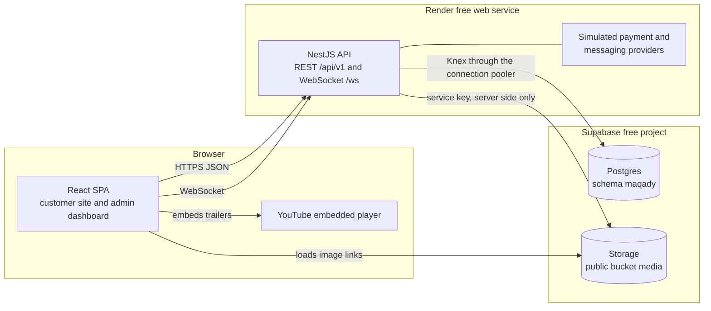
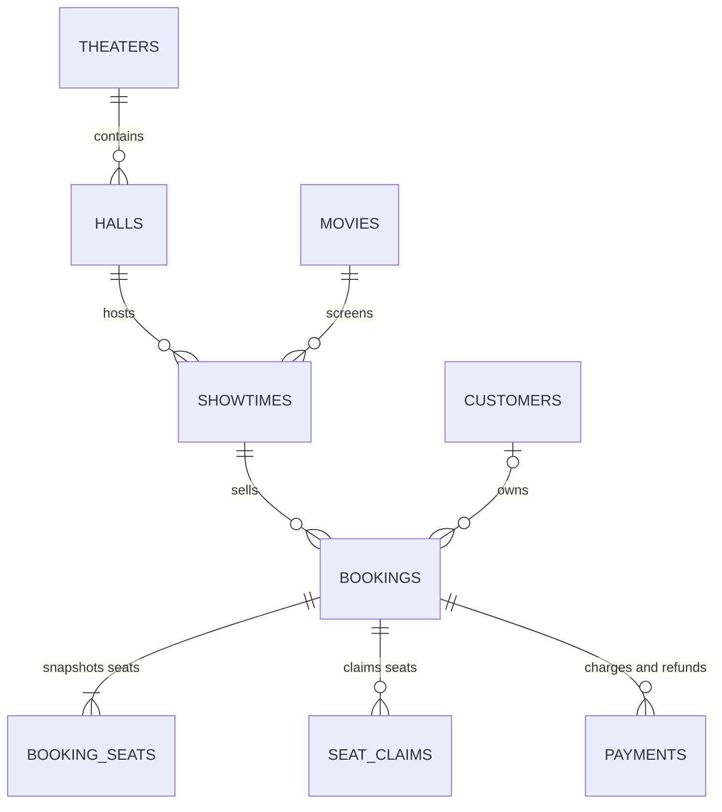

# Maqady backend — system design

> Requirements live in PRD v2.0 (`docs/reference/prd-v2.md`). This document says how the
> backend meets them. The PRD decides *what*; this document decides *how*. When they disagree,
> fix whichever is wrong in the same pull request.
>
> Decisions marked **Locked** in the decision register (§18) came from the owner and change
> only with the owner. Every other choice is the builder's: a unit's `spec.md` may change it,
> as long as it says so and updates this document in the same pull request.

## 1. Summary

Maqady's backend is one NestJS service. It serves a REST API under `/api/v1` and one plain
WebSocket endpoint for the live seat map. It runs as a single instance on Render's free tier,
with Supabase providing Postgres and file storage.

Postgres is the single source of truth for everything that must be correct: seat ownership,
holds, payments, sessions and idempotency keys. A seat is claimed with one atomic upsert,
so two buyers can never confirm the same seat. Anything that expires is judged from its stored
timestamp whenever it is read, because the free host sleeps and no timer can be trusted.

Payments, email and SMS go through simulated providers that live inside the service, behind
interfaces a real provider could replace later.

## 2. Intent, goals, non-goals, anti-goals

**Intent.** Give the React frontend a complete, trustworthy API for every screen and rule in
PRD v2.0. The backend is built the way a production cinema platform would be, on free
infrastructure, as a codebase worth learning NestJS from.

**Goals**

| # | Goal | How we know |
|---|---|---|
| G-1 | No seat is ever sold twice, and no booking is ever charged twice | Concurrency and idempotency tests in §15 pass against real Postgres |
| G-2 | Every PRD v2.0 screen and rule has an API behind it | Each PRD section maps to a unit in §21; the contract covers every screen |
| G-3 | Production practices on free hosting | Deny-by-default security, structured logs, a tested CI gate and reproducible deploys |
| G-4 | A clear codebase to learn NestJS from | One module per feature, raw SQL migrations and no framework magic beyond Nest itself |

**Non-goals**

- Real payments, real email or real SMS.
- More than one API instance, high availability or high traffic.
- Multiple tenants, currencies or languages.
- A public API for third parties.

**Anti-goals: what we refuse to do, even when convenient**

- Let a background timer decide whether something is correct.
- Trust the client for prices, seat availability, identity or payment results.
- Use an ORM, or let the frontend reach Supabase's database or APIs directly.
- Store card data, or put personal data in logs.

## 3. Constraints

| Constraint | What it forces |
|---|---|
| Render free web service: one instance that sleeps when idle and has little memory | No correctness on timers (§7.3). Rate-limit counters and WebSocket fan-out stay in process memory. Image processing runs one job at a time. |
| Supabase free: 500 MB database, 1 GB storage, 50 MB per file, 10 GB monthly egress, paused after 7 days of low activity | Photos only, stored in web sizes. Videos are YouTube links. An optional daily ping keeps the project active (§16). |
| Locked stack: NestJS on Express, Knex with raw SQL migrations, PostgreSQL ([ADR 0002](adr/0002-nestjs-instead-of-express.md)); no Redis ([ADR 0003](adr/0003-idempotency-in-postgres.md)) | No ORM, no second query builder. Idempotency keys live in Postgres. |
| Frontend contract: REST plus one WebSocket using the browser's built-in `WebSocket` | Plain `ws` through `@nestjs/platform-ws`, not socket.io |
| Cairo time with summer-time changes | Every time calculation goes through shared time helpers (§8) |
| Practice project | Simulated payment and messaging providers, behind interfaces (§7.4, §13.1) |

## 4. Architecture at a glance



- One Node process serves REST and the WebSocket. Simulated providers are ordinary modules in
  the same process.
- The browser talks only to the API, plus public image links and YouTube embeds. It never
  holds a Supabase key.
- Every write runs in one database transaction, opened by the write interceptor (§14.1).
  Events that leave the process, such as seat-map pushes, are sent only after that
  transaction commits.

## 5. Modules

Source lives under `src/`. Shared, framework-level code is in `src/common/`. Each feature is a
Nest module in `src/modules/<name>/` with the files `CLAUDE.md` prescribes: `types.ts`, `dto/`,
a repository, a service, a controller or gateway, and the module file.

| Module | Owns (tables) | Uses |
|---|---|---|
| `common/database` | Knex provider, transaction context, migrations runner | — |
| `common/idempotency` | `idempotency_keys`, the write interceptor | database |
| `common/audit` | `audit_events` (write side) | database |
| `common/auth` | Guards, `@Public()`, `@Roles()`, `@CurrentPrincipal()` | auth |
| `common/time`, `common/money`, `common/errors`, `common/pagination`, `common/logging`, `common/config` | Shared helpers, `AppError`, the global exception filter, cursor codec, pino setup, validated environment | — |
| `auth` | `sessions`, `one_time_tokens` | customers, staff, messaging |
| `customers` | `customers` | messaging, audit |
| `staff` | `staff_users` | messaging, audit |
| `media` | `images`; the Supabase Storage adapter and image pipeline | — |
| `theaters` | `theaters`, `theater_phones`, `theater_facilities`, `theater_photos`, `theater_hours`, `theater_special_dates` | media, time |
| `halls` | `halls`, `hall_rows`, `hall_seat_marks` | theaters, seating |
| `catalog` | `genres`, `movies`, `movie_genres`, `people`, `person_roles`, `movie_credits`, `movie_photos`, `movie_videos` | media |
| `showtimes` | `showtimes` | catalog, halls, theaters, time, bookings (cancellation) |
| `seating` | `seat_claims`; the seat-map gateway and in-process event bus | — |
| `bookings` | `bookings`, `booking_seats`, `booking_notes` | seating, payments, messaging, showtimes |
| `payments` | `payments`; the payment-provider interface and the simulated provider | — |
| `messaging` | `messages`; templates and the simulated email/SMS sender | — |
| `search`, `analytics`, `exports`, `activity` | Read-only queries; `staff_alert_reads` (analytics) | the modules they read |
| `health` | Liveness and readiness | database |

Rules:

- Only repositories inject Knex. Modules talk to each other only through exported services,
  never another module's repository.
- Dependencies point one way. `seating`, `payments` and `messaging` depend on nothing else in
  this table. `bookings` orchestrates them.
- The showtimes ↔ bookings cycle (cancelling a showtime refunds its bookings) is broken by
  `bookings` exporting a `ShowtimeCancellationService` that `showtimes` calls. `bookings` reads
  showtimes through its own SQL joins, not through the showtimes service.

## 6. Data model

### 6.1 Conventions

- **Schema.** All tables live in the `maqady` schema, which is not exposed through Supabase's
  Data API. As a backstop, every table has row-level security enabled with no policies, so
  nothing leaks even if the schema is exposed by mistake. The service connects as the owner
  role, which bypasses row-level security.
- **Extensions.** `citext`, `pg_trgm` and `btree_gist`. Supabase installs them in its
  `extensions` schema, so the connection's `search_path` is `maqady, extensions`.
- **Naming and types.** Follow `CLAUDE.md` and PostgreSQL Standards: plural `snake_case` tables;
  `id BIGSERIAL`; foreign keys named `fk_…` with a covering `idx_…`; enum-likes as
  `VARCHAR CHECK (…)` mirrored in the module's `enums.ts`; `TIMESTAMPTZ` everywhere.
- **Money.** Whole piastres as `INT` plus `currency VARCHAR(3)` (always `EGP` in v1). The
  one exception is a movie's optional budget, stored as `BIGINT` piastres because large
  budgets overflow `INT`.
- **Migrations.** Raw SQL, append-only, one Knex migration file per change. Every index
  carries a comment naming the query it serves.

### 6.2 Tables

**Identity and platform**

| Table | Purpose | Key columns and constraints |
|---|---|---|
| `customers` | Customer accounts | `email CITEXT`, unique among rows where `deleted_at IS NULL`; `password_hash`; `phone`; `email_verified_at`; `status` (`active`, `blocked`); `deleted_at`. An anonymised row has no email or phone (CHECK). |
| `staff_users` | Staff accounts | `email CITEXT UNIQUE`; `role` (`admin`, `box_office`); `status` (`invited`, `active`, `deactivated`); `password_hash` is NULL until the invite is accepted; `last_sign_in_at` |
| `sessions` | Refresh-token sessions | Exactly one of `customer_id`, `staff_user_id` (CHECK `num_nonnulls(…) = 1`); `family_id`; `token_hash` UNIQUE; `expires_at`; `revoked_at`; `replaced_by_id` |
| `one_time_tokens` | Email verification, password reset, staff invite | `purpose` (`verify_email`, `reset_password`, `staff_invite`); one owner FK as above; `token_hash` UNIQUE; `expires_at`; `used_at` |
| `idempotency_keys` | Stored results of writes | UNIQUE (`scope`, `key`); `request_hash`; `response_status`; `response_body JSONB`; `created_at`. A key older than 24 hours counts as absent. |
| `audit_events` | Activity log | `actor_kind` (`staff`, `customer`, `system`) plus actor FKs; `action` (for example `booking.refunded`); `entity_type`, `entity_id`; `booking_id`; `summary`; `metadata JSONB`. No personal data in `summary` or `metadata`. |
| `messages` | Simulated email and SMS: the outbox and the Message log | `channel` (`email`, `sms`); `template`; `recipient`; `subject`; `body`; FKs to the related customer, staff user or booking |
| `staff_alert_reads` | Bell read state | PK `staff_user_id`; `last_seen_at` |

**Catalog**

| Table | Purpose | Key columns and constraints |
|---|---|---|
| `genres` | Fixed genre list, seeded by migration | `name` UNIQUE |
| `movies` | Movies | `status` (`draft`, `coming_soon`, `now_showing`, `archived`); `age_rating` (`G`, `PG`, `12+`, `16+`, `18+`); `runtime_minutes > 0`; `release_date DATE`; `featured_position` 1–5, UNIQUE where not NULL; `hero_video_id`; `poster_image_id`; `backdrop_photo_id`; optional `budget` and `filming_locations`; `updated_by_staff_id` |
| `movie_genres` | Movie ↔ genre | PK (`movie_id`, `genre_id`) |
| `people` | Actors and crew | `full_name`, `name_ar`, `birth_date`, `birth_place`, `nationality`, `bio` (at most 400 characters), `photo_image_id`, three social links |
| `person_roles` | Roles shown on a person, even without credits | PK (`person_id`, `role`); `role` is one of the 7 credit roles |
| `movie_credits` | Cast and crew | UNIQUE (`movie_id`, `person_id`, `role`); `character_name` allowed only for `actor` and `voice` (CHECK); `sort_order` |
| `movie_videos` | YouTube videos | `youtube_id` CHECK `~ '^[A-Za-z0-9_-]{11}$'`; `kind` (`trailer`, `teaser`, `clip`, `featurette`); `title`; optional `duration_seconds`; `sort_order` |
| `movie_photos` | Movie photos | `image_id`; `kind` (`still`, `behind_the_scenes`); `caption`; `sort_order` |
| `images` | Every uploaded image | `storage_prefix`; `variants JSONB` (name → path, width, height); `created_by_staff_id` |

**Theaters and halls**

| Table | Purpose | Key columns and constraints |
|---|---|---|
| `theaters` | Theaters | `status` (`draft`, `active`, `sales_paused`); `latitude`, `longitude NUMERIC(9,6)` with range CHECKs; `default_price_front`, `_middle`, `_back INT` plus `currency`, required once the theater leaves `draft` (CHECK); `show_contacts_public`; `cover_image_id` |
| `theater_phones` | Labelled phone numbers | `label`, `number`, `sort_order` |
| `theater_facilities` | Facilities | PK (`theater_id`, `facility`); `facility` is one of `wheelchair_access`, `free_parking`, `valet_parking`, `street_parking`, `cafe_bar`, `food_court`, `kids_room` |
| `theater_photos` | Gallery | `image_id`, `sort_order` |
| `theater_hours` | Weekly hours, by cinema-day weekday | PK (`theater_id`, `weekday`); `is_closed`, or `opens_minute` and `closes_minute` counted from midnight at the start of the cinema date, with CHECK `360 <= opens_minute < closes_minute <= 1800` (06:00 to 06:00 next day) |
| `theater_special_dates` | Holiday hours | UNIQUE (`theater_id`, `cinema_date`); `label`; hours as above, or closed |
| `halls` | Halls | UNIQUE (`theater_id`, `name`); `status` (`draft`, `active`, `retired`); `row_count` 4–15; `seats_per_row` 8–20; UNIQUE (`id`, `theater_id`) to back the composite FK from `showtimes` |
| `hall_rows` | One zone per row | PK (`hall_id`, `row_index`); `row_label` (A–P without I); `zone` (`front`, `middle`, `back`) |
| `hall_seat_marks` | Exceptions to the full grid | PK (`hall_id`, `row_label`, `seat_number`); `kind` (`wheelchair`, `no_seat`) |

**Showtimes, bookings and payments**

| Table | Purpose | Key columns and constraints |
|---|---|---|
| `showtimes` | A movie in a hall at a time | Composite FK (`hall_id`, `theater_id`) → `halls`; `starts_at`, `ends_at`, `cleaning_ends_at` (`ends_at` + 20 minutes, written by the service); `cinema_date`; `price_front`, `_middle`, `_back` plus `currency`; `seat_capacity`; `status` (`scheduled`, `cancelled`); `cancel_reason`. **EXCLUDE USING gist (`hall_id` WITH =, `tstzrange(starts_at, cleaning_ends_at)` WITH &&) WHERE `status = 'scheduled'`.** |
| `bookings` | Holds and bookings | `reference` UNIQUE; `status` (`held`, `confirmed`, `refunded`); `channel` (`online`, `counter`); nullable `customer_id`; `hold_token_hash`; `hold_expires_at`; `has_declined_payment`; `total_amount` plus `currency`; `seat_count` 1–8; contact name, email and phone; `created_by_staff_id`; `qr_version`; `checked_in_at`, `checked_in_by_staff_id`; UNIQUE (`id`, `showtime_id`) |
| `booking_seats` | Seat and price snapshot | PK (`booking_id`, `seat_label`); `row_label`, `seat_number`, `zone`, `price`, `is_wheelchair` |
| `seat_claims` | Who holds each seat right now | **PK (`showtime_id`, `seat_label`)**; composite FK (`booking_id`, `showtime_id`) → `bookings`; `claimed_until` (NULL means sold) |
| `payments` | Charges and refunds | `kind` (`charge`, `refund`); `purpose` (`sale`, `edit_difference`, `cancellation`); `method` (`card`, `wallet`, `cash`, `card_terminal`); `status` (charge: `processing`, `succeeded`, `declined`, `cancelled`; refund: `pending`, `succeeded`; CHECK per kind); `amount > 0`; `provider_reference`; `card_brand`, `card_last4`, `wallet_type`; `settles_at`; `collected_by_staff_id`; `paid_out_at`, `paid_out_by_staff_id`. **UNIQUE (`booking_id`) WHERE `kind = 'charge' AND purpose = 'sale' AND status IN ('processing', 'succeeded')`.** |
| `booking_notes` | Internal staff notes | `staff_user_id`, `body` (at most 1,000 characters) |



### 6.3 Where correctness lives

Each rule below is enforced by the database, not only by application code:

| Rule | Enforced by |
|---|---|
| A seat belongs to at most one live booking per showtime | `seat_claims` primary key plus the claim upsert (§7.1) |
| A claim always matches its booking's showtime | Composite FK (`booking_id`, `showtime_id`) |
| A booking has at most one in-flight or successful sale charge | Partial unique index on `payments` |
| Two showtimes in a hall are at least 20 minutes apart | Exclusion constraint on `showtimes` |
| A showtime's hall belongs to its theater | Composite FK (`hall_id`, `theater_id`) |
| Booking references never repeat | UNIQUE `bookings.reference` |
| At most one movie per carousel position | Partial UNIQUE on `movies.featured_position` |
| No customer email is shared by two live accounts | Partial UNIQUE on `customers.email` |

Opening hours, the movie's status and the 8-seat limit are checked by services. Those checks
need joins or time-zone logic that a constraint cannot express.

## 7. Booking core

### 7.1 Seat claims

`seat_claims` is the only place that says who holds a seat right now. `booking_seats` keeps
the history: which seats a booking had, and at what price.

Claiming seats is one statement, inside the transaction that creates the hold:

```sql
INSERT INTO seat_claims (showtime_id, seat_label, booking_id, claimed_until)
SELECT :showtime_id, label, :booking_id, :hold_expires_at
FROM unnest(:seat_labels::text[]) AS label
ON CONFLICT (showtime_id, seat_label) DO UPDATE
  SET booking_id = EXCLUDED.booking_id,
      claimed_until = EXCLUDED.claimed_until
  WHERE seat_claims.claimed_until IS NOT NULL
    AND seat_claims.claimed_until <= :now
RETURNING seat_label;
```

- If fewer labels come back than were requested, a seat was taken. The transaction rolls back,
  and the API answers `SEAT_TAKEN` listing the seats that failed.
- Two concurrent requests for the same seat serialize on the row lock that `ON CONFLICT`
  takes. The second one sees an unexpired claim and gets nothing back.
- An expired hold's claim is simply overwritten. Nothing has to run to free a seat.
- Confirming a booking sets `claimed_until` to NULL, so its claims can never be overwritten.
- Refunding a booking deletes its claims.
- `:now` comes from the application's clock (§14.6), never from SQL `now()`, so tests control
  time.

A showtime's availability snapshot is its claims where `claimed_until IS NULL OR
claimed_until > :now`.

### 7.2 Holds

A hold is a booking with `status = 'held'`. Creating one checks, in order:

1. The showtime is `scheduled` and hasn't started, its movie is `now_showing`, its theater is
   `active` and its hall is `active`.
2. There are 1 to 8 distinct seats, and each exists in the hall's layout (not a `no_seat`).
3. The caller has no other live hold for this purpose. A browser presenting a previous hold
   code, a signed-in customer, or a staff member making a counter sale: the earlier hold is
   released first (`hold_expires_at = :now` and its claims deleted).

The hold then:

- inserts the booking with a new reference, `hold_expires_at = :now + 5 minutes`, the seat
  snapshot priced from the showtime's current zone prices, and the total;
- claims the seats (§7.1);
- for a guest, generates a 32-byte random **hold code**, stores its SHA-256 hash and returns the
  code once;
- after commit, publishes `seat.held` to the seat map (§12).

**Claiming a guest hold.** `POST /holds/{reference}/claim` carries the hold code in an
`X-Hold-Token` header and a customer access token. The hold must be live and unowned, and the
code's hash must match. The customer's other live hold, if any, is released. The booking gets
the `customer_id`, and its `hold_token_hash` is cleared, so the code is useless from then on.

**Releasing.** `DELETE /holds/{reference}` (owner or code holder) sets `hold_expires_at =
:now` and deletes the claims. The booking then reads as Abandoned, or Failed if it had a
declined payment.

**Rate limits.** Holds are limited per IP address, and per customer when signed in (§10.6).

### 7.3 Statuses decided by the clock

Only `held`, `confirmed` and `refunded` are stored. The three other PRD statuses follow from
stored timestamps the moment they are read, so no job ever has to run:

| PRD status | Stored status | Condition at read time |
|---|---|---|
| Held | `held` | `hold_expires_at > :now` |
| Failed | `held` | `hold_expires_at <= :now` and `has_declined_payment` |
| Abandoned | `held` | `hold_expires_at <= :now` and not `has_declined_payment` |
| Confirmed | `confirmed` | the showtime's `ends_at > :now` |
| Completed | `confirmed` | the showtime's `ends_at <= :now` |
| Refunded | `refunded` | — |

One file in the bookings module, `booking-status.sql.ts`, owns these predicates. Lists, filters,
analytics and the API's `status` field all use it, so the rule exists in exactly one place.
The booking-level payment status shown in the UI is derived the same way: Unpaid, Processing,
Declined, Paid or Refunded.

The same approach covers every other time-based state: a showtime that has started, a
theater's open state, an expired one-time token, an expired idempotency key and the ticket
scan window.

### 7.4 Online payment and settlement

```mermaid
sequenceDiagram
  participant B as Browser
  participant A as API
  participant D as Postgres
  participant P as Simulated provider
  B->>A: POST /showtimes/{id}/holds (seats, Idempotency-Key)
  A->>D: insert held booking, claim seats
  A-->>B: 201 reference, hold code (guest only), expiresAt, total
  A--)B: WebSocket seat.held to every viewer
  B->>A: POST /holds/{ref}/claim (after sign-in, guests only)
  B->>A: POST /bookings/{ref}/payments (method, test token, Idempotency-Key)
  A->>D: lock booking, check the hold, insert charge (processing)
  A->>P: charge (amount, token, idempotency key)
  P-->>A: succeeded, declined, cancelled or processing
  A->>D: record the result; on success confirm, make claims permanent, queue tickets
  A-->>B: 201 payment status and booking
  A--)B: WebSocket seat.booked
```

- **Preconditions.** The caller owns the booking. It is live (`hold_expires_at > :now`), and no
  sale charge is processing or succeeded (also enforced by the partial unique index).
- **Outcomes.** A decline is a normal result, not an error. The response is `201` with
  `payment.status = "declined"`, and the booking is marked `has_declined_payment`. Its seats
  stay held until the timer ends, so the customer can retry with a new Idempotency-Key.
- **Success.** In the same transaction: the charge becomes `succeeded`, the booking `confirmed`,
  `confirmed_at` is set, claims get `claimed_until = NULL`, `qr_version = 1`, the tickets message
  is written (§13.1) and an audit event is recorded. After commit, `seat.booked` is published.
- **Processing.** The slow test token returns `processing` with a `settles_at` time. The hold
  and its claims are extended to `settles_at` plus 30 seconds, which keeps the PRD promise
  that seats stay theirs until the payment answers. There is no callback and no timer: every
  read of the booking asks the provider for the payment's state and settles it on the spot.
  The simulated provider answers from `settles_at`.
- **Guard for real providers.** If a payment ever succeeds after its claims were lost (only
  possible with a slow real provider), settlement refunds it at once, and the booking ends
  Refunded.

**Provider interface.** `PaymentProvider` has `charge`, `retrieve` and `refund`. Each call
carries our idempotency key, as a real gateway would require. The simulated provider is
stateless and decides each result from the test token:

| Test token | Result |
|---|---|
| `sim_card_visa`, `sim_card_mastercard`, `sim_card_meeza` | Approved (brand and last four recorded) |
| `sim_card_declined` | Declined |
| `sim_card_slow` | Processing, approved 10 seconds later |
| `sim_card_slow_declined` | Processing, declined 10 seconds later |
| `sim_wallet_apple_pay`, `sim_wallet_google_pay` | Approved |
| `sim_wallet_cancelled` | Cancelled by the customer (not a decline) |

### 7.5 Counter sales

1. A staff member picks seats on the live map. `POST /admin/counter-holds` creates a
   `counter`-channel hold owned by that staff member, with the same claims and 5-minute timer
   as online. A staff member has at most one live counter hold.
2. `POST /admin/bookings/{ref}/counter-payment` records `cash` or `card_terminal` with the
   terminal's receipt reference, and the customer: walk-in, an existing customer, or typed
   contact details. The booking is confirmed in the same transaction, `collected_by_staff_id`
   comes from the signed-in staff member, and tickets go to any email or phone given.
3. A counter hold that lapses becomes Abandoned, like any other.

### 7.6 Cancelling, refunding and paying out

- **Cancel & refund (admin only).** The booking must be Confirmed with its showtime not ended.
  One transaction records a refund for the full amount and sets the booking to `refunded`,
  deleting its claims. An online charge is refunded through the provider (`succeeded`). A
  cash or terminal sale gets a `pending` refund. Then the refund message and an audit event.
  After commit, `seat.released` is published.
- **Paying out a counter refund.** `POST /admin/refunds/{id}/paid-out` moves a `pending` refund
  to `succeeded` and records who paid it out and when.
- **Cancelling a showtime.** One transaction sets the showtime to `cancelled`, refunds every
  Confirmed booking as above, releases every live hold, and writes the email and SMS rows for
  every ticket holder. Everything is batched (`whereIn`, multi-row inserts), never one query
  per booking.

### 7.7 Booking edits (admin only)

An edit can change the showtime (same movie), the seats, or the contact details, with a
required reason. `POST /admin/bookings/{ref}/edit/preview` returns the new total and the
difference without saving. `POST /admin/bookings/{ref}/edit` applies it in one transaction:

1. Claim the new seats first. A conflict fails the whole edit with `SEAT_TAKEN`.
2. Release the claims the edit gives up, and rebuild `booking_seats`. Seats kept on the same
   showtime keep the price they were sold at; new seats take the target showtime's current
   prices.
3. Settle the difference. A lower total is refunded to the original method (online through
   the provider, counter as a `pending` payout). A higher total must arrive in the same request
   as a counter payment (`cash` or `card_terminal`), recorded as an `edit_difference` charge.
4. Increment `qr_version`, so the old QR code stops working. Write an audit event with the
   before and after, and send new tickets if the admin asked to notify.

Completed, Refunded, Failed and Abandoned bookings can't be edited.

### 7.8 References, tickets and scanning

- **Reference.** `MQ-` plus 6 characters from `23456789ABCDEFGHJKMNPQRSTUVWXYZ` (no 0, O, 1, I
  or L), drawn with `crypto.randomInt`. The UNIQUE constraint backs it, with up to 5 retries on
  a collision. API paths identify bookings by reference; internal ids never leave the API.
- **QR payload.** `MQ1.<reference>.<qr_version>.<signature>`, where the signature is
  HMAC-SHA256 under `QR_SIGNING_KEY`, truncated to 16 bytes and base64url-encoded. The API
  returns the payload string; the frontend draws the code.
- **Downloads.** `GET /bookings/{ref}/ticket.pdf` builds the PDF on demand (pdfkit and
  qrcode). `GET /bookings/{ref}/calendar.ics` returns the showtime and the theater's address.
- **Scanning.** `POST /admin/scans` takes `{ theaterId, code }`. The code is a QR payload, or a
  typed reference as a staff-only fallback. Results:
  - `VALID` with the seat count, recording `checked_in_at` atomically (`WHERE checked_in_at IS
    NULL`);
  - `ALREADY_USED` with the first scan's time;
  - `WRONG_SHOWTIME`: another theater, or outside the window that opens 60 minutes before
    the start and closes when the showtime ends;
  - `NOT_VALID`: refunded, or an old QR version;
  - `NOT_FOUND`.

### 7.9 Prices

- A new showtime copies the theater's three default zone prices. An admin can change a
  showtime's prices later, and the change applies to new holds only.
- A hold prices each seat from its row's zone and stores the per-seat price and the total.
  Checkout charges exactly that total ("Price confirmed by Maqady").
- A showtime's "from" price is the lowest zone price among the zones its hall actually uses.
- No fees, discounts or taxes exist in v1.

## 8. Scheduling and time

- **One time zone.** `Africa/Cairo`, a constant in `common/time`. Timestamps are stored as
  `TIMESTAMPTZ`. The API writes them in Cairo time with their offset, for example
  `2026-10-16T19:30:00+03:00`.
- **Cinema day.** A cinema day runs from 06:00 to 06:00. `cinemaDateOf(instant)` is the Cairo
  wall-clock date of `instant − 6 hours`. `showtimes.cinema_date` is written by the service
  when the showtime is created or moved.
- **Shared helpers only.** `common/time` wraps a time-zone-aware library (Luxon). It is the only
  place that converts between wall-clock times and instants. Inline offset or millisecond
  arithmetic is forbidden, as `CLAUDE.md` says.
- **Summer-time changes.** Converting a wall-clock time that doesn't exist that night is
  refused (`TIME_DOES_NOT_EXIST`). A time that occurs twice resolves to its first occurrence.
- **Opening hours.** The hours for a cinema date are the special date's, if one exists, else
  the weekday's. They become instants by adding the stored minutes to the date's wall clock
  through the helpers.
- **Showtime checks.**
  - The hours check, a service rule: the showtime starts and ends inside that window.
  - The 20-minute cleaning gap, the exclusion constraint. A violation becomes
    `SHOWTIME_CONFLICT`, naming the showtime it overlaps.
  - Only `now_showing` movies and `active` halls can be scheduled.
- **Dry run.** `POST /admin/showtimes/check` runs every check for each requested date
  without writing, and suggests free start times on a 5-minute grid. `POST /admin/showtimes`
  creates the dates that pass and, if asked, skips the ones that don't.
- **Moving.** Changing the start re-runs every check, recomputes `ends_at`,
  `cleaning_ends_at` and `cinema_date`, and messages every ticket holder.
- **Capacity.** `showtimes.seat_capacity` is the hall's seat count when the showtime is
  created. A layout save refreshes it for that hall's future showtimes, so past occupancy
  never changes.

## 9. Theaters, halls, catalog and media

- **Theater lifecycle.** A theater is created as `draft`. `POST /admin/theaters/{id}/publish`
  requires zone prices, at least one active hall and opening hours, then sets `active`.
  `PATCH /admin/theaters/{id}/selling` toggles `active` and `sales_paused`. Customers see only
  `active` theaters and their showtimes. Only an empty draft can be deleted.
- **Hall layouts.** `PUT /admin/halls/{id}/layout` replaces the whole layout (row count, seats
  per row, row zones and seat marks) in one transaction. It is refused with `HALL_IN_USE`,
  listing the blocking showtimes, if any showtime in the hall that hasn't ended has a live
  claim. Aisles aren't stored: the API reports `aisleAfter = [4, seatsPerRow − 4]`,
  deduplicated. A hall that ever had a showtime can only be retired, which requires no future
  scheduled showtimes.
- **Catalog.** Movies, people, credits and genres follow PRD §A2–A3. A movie that ever had a
  booking can't be deleted. Deleting a person removes their credits. Featured positions are
  unique, and a featured movie must have a hero video.
- **YouTube.** The API accepts watch, youtu.be, shorts and embed URLs, and stores only the
  11-character video id. Thumbnails and the privacy-enhanced embed URL are derived from the id.
  Titles and optional durations are typed by the admin, so there is no YouTube API key.
- **Image pipeline.**
  1. Multer receives the file in memory, at most 10 MB.
  2. The pipeline checks the file's magic bytes (JPG or PNG only) and refuses images above 40
     megapixels.
  3. sharp, running one job at a time, rotates by EXIF, strips metadata and writes WebP
     variants per use: posters 2:3, backdrops 16:9, people photos square and at least
     600 × 600, galleries.
  4. The variants are uploaded under one storage prefix, and an `images` row is inserted.
  - If the transaction rolls back, the uploaded files are deleted. Replacing or deleting an image
    deletes its files after commit.
  - A maintenance script lists and removes any orphaned storage paths. It only tidies up.
- **Image links.** The `media` bucket is public-read. The API returns full public URLs for
  each variant, and only the server holds the service key.

## 10. Identity and access

### 10.1 Accounts

- Customers and staff are separate tables with separate sign-in routes and token audiences.
  A customer token never opens `/admin` routes, and a staff token never acts as a customer.
- Passwords need at least 8 characters including a digit. They are hashed with Node's built-in
  scrypt using OWASP's `N = 2^15, r = 8, p = 3` profile, with a per-password salt.
- The first admin is created by a command run against the deployed database:
  `npm run admin:create`, with the email and a one-time password from environment variables.
  After that, admins invite staff.

### 10.2 Tokens and sessions

- **Access token.** A JWT (HS256) valid for 15 minutes, carrying `sub`, `aud` (`customer` or
  `staff`), `role` for staff, and `sid`. Separate secrets per audience.
- **Refresh token.** An opaque 32-byte random value. Only its SHA-256 hash is stored, in
  `sessions`. It lasts 30 days for customers and 12 hours for staff.
- **Rotation.** Every refresh issues a new refresh token in the same family. Presenting an
  already-rotated token revokes the whole family (`SESSION_REVOKED`).
- **Sign-out** revokes the family. Blocking a customer, or deactivating or demoting a staff
  member, revokes all their sessions.
- **Transport.** Tokens travel in JSON bodies and the `Authorization` header, not cookies. The
  frontend and API sit on different sites on free hosting, where browsers increasingly block
  third-party cookies. The frontend keeps the access token in memory and the refresh token in
  storage. Rotation with reuse detection limits what a stolen refresh token is worth. See §20
  for the trade-off.

### 10.3 Guards

- `JwtAuthGuard` and `RolesGuard` are registered globally (`APP_GUARD`). A route is public only
  with `@Public()`. Staff routes declare `@Roles('admin')` or `@Roles('admin', 'box_office')`.
- On every authenticated request, the guard loads the principal's current status with one
  indexed query. A blocked customer gets `ACCOUNT_BLOCKED`; a deactivated staff member
  `UNAUTHENTICATED`. Blocking takes effect immediately, not when the token expires.

### 10.4 Ownership

- A customer reaches only their own bookings. Anyone else's reference answers `NOT_FOUND`, as
  `CLAUDE.md` requires for sensitive resources.
- A guest reaches a live, unclaimed hold only with its hold code.
- Box office staff can read every booking and customer, but write only counter sales, scans,
  resends and notes.

### 10.5 One-time tokens

Email verification (24 hours), password reset (1 hour) and staff invite (72 hours) each use a
32-byte random token, stored as a hash and usable once. Requesting a new one invalidates the
previous token of the same purpose. "Forgot password" always answers `202`, whether or not the
email exists.

Registration does report an email already in use (`EMAIL_TAKEN`). It is rate-limited, and
registering is useless without the password, so the usability gain outweighs the small
enumeration risk. See §20.

### 10.6 Rate limits

`@nestjs/throttler` with in-memory storage. The service trusts one proxy hop, so it sees the
client's address behind Render.

| Route | Limit | Keyed by |
|---|---|---|
| Customer and staff sign-in | 5 per minute | IP address plus email |
| Registration | 5 per hour | IP address |
| Forgot password, resend verification | 3 per hour | Email (plus 20 per hour per IP address) |
| Create a hold | 10 per 10 minutes | Customer when signed in, else IP address |
| Pay | 10 per 5 minutes | Booking |
| Customer "Email again" | 3 per hour | Booking |
| Search | 60 per minute | IP address |
| WebSocket | 20 connections, 3 subscriptions each | IP address and connection |
| Every other route | 300 per minute | IP address |

### 10.7 Transport security

- Helmet's default headers.
- CORS restricted to the configured frontend origins.
- JSON bodies up to 1 MB; multipart only on upload routes, up to 10 MB.
- HTTPS is terminated by Render.

## 11. API conventions and surface

**Conventions**

- Base path `/api/v1`, JSON with camelCase fields.
- Money is `{ "amount": 19000, "currency": "EGP" }`. Times are ISO 8601 with offset, and
  showtimes also carry `cinemaDate`.
- Lists are cursor-paginated and return `{ "items", "nextCursor", "total" }`. The default page
  size is 20, the maximum 100. The cursor is an opaque base64url encoding of the last row's sort
  key and id.
- Every non-GET request accepts `Idempotency-Key`. The ones marked **strict** below require it.
- Errors always look like `{ "error": { "code", "message", "details", "correlationId" } }` (§14.3).
- Request DTOs are classes validated by the global `ValidationPipe`. Responses are response
  DTOs, never entities.

**Public and customer routes**

| Area | Routes |
|---|---|
| Discovery | `GET /home` (carousel, ticker, rows, cinemas) · `GET /genres` · `GET /movies` (status, q, genres, cast, date, cursor) · `GET /movies/{id}` · `GET /movies/{id}/showtimes` · `GET /movies/{id}/similar` · `GET /people` (cast filter options) |
| Theaters | `GET /theaters` (open now, parking) · `GET /theaters/{id}` · `GET /theaters/{id}/showtimes?date=` |
| Seats and holds | `GET /showtimes/{id}` (header, layout, prices) · `GET /showtimes/{id}/seats` (snapshot) · `POST /showtimes/{id}/holds` **strict** · `POST /holds/{ref}/claim` **strict** · `DELETE /holds/{ref}` |
| Bookings | `GET /bookings/{ref}` · `POST /bookings/{ref}/payments` **strict** · `GET /bookings/{ref}/ticket.pdf` · `GET /bookings/{ref}/calendar.ics` · `POST /bookings/{ref}/resend` **strict** · `GET /me/bookings?tab=upcoming\|past` |
| Account | `POST /auth/register` · `POST /auth/login` · `POST /auth/refresh` · `POST /auth/logout` · `POST /auth/verify-email` · `POST /auth/verify-email/resend` · `POST /auth/forgot-password` · `POST /auth/reset-password` · `GET /me` · `PATCH /me` · `POST /me/password` |
| Search | `GET /search?q=` |
| Health | `GET /health` · `GET /health/ready` |

**Admin routes** (`/api/v1/admin`, staff token; role in brackets)

| Area | Routes |
|---|---|
| Auth and staff | `POST /admin/auth/login`, `/refresh`, `/logout`, `/set-password` · `GET`, `POST /admin/staff` [admin] · `PATCH /admin/staff/{id}` (role, status) [admin] · `POST /admin/staff/{id}/resend-invite` [admin] |
| Catalog [admin] | `/admin/movies` CRUD · `POST /admin/movies/archive` (bulk) · `/admin/movies/{id}/photos`, `/videos`, `/credits` · `/admin/people` CRUD · `/admin/people/{id}/photo` |
| Theaters and halls [admin] | `/admin/theaters` CRUD · `POST /admin/theaters/{id}/publish` · `PATCH /admin/theaters/{id}/selling` · `PUT /admin/theaters/{id}/hours`, `/phones`, `/facilities`, `/prices` · `/admin/theaters/{id}/special-dates`, `/photos`, `/halls` · `PUT /admin/halls/{id}/layout` · `POST /admin/halls/{id}/retire` |
| Showtimes [admin] | `GET /admin/showtimes?theaterId&date` · `POST /admin/showtimes/check` · `POST /admin/showtimes` **strict** · `PATCH /admin/showtimes/{id}` (move, prices) **strict** · `POST /admin/showtimes/{id}/cancel` **strict** |
| Bookings | `GET /admin/bookings` · `GET /admin/bookings/{ref}` · `POST /admin/counter-holds` **strict** · `POST /admin/bookings/{ref}/counter-payment` **strict** · `POST /admin/bookings/{ref}/resend` **strict** · `POST /admin/bookings/{ref}/notes` · `POST /admin/scans` [both roles] · `POST /admin/bookings/{ref}/cancel-refund` **strict** · `POST /admin/bookings/{ref}/edit/preview` · `POST /admin/bookings/{ref}/edit` **strict** [admin] |
| Customers | `GET /admin/customers` · `GET /admin/customers/{id}` [both roles] · `PATCH /admin/customers/{id}` · `POST /admin/customers/{id}/block`, `/unblock`, `/password-reset` · `DELETE /admin/customers/{id}` [admin] |
| Payments [admin] | `GET /admin/payments` (transactions) · `GET /admin/payments/summary` (KPIs, reconciliation) · `POST /admin/refunds/{id}/paid-out` **strict** |
| Insights | `GET /admin/overview` [admin] · `GET /admin/alerts` · `POST /admin/alerts/seen` [both roles] · `GET /admin/activity` · `GET /admin/messages` · `GET /admin/messages/{id}` [admin] · `GET /admin/search` [both roles, results filtered by role] · `GET /admin/exports/{overview,bookings,customers,payments}.csv` [admin] |

Exact request and response shapes are defined in each unit's spec and published in the
generated contract (§19).

## 12. Live seat map (WebSocket)

- **Endpoint.** `/ws`, served by `@nestjs/platform-ws` (`WsAdapter`). Messages are JSON in
  Nest's `{ "event", "data" }` shape.
- **Public.** No sign-in: the data is public and carries seat labels only. The gateway checks
  the `Origin` header against the CORS allowlist and enforces the per-IP limits in §10.6.

| Direction | Event | Data |
|---|---|---|
| Client → server | `subscribe` | `{ showtimeId }` |
| Client → server | `unsubscribe` | `{ showtimeId }` |
| Server → client | `snapshot` | `{ showtimeId, serverTime, seats: [{ label, state: "held" \| "booked", heldUntil? }] }` |
| Server → client | `seat.held` | `{ showtimeId, labels, heldUntil }` |
| Server → client | `seat.released` | `{ showtimeId, labels }` |
| Server → client | `seat.booked` | `{ showtimeId, labels }` |
| Server → client | `error` | `{ code }` |

- **Expiry without a timer.** The server never announces an expiry. Clients free a held seat
  locally when `heldUntil` passes, using `serverTime` to correct their clock.
- **Ordering.** Events are published after the transaction commits, through an in-process
  event bus. A subscriber may miss an event during a reconnect, so every new subscription
  starts with a fresh snapshot.
- **Liveness.** The server pings every 30 seconds and drops connections that don't answer.
  A message is at most 4 KB.
- **Scaling note.** Fan-out is in-process because there is one instance. A second instance would
  need Postgres `LISTEN/NOTIFY` over a session-mode connection (§20).

## 13. Messaging, search, analytics, exports and activity

### 13.1 Messaging

- `MessageSender` is an interface; the simulated sender inserts the rendered message into
  `messages`, in the same transaction as the change that caused it. That row *is* the send.
- Templates are plain-text TypeScript functions in `messaging/templates/`, one per PRD trigger
  (PRD "Email and SMS"). Links are built from `FRONTEND_BASE_URL`.
- The Message log API redacts one-time tokens in links unless `MESSAGE_LOG_REVEAL_SECRETS=true`.
  The practice deployment sets it, because no real email exists to receive the links (PRD veto
  call 16).
- Deleting a customer deletes their messages, along with nulling their personal data.

### 13.2 Search

- Trigram GIN indexes on movie titles, people's names, theater names and districts, customer
  names, emails and phones, and booking contact fields. Booking references use an exact
  B-tree.
- Queries need at least 2 characters and are case-insensitive substring matches, ranked by
  similarity.
- Customer search returns up to 5 hits per group; admin search up to 10, filtered by role.

### 13.3 Analytics and alerts

- Every number on the Overview, Payments and bell is computed on read with SQL aggregates,
  following the PRD "Dashboard numbers" definitions. No rollup tables, because refreshing
  them would need a timer.
- Revenue, tickets and occupancy group by `showtimes.cinema_date`. "Collected" figures group by
  the cinema date of the money movement: `payments.created_at` for charges, the payout or refund
  time for refunds.
- The Payments screen's "Refunds (% of revenue)" is refunds ÷ money collected in the same
  period. That keeps the whole screen on the money-moved basis.
- Heatmap slots group showtimes by local start time: 12–15, 15–18, 18–21, 21–24 and 00–06.
- Alerts are computed on read:
  - failed online payments today;
  - showtimes later today under 35% sold;
  - active halls with no showtimes on a cinema day in the next 7.

  The bell's unread count compares each alert's latest underlying event with the staff
  member's `last_seen_at`.

### 13.4 Exports

- CSV streamed from a Knex stream through `csv-stringify`, with the same filters as the screen.
- Admins only. Each export writes an audit event, because exports contain personal data.

### 13.5 Activity log

- `AuditService.record()` runs inside the transaction of every staff write, and of customer
  booking events.
- The admin Activity log filters by staff member, entity type and date.
- A customer's booking History is the customer-visible subset of that booking's events,
  mapped to friendly labels.

## 14. Cross-cutting concerns

### 14.1 Transactions and idempotency

One global `WriteInterceptor` wraps every non-GET request:

1. Open a Knex transaction and store it in an `AsyncLocalStorage` context. Repositories pick
   up the current transaction from there.
2. If an `Idempotency-Key` is present, or the route is marked **strict** (which makes it
   required), insert the `idempotency_keys` row.
   - Scope: the principal, or `anonymous`.
   - A concurrent duplicate waits on the unique index until the first commits, then replays
     its stored response.
   - A stored key with a different `request_hash` fails with `IDEMPOTENCY_KEY_REUSED`.
3. Run the handler. Store the response in the key row. Commit.
4. Run the post-commit hooks: seat-map events, and deleting replaced storage files.
5. If the handler throws, the transaction rolls back, key included, so a retry re-executes.

Replays return the stored status and body with an `Idempotent-Replayed: true` header.
Business results that must persist, such as a declined payment, are successful responses, not
errors. That way they commit and replay correctly.

Expired keys are ignored on read. Writes opportunistically delete a small batch of expired
rows, which only tidies up (ADR 0003).

### 14.2 Database access

- One shared Knex instance (`pg` driver), connecting through Supabase's shared pooler
  (Supavisor) in session mode, port 5432. On the free plan, Supabase's direct connection is
  IPv6-only and Render connects over IPv4 only
  ([Supabase: connecting](https://supabase.com/docs/guides/database/connecting-to-postgres)).
- The pool holds at most 5 connections, with `statement_timeout` at 10 seconds.

### 14.3 Errors

- Services throw `AppError(code, status, message, details)`, never `HttpException`.
- One global filter maps `AppError` to the error shape, and maps Nest's own validation, guard
  and throttling exceptions to `VALIDATION_FAILED`, `UNAUTHENTICATED`, `FORBIDDEN` and
  `RATE_LIMITED`.
- Unknown errors become `INTERNAL` (500), logged with their stack. A database outage becomes
  `SERVICE_UNAVAILABLE` (503).
- The initial catalogue:

| Code | HTTP | Code | HTTP |
|---|---|---|---|
| `VALIDATION_FAILED` | 400 | `SEAT_TAKEN` | 409 |
| `IDEMPOTENCY_KEY_REQUIRED` | 400 | `HOLD_EXPIRED` | 409 |
| `UNAUTHENTICATED` | 401 | `HOLD_ALREADY_CLAIMED` | 409 |
| `SESSION_EXPIRED` | 401 | `ALREADY_PAID` | 409 |
| `SESSION_REVOKED` | 401 | `PAYMENT_IN_PROGRESS` | 409 |
| `ACCOUNT_BLOCKED` | 403 | `SHOWTIME_NOT_BOOKABLE` | 409 |
| `FORBIDDEN` | 403 | `SHOWTIME_CONFLICT` | 409 |
| `NOT_FOUND` | 404 | `HALL_IN_USE` | 409 |
| `EMAIL_TAKEN` | 409 | `OUTSIDE_OPENING_HOURS` | 422 |
| `IDEMPOTENCY_KEY_REUSED` | 422 | `TIME_DOES_NOT_EXIST` | 422 |
| `RATE_LIMITED` | 429 | `INVALID_TOKEN` | 400 |
| `INTERNAL` | 500 | `SERVICE_UNAVAILABLE` | 503 |

### 14.4 Logging and observability

- `nestjs-pino` writes structured JSON with a `correlationId` on every line. The id comes from
  `X-Request-Id` when the format is valid, else a new UUID, and is echoed in responses and
  error bodies.
- One line per request: method, route template, status, duration, principal kind and id.
- Redacted: `authorization`, `x-hold-token` and cookies. Bodies are never logged. No email,
  phone or name appears in any log line.
- Render keeps the logs. `GET /health` reports liveness, and `GET /health/ready` checks the
  database.

### 14.5 Configuration

Environment variables are validated at boot, and a missing or malformed value stops the start.

- `DATABASE_URL`, `DB_SCHEMA` (`maqady`)
- `JWT_SECRET_CUSTOMER`, `JWT_SECRET_STAFF`, `QR_SIGNING_KEY`
- `SUPABASE_URL`, `SUPABASE_SERVICE_ROLE_KEY`, `STORAGE_BUCKET`
- `FRONTEND_BASE_URL`, `CORS_ORIGINS`
- `MESSAGE_LOG_REVEAL_SECRETS`
- `LOG_LEVEL`, `PORT`

`.env.example` lists every variable without values.

### 14.6 Clock

A `Clock` provider supplies "now" to services and queries. Tests replace it to move time,
which is how expiry, the cinema day and summer-time changes are tested without sleeping.

## 15. Testing strategy

The testing policy in `CLAUDE.md` binds this section.

- **Tools.** Jest with `ts-jest`. Unit tests live in `test/unit/` and integration tests in
  `test/integration/`, both mirroring `src/`. Nest's generator is run with `--no-spec`.
- **Integration.** Tests run against a real Postgres: Docker Compose locally, a service
  container in CI. They pin the Supabase project's major version and run every migration from
  zero.
  - HTTP goes through `supertest`; the gateway is tested with the `ws` client.
  - Our own simulated providers are real code and are never mocked.
  - Only Supabase Storage is replaced, at the adapter boundary, because it is genuinely
    external.
- **Must-pass scenarios.** These are the acceptance gate for the units that own them:
  - 20 parallel holds on the same seat produce exactly 1 success and 19 `SEAT_TAKEN`.
  - Two concurrent payments with the same Idempotency-Key produce 1 charge and 1 replay.
  - Two different keys paying one booking: the second gets `PAYMENT_IN_PROGRESS` or
    `ALREADY_PAID`.
  - An expired hold's seats can be claimed by someone else without any job running. The old
    booking reads Abandoned, or Failed after a decline.
  - Overlapping showtimes, including the 20-minute gap, are refused by the database.
  - A booking at 00:30 belongs to the previous cinema day. Summer-time edge times behave as
    in §8.
  - A customer can't read another customer's booking (`NOT_FOUND`). Box office can't call
    admin-only routes (`FORBIDDEN`).
  - A layout edit is refused while a live claim exists.
  - Every dashboard number matches a hand-computed fixture.
- **Infrastructure failures.** "The datastore is down → 503" is a unit test of the handler,
  where mocking is allowed. No global infrastructure mock exists in shared setup.

## 16. Environments and delivery

- **Runtime.** Node 24 LTS in the Docker image and in CI.
- **Local.** `docker compose up` starts Postgres with the three extensions. `npm run dev`
  migrates and starts the API. `npm run seed` loads demo data: theaters with halls of
  different sizes, movies with YouTube trailers, a week of showtimes, an admin and a box-office
  user.
- **CI.** The existing workflow gains the steps below, and loses its Redis service and Node 20,
  which is past end of life.
  1. Lint, typecheck, unit tests, then integration tests against the Postgres service.
  2. Build.
  3. The contract check: `npm run contract` regenerates `contracts/openapi.yaml`, then
     `git diff --exit-code` fails the job if the committed copy is stale. The script builds the
     app without a database or a listener.
- **Deployment.** Render builds the Dockerfile from `main`.
  - On boot the service runs `knex migrate:latest` before listening. Knex's migration lock
    makes that safe, and there is one instance.
  - The health check path is `/health`.
  - Secrets live in Render's environment settings.
- **Supabase setup.**
  - A project in the region nearest Egypt.
  - The `maqady` schema, left out of the Data API's exposed schemas (or the Data API turned off).
  - A public `media` bucket.
  - The pooler connection string in `DATABASE_URL`.
- **Keep-alive (optional).** A daily scheduled GitHub Actions job calls `/health/ready`, so
  the Supabase project shows activity and isn't paused. It affects availability only.
- **Bootstrap.** After the first deploy, run `npm run admin:create` once against the
  production database.

## 17. How the design closes the inventory gaps

| Gap | Resolution |
|---|---|
| G1 Pricing models | Zone prices only: theater defaults copied to each showtime, which can override them (§7.9) |
| G2 Single seat map | Per-hall layouts in `hall_rows` and `hall_seat_marks`, locked while in use (§9) |
| G3 Booking before payment, no ids | A hold is a `held` booking with a reference; guest hold code and claim; live map over WebSocket (§7.2, §12) |
| G4 Refund and cancel policy | Admin cancel always refunds in full; counter refunds pay out at the counter; customers can't cancel (§7.6) |
| G5 No admin identity | Staff accounts, two roles, audit on every staff write (§10, §13.5) |
| G6 Fields without admin input | Optional budget and filming locations, photo kinds and captions, theater photos; scores and the free tag chip dropped |
| G7 Hero video source | Every video is YouTube, so any video can be the hero (§9) |
| G8 Hold and decline behaviour | A decline keeps the hold; the clock decides Failed or Abandoned; processing extends the hold (§7.3, §7.4) |
| G9 Booking reference | `MQ-` plus 6 random characters from an unambiguous alphabet (§7.8) |
| G10 Draft and publish | Theater draft → publish → selling or paused; movie statuses; showtimes on sale on creation; sales window dropped |
| G11 Unwired stubs | Exports, downloads, calendar file, forgot password, search, bell, hall retire and delete rules, sign-out. Help, Terms and Privacy are static frontend pages. |
| G12 Synthetic analytics | Real SQL on PRD definitions (§13.3) |
| G13 "Sold out" | No seat claimable right now, one rule for both sites |
| G14 Date filter | Computed from showtimes per cinema day; the weekend is Friday and Saturday |
| G15 KPI definitions | PRD "Dashboard numbers"; revenue on the show's cinema day (§13.3) |
| G16 Role and format lists | One 7-role credit list; formats removed; facilities list includes street parking |
| G17 Status vocabulary | Held, Confirmed, Completed, Refunded, Failed, Abandoned (§7.3) |
| G18 Missing screens | All in scope except person pages (dropped) and end-of-day cash report entry (unneeded: every counter payment is recorded) |
| G19 Concurrency and integrity | Seat-claim upsert, idempotency in the write transaction, exclusion constraint, no timers, server-side 8-seat limit, layout lock, notifications in the same transaction |
| G20 Time handling | Cairo zone, cinema day ending 06:00, shared helpers, summer-time rules (§8) |
| G21 Pagination | Cursor pagination with totals on every list; date ranges on Bookings and Payments |
| G22 Prototype truncations | Ignored |

## 18. Decision register

| # | Decision | Status |
|---|---|---|
| D-01 | NestJS on Express, plain `ws` gateway, OpenAPI generated from code | Locked ([ADR 0002](adr/0002-nestjs-instead-of-express.md)) |
| D-02 | Knex with raw, append-only SQL migrations; correctness in database constraints | Locked |
| D-03 | Postgres and Storage on Supabase free; the API on Render free; the frontend never touches Supabase | Locked |
| D-04 | Own JWT access and refresh tokens; customers and staff separate | Locked |
| D-05 | Simulated payment, email and SMS providers | Locked |
| D-06 | Idempotency keys in Postgres; no Redis | Locked ([ADR 0003](adr/0003-idempotency-in-postgres.md)) |
| D-07 | PRD v2.0 product rules: scope, zone pricing, seat maps, holds, statuses, roles, refunds, time, analytics | Locked (`docs/reference/prd-v2.md`) |
| D-08 | PRD "Calls open for veto" | Stand unless the owner vetoes |
| D-09 | `seat_claims` upsert as the single seat-ownership mechanism | Builder |
| D-10 | Statuses decided by the clock; only `held`, `confirmed`, `refunded` stored | Builder |
| D-11 | Stateless simulated provider with test tokens; settlement on read | Builder |
| D-12 | Tokens in body and header, not cookies | Builder (see §20) |
| D-13 | scrypt for passwords; Luxon for time; pino for logs; sharp for images; pdfkit and qrcode for tickets | Builder |
| D-14 | `maqady` schema, row-level security as a backstop, the pooler connection | Builder |
| D-15 | Migrations at boot; the optional keep-alive workflow | Builder |
| D-16 | API identifies bookings by reference, never internal id | Builder |
| D-17 | Contract generated and committed; CI drift check | Builder (§19) |

## 19. Kit and process reconciliations

- **Contract drift.** `CLAUDE.md` says contracts win against code and `spec.md`. With the
  contract generated from code, `contracts/openapi.yaml` is committed and checked by CI
  (§16). Every API change shows up in the pull request diff. A unit's `spec.md` describes the
  intended contract; where they disagree after review, the committed contract wins and the
  spec is corrected. `CLAUDE.md` now says this.
- **Redis.** Removed from the stack by ADR 0003. `CLAUDE.md`'s Stack and Idempotency rules now
  say Postgres.
- **Test location.** Tests live under `test/`, not beside the source as Nest's generator
  places them.
- **Service-to-service auth.** v1 has no internal endpoints, so the review dimension has
  nothing to check yet. Any future internal route must verify a service token.
- **Source directories.** `CLAUDE.md` lists `src/` and `test/` once the scaffold unit creates
  them.

## 20. Risks and open questions

| Risk or question | Mitigation or next step |
|---|---|
| A refresh token kept in browser storage can be stolen by XSS | Short access tokens, rotation with reuse detection, staff sessions of 12 hours. If frontend and API later share one site, move the refresh token to an `HttpOnly` cookie. |
| Registration reveals that an email is in use | Rate-limited; revisit if abuse appears |
| A real payment provider would settle through webhooks and must not be called inside a database transaction | The interface already carries idempotency keys and has `retrieve`. A real provider unit adds a webhook route and moves the call outside the transaction. |
| One instance: rate limits and seat-map fan-out live in memory | Acceptable on the free tier. Scaling out needs shared counters and `LISTEN/NOTIFY`. |
| Render cold starts slow the first request | The frontend shows the PRD's "waking up" state |
| Supabase pauses idle free projects | The optional keep-alive; restoring takes one click |
| `idempotency_keys` and `messages` grow without bound | Opportunistic deletion of expired keys; message retention can be added if the 500 MB budget is ever at risk |
| CI on `main` is red until the scaffold adds `package.json` | Unit U0 fixes it first |

## 21. Delivery plan

Each unit below becomes a GitHub issue at `/kickoff` and runs through `/flow`. The order unblocks
the frontend early: a deployed API with real reads comes before the booking flow.

| Unit | Delivers | Depends on |
|---|---|---|
| U0 Scaffold and deploy | Nest app, scripts (`typecheck`, `lint`, `test`, `build`, `contract`), Docker Compose, CI (Postgres, contract check, no Redis), config, logging, error filter, health, Knex provider and migrations runner, Dockerfile, a first Render deploy | — |
| U1 Foundations | Write interceptor with idempotency, transaction context, audit service, `Clock`, time and money helpers, cursor pagination, rate-limit setup, the error catalogue | U0 |
| U2 Staff access | `staff_users`, sessions, admin bootstrap command, staff sign-in and refresh, invites and set-password, roles guard, staff management | U1 |
| U3 Messaging | `messages`, templates, simulated sender, Message log API | U1 |
| U4 Media and theaters | Image pipeline, storage adapter, theaters with hours, special dates, phones, facilities, photos, prices, publish and selling | U2 |
| U5 Halls | Hall CRUD, layout editor API, lock rule, retire and delete | U4 |
| U6 Catalog | Genres, movies, people, credits, photos, YouTube videos, publishing, featured carousel | U4 |
| U7 Showtimes | Scheduling with hours and overlap checks, dry run, batch create, move, prices, admin timeline and list | U5, U6 |
| U8 Discovery reads | Home, movies list with filters, movie details, showtimes by movie and theater, theaters list and details, similar movies | U7 |
| U9 Customer accounts | Register, sign-in, refresh, verify email, forgot and reset, profile, password change, block checks | U3 |
| U10 Holds and live map | Seat claims, holds, claim and release, availability snapshot, WebSocket gateway | U7, U9 |
| U11 Checkout | Payment provider interface, simulated provider, payments, settlement on read, confirmation, tickets message, QR, PDF and calendar | U10 |
| U12 Customer bookings | My Bookings, booking details and history, Email again | U11 |
| U13 Box office | Counter holds and sales, ticket scanning | U11 |
| U14 Admin bookings | List, search and filters, detail, notes, cancel & refund, refund payout, edits with preview, staff resend, showtime cancellation fan-out | U13 |
| U15 Admin customers | List, edit, block and unblock, anonymise, reset email, no-shows | U14 |
| U16 Payments screen | Transactions, KPIs, reconciliation | U14 |
| U17 Overview and bell | Overview analytics, alerts, unread state | U16 |
| U18 Search | Customer and admin search | U15 |
| U19 Exports and activity | CSV exports, Activity log API | U17 |
