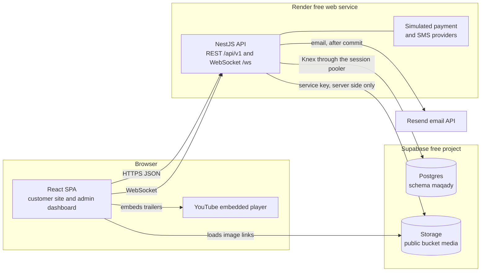
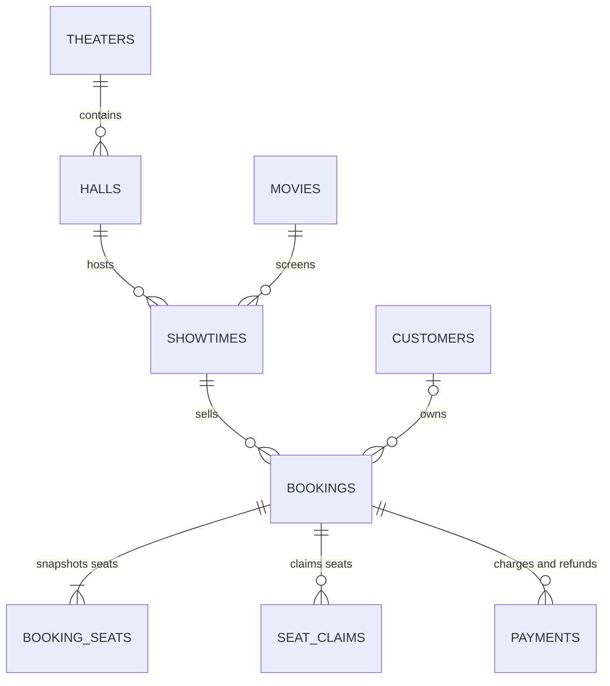

# Maqady backend — system design

> Requirements live in PRD v2.0 (`docs/reference/prd-v2.md`). This document says how the
> backend meets them. The PRD decides *what*; this document decides *how*. When they disagree,
> fix whichever is wrong in the same pull request.
>
> Decisions marked **Locked** in the decision register (§18) came from the owner and change
> only with the owner. Every other choice is the builder's: a unit's `spec.md` may change it,
> as long as it says so and updates this document in the same pull request.

## 1. Summary

Maqady's backend is one NestJS service. It serves a REST API under `/api/v1` and one plain
WebSocket endpoint for the live seat map. It runs as a single instance on Render's free tier,
with Supabase providing Postgres and file storage.

Postgres is the single source of truth for everything that must be correct: seat ownership,
holds, payments, sessions and idempotency keys. Seats are claimed with one atomic upsert and
locked in a fixed order while a payment runs, so two buyers can never confirm the same seat.
Anything that expires is judged from its stored timestamp whenever it is read, because the free
host sleeps and no timer can be trusted.

Payments and SMS go through simulated providers that live inside the service, behind
interfaces a real provider could replace later. Email is sent for real through Resend's free
plan ([ADR 0004](adr/0004-email-through-resend.md)).

## 2. Intent, goals, non-goals, anti-goals

**Intent.** Give the React frontend a complete, trustworthy API for every screen and rule in
PRD v2.0. The backend is built the way a production cinema platform would be, on free
infrastructure, as a codebase worth learning NestJS from.

**Goals**

| # | Goal | How we know |
|---|---|---|
| G-1 | No seat is ever sold twice, and no booking is ever charged twice | Concurrency and idempotency tests in §15 pass against real Postgres |
| G-2 | Every PRD v2.0 screen and rule has an API behind it | Each PRD section maps to a unit in §21; the contract covers every screen |
| G-3 | Production practices on free hosting | Deny-by-default security, structured logs, a tested CI gate and reproducible deploys |
| G-4 | A clear codebase to learn NestJS from | One module per feature, raw SQL migrations and no framework magic beyond Nest itself |

**Non-goals**

- Real payments, real email or real SMS.
- More than one API instance, high availability or high traffic.
- Multiple tenants, currencies or languages.
- A public API for third parties.

**Anti-goals: what we refuse to do, even when convenient**

- Let a background timer decide whether something is correct.
- Trust the client for prices, seat availability, identity or payment results.
- Use an ORM, or let the frontend reach Supabase's database or APIs directly.
- Store card data, keep a live secret in plain text, or put personal data in logs.

## 3. Constraints

| Constraint | What it forces |
|---|---|
| Render free web service: one instance that sleeps when idle and has little memory and CPU | No correctness on timers (§7.4). Rate-limit counters and WebSocket fan-out stay in process memory. Image processing runs one job at a time, outside database transactions. |
| Supabase free: 500 MB database, 1 GB storage, 50 MB per file, 10 GB monthly egress, paused after 7 days of low activity | Photos only, stored in web sizes. Videos are YouTube links. An optional daily ping keeps the project active (§16). |
| Locked stack: NestJS on Express, Knex with raw SQL migrations, PostgreSQL ([ADR 0002](adr/0002-nestjs-instead-of-express.md)); no Redis ([ADR 0003](adr/0003-idempotency-in-postgres.md)) | No ORM, no second query builder. Idempotency keys live in Postgres. |
| Frontend contract: REST plus one WebSocket using the browser's built-in `WebSocket` | Plain `ws` through `@nestjs/platform-ws`, not socket.io |
| Cairo time with summer-time changes | Every time calculation goes through shared time helpers (§8) |
| Practice project | Simulated payment and SMS providers, behind interfaces (§7.5, §13.1) |
| Email through Resend's free plan | Sending needs a verified domain and stops at 100 emails a day, so messages go through an outbox that retries (§13.1) |

## 4. Architecture at a glance



- One Node process serves REST and the WebSocket. The simulated providers are ordinary modules
  in the same process. Email leaves through Resend's HTTP API.
- The browser talks only to the API, plus public image links and YouTube embeds. It never
  holds a Supabase key.
- Every write request runs in one database transaction, opened by the write interceptor
  (§14.1). Events that leave the process, such as seat-map pushes, are sent only after that
  transaction commits.

## 5. Modules

Source lives under `src/`. Shared, framework-level code is in `src/common/`. Each feature is a
Nest module in `src/modules/<name>/` with the files `CLAUDE.md` prescribes: `types.ts`, `dto/`,
a repository, a service, a controller or gateway, and the module file.

| Module | Owns (tables) | Uses |
|---|---|---|
| `common/database` | Knex provider, `TransactionRepository`, transaction context, migrations runner, pg type parsers | — |
| `common/idempotency` | `idempotency_keys`, the write interceptor | database |
| `common/audit` | `audit_events` (write side) | database |
| `common/auth` | Guards, the access decorators (§11), the boot-time route check | auth |
| `common/crypto` | Encryption for stored idempotency responses, HMAC helpers | config |
| `common/time`, `common/money`, `common/errors`, `common/pagination`, `common/logging`, `common/config` | Shared helpers, `AppError`, the global exception filter, cursor codec, pino setup, validated environment | — |
| `auth` (`CredentialsModule`) | `sessions`, `one_time_tokens`; passwords | audit. Staff and customers import it and pass in their own account checks, so it points at neither (U2a) |
| `customers` | `customers` | auth, messaging, audit |
| `staff` | `staff_users` | auth, messaging, audit |
| `media` | `images`; the Supabase Storage adapter and image pipeline | — |
| `theaters` | `theaters`, `theater_phones`, `theater_facilities`, `theater_photos`, `theater_hours`, `theater_special_dates` | media, time |
| `halls` | `halls`, `hall_rows`, `hall_seat_marks` | theaters. Showtimes and seating plug their rules into its `HallLifecycleRegistry`, so it imports neither (U5) |
| `catalog` | `genres`, `movies`, `movie_genres`, `people`, `person_roles`, `movie_credits`, `movie_photos`, `movie_videos` | media |
| `showtimes` | `showtimes` | catalog, halls, theaters, time, messaging, seating (live claims behind `HALL_IN_USE`, U10), bookings (cancellation) |
| `seating` | `seat_claims`, `hold_refusals`; the seat-map gateway and in-process event bus | — |
| `bookings` | `bookings`, `booking_seats`, `booking_notes` | seating, payments, messaging; it reads showtimes, halls, theaters, catalog, customers and media through their exported services (U10, `docs/gh-11-holds/spec.md`) |
| `payments` | `payments`; the payment-provider interface, the simulated provider and `SettlementService` | seating |
| `messaging` | `messages`; templates, the outbox, the Resend email sender and the simulated SMS sender | — |
| `discovery` | No table: the public home and browsing reads (U8a, `docs/gh-9-home-and-browse/spec.md`); the ticker and hall-count seams U8b fills | catalog, theaters, media |
| `search`, `analytics`, `exports`, `activity` | Read-only queries; `staff_alert_reads` (analytics) | the modules they read |
| `health` | Liveness and readiness; a readiness `200` starts an outbox flush (§13.1, §16) | database, messaging |

Rules:

- Only repositories inject Knex. Transactions are opened by `TransactionRepository.run()` in
  `common/database`, so even the write interceptor reaches Knex through a repository.
- Modules talk to each other only through exported services, never another module's
  repository.
- Dependencies point one way. `seating` and `messaging` depend on nothing else in this table.
  `payments` uses `seating` to confirm claims when it settles a payment. `bookings`
  orchestrates holds, payments and refunds.
- The showtimes ↔ bookings cycle (cancelling a showtime refunds its bookings) is broken by
  `bookings` exporting a `ShowtimeCancellationService` that `showtimes` calls. `bookings` reads
  showtimes through its own SQL joins, not through the showtimes service.

## 6. Data model

### 6.1 Conventions

- **Schema.** All tables live in the `maqady` schema, which is not exposed through Supabase's
  Data API. As a backstop, every table has row-level security enabled with no policies, so
  nothing leaks even if the schema is exposed by mistake. The service connects as the owner
  role, which bypasses row-level security.
- **Extensions.** `citext`, `pg_trgm` and `btree_gist`, created by the first migration.
  - On Supabase they go in its `extensions` schema. Plain Postgres (Docker Compose, CI) has no
    such schema, so they go in `public`.
  - The connection's `search_path` is `maqady, extensions, public`. Postgres skips a schema
    that doesn't exist, so one setting works in both places.
- **Knex's bookkeeping.** `knex_migrations` and `knex_migrations_lock` live in `maqady`, with
  row-level security on like every other table, never in Supabase's exposed `public` schema.
  Migrations are recorded without a file extension, so the TypeScript sources (tests) and the
  compiled files (production) record the same names.
- **Naming and types.** Follow `CLAUDE.md` and PostgreSQL Standards: plural `snake_case` tables;
  `id BIGSERIAL`; foreign keys named `fk_…` with a covering `idx_…`; enum-likes as
  `VARCHAR CHECK (…)` mirrored in the module's `enums.ts`; `TIMESTAMPTZ` everywhere.
- **Money.** Whole piastres as `INT` plus `currency VARCHAR(3)` (always `EGP` in v1). A movie's
  budget is display text (`budget_label`, for example "EGP 48M"), not money: it is never added,
  converted or charged.
- **No defaults on critical columns.** Timestamps such as `created_at` are written by the
  service from the `Clock` (§14.6), not by `DEFAULT now()`, so tests control time.
- **Migrations.** Raw SQL, append-only, one Knex migration file per change. Every index carries
  a comment naming the query it serves. A table that references one created by a later unit
  gets that foreign key in the later unit's migration.
- **Backward-compatible migrations.** Render may run the old and new release side by side
  during a deploy, so a migration never breaks the previous release: expand first, contract in
  a later release.

### 6.2 Tables

**Identity and platform**

| Table | Purpose | Key columns and constraints |
|---|---|---|
| `customers` | Customer accounts | `email CITEXT`, unique among rows where `deleted_at IS NULL`; `full_name`; `password_hash`; `phone` (E.164, optional); `email_verified_at`; `status` (`active`, `blocked`); `last_sign_in_at`; `created_at`, `updated_at`; `deleted_at`. A live row has an email, name and hash; an anonymised row has no email, name, phone or hash (CHECK) (U9). |
| `staff_users` | Staff accounts | `email CITEXT UNIQUE`; `role` (`admin`, `box_office`); `status` (`invited`, `active`, `deactivated`); `password_hash` is NULL until a password is set; `last_sign_in_at` |
| `sessions` | Refresh-token sessions, one row per refresh token | Exactly one of `customer_id`, `staff_user_id` (CHECK `num_nonnulls(…) = 1`); `family_id UUID` (one sign-in's chain); `token_hash` UNIQUE; `rotated_at`; `expires_at` (the family's, copied on rotation); `revoked_at` with `revoked_reason`; `replaced_by_id` |
| `one_time_tokens` | Single-use links | `purpose` (`verify_email`, `customer_password_reset`, `staff_invite`, `staff_password_reset`); one owner FK as above; `token_hash` UNIQUE; `expires_at`; `used_at` |
| `idempotency_keys` | Stored results of writes | UNIQUE (`scope`, `key`); `request_hash`; `response_status`; `response_ciphertext` (the response body, encrypted, §14.1); `created_at`. A key older than 24 hours counts as absent. |
| `audit_events` | Activity log | `actor_kind` (`staff`, `customer`, `system`) plus actor FKs; `action` (for example `booking.refunded`); `entity_type`, `entity_id`; `booking_id`; `changed_fields TEXT[]`; `metadata JSONB`. Never personal data: names of changed fields, not their values. |
| `messages` | The outbox and the Message log | `channel` (`email`, `sms`); `template`; `recipient`; `subject`, `body_text` and `body_html` with one-time links redacted; `status` (`queued`, `sent`, `failed`); `attempts`; `last_error_code`; `next_attempt_at`; `payload_ciphertext` (the template parameters, encrypted, while `queued` or `failed`; NULL once `sent`, §13.1); `provider_message_id`; `sent_at`; `related_customer_id`, `related_staff_user_id`, `related_booking_id` (FKs added by the units that create those tables) |
| `staff_alert_reads` | Bell read state | PK (`staff_user_id`, `alert_key`); `seen_at` |
| `hold_refusals` | Seat conflicts, for the PRD's seat-conflict rate | `showtime_id`, `refused_at`, `seat_count`. Written in its own transaction after a refused hold rolls back. |

**Catalog**

| Table | Purpose | Key columns and constraints |
|---|---|---|
| `genres` | Fixed genre list, seeded by migration | `name` UNIQUE; `slug` UNIQUE (`sci-fi`), for URLs and the contract's `GenreRef` |
| `movies` | Movies | `status` (`draft`, `coming_soon`, `now_showing`, `archived`); `age_rating` (`G`, `PG`, `12+`, `16+`, `18+`); `runtime_minutes` 1–600; `release_date DATE`; `synopsis` (≤ 600), `language`, `country`, `production_company`; a public movie has a synopsis, runtime and release date (CHECK); `featured_position` 1–5, UNIQUE where not NULL, and only on a public movie with a hero video (CHECK); `hero_video_id` and `backdrop_photo_id` with composite FKs onto the movie's own video and photo (`(id, movie_id)`); `poster_image_id`; optional `budget_label` and `filming_locations`; `updated_by_staff_id` |
| `movie_genres` | Movie ↔ genre, at most 5 in display order | PK (`movie_id`, `genre_id`); `sort_order` 0–4, UNIQUE per movie |
| `people` | Actors and crew | `full_name`, `birth_date`, `birth_place`, `nationality`, `bio` (at most 400 characters), `photo_image_id`, three `https` social links |
| `person_roles` | Roles shown on a person, even without credits | PK (`person_id`, `role`); `role` is one of the 7 credit roles |
| `movie_credits` | Cast and crew | UNIQUE (`movie_id`, `person_id`, `role`); `character_name` allowed only for `actor` and `voice` (CHECK); `sort_order` 0–199; goes with its movie and with its person |
| `movie_videos` | YouTube videos | `youtube_id` CHECK `~ '^[A-Za-z0-9_-]{11}$'`, UNIQUE per movie; `kind` (`trailer`, `teaser`, `clip`, `featurette`); `title`; optional `duration_seconds`; `sort_order` |
| `movie_photos` | Movie photos | `image_id`; `kind` (`still`, `behind_the_scenes`); `caption`; `sort_order` |
| `images` | Every uploaded image | `storage_prefix`; `variants JSONB` (name → path, width, height); `created_by_staff_id` |

**Theaters and halls**

| Table | Purpose | Key columns and constraints |
|---|---|---|
| `theaters` | Theaters | `name CITEXT` UNIQUE (case-insensitive); `status` (`draft`, `active`, `sales_paused`); `address`, `district`, `city`; `latitude`, `longitude NUMERIC(9,6)` with range CHECKs; optional `transit_info`, `parking_info`, `email`; `default_price_front`, `_middle`, `_back INT` plus `currency`, set all together or not at all, and required once the theater leaves `draft` (CHECK); `show_contacts_public`; `cover_image_id` (an `images` row of kind `backdrop`, UNIQUE). Hard-deleted: only a draft goes (U4b, `docs/gh-5-theaters/spec.md`) |
| `theater_phones` | Labelled phone numbers | `label`, `number` (E.164, CHECK), `sort_order` (0 is the main phone); at most 10 per theater, replaced as a whole |
| `theater_facilities` | Facilities | PK (`theater_id`, `facility`); `facility` is one of `wheelchair_access`, `free_parking`, `valet_parking`, `street_parking`, `cafe_bar`, `food_court`, `kids_room` |
| `theater_photos` | Gallery | `image_id` (UNIQUE, kind `gallery`), optional `caption` (the photo's alt text), `sort_order` kept contiguous from 0; at most 20 per theater |
| `theater_hours` | Weekly hours, by cinema-day weekday | PK (`theater_id`, `weekday`); `is_closed`, or `opens_minute` and `closes_minute` counted from midnight at the start of the cinema date, with CHECK `360 <= opens_minute < closes_minute <= 1800` (06:00 to 06:00 next day) |
| `theater_special_dates` | Holiday hours | UNIQUE (`theater_id`, `cinema_date`); `label`; hours as above, or closed |
| `halls` | Halls | `name CITEXT`, UNIQUE (`theater_id`, `name`), so unique per theater ignoring case, in any status; `status` (`draft`, `active`, `retired`); `row_count` 4–15; `seats_per_row` 8–20; UNIQUE (`id`, `theater_id`) to back the composite FK from `showtimes`. Hard-deleted, children cascading: only a hall that never had a showtime goes (U5, `docs/gh-6-halls/spec.md`) |
| `hall_rows` | One zone per row | PK (`hall_id`, `row_index`); `row_label` (A–P without I), CHECKed to be the letter at `row_index`, UNIQUE (`hall_id`, `row_label`); `zone` (`front`, `middle`, `back`) |
| `hall_seat_marks` | Exceptions to the full grid | PK (`hall_id`, `row_label`, `seat_number`); FK (`hall_id`, `row_label`) → `hall_rows`, so a mark sits in an existing row and goes with it; `kind` (`wheelchair`, `no_seat`) |

**Showtimes, bookings and payments**

| Table | Purpose | Key columns and constraints |
|---|---|---|
| `showtimes` | A movie in a hall at a time | Composite FK (`hall_id`, `theater_id`) → `halls`; FKs to `movies` and `theaters`, all `NO ACTION`; `starts_at`, `ends_at`, `cleaning_ends_at` (`ends_at` + 20 minutes, written by the service and CHECKed); `cinema_date` (written by the service, not CHECKed); `price_front`, `_middle`, `_back` (1–1,000,000) plus `currency`; `seat_capacity` (1–300); `status` (`scheduled`, `cancelled`); `cancel_reason` and `cancelled_at`, set together exactly when cancelled. **EXCLUDE USING gist (`hall_id` WITH =, `tstzrange(starts_at, cleaning_ends_at)` WITH &&) WHERE `status = 'scheduled'`.** Indexes (`hall_id`, `theater_id`, `starts_at`), (`theater_id`, `cinema_date`, `starts_at`), (`movie_id`, `cinema_date`, `starts_at`), (`cinema_date`, `starts_at`) (U7, `docs/gh-8-showtimes/spec.md`) |
| `bookings` | Holds and bookings | `reference` UNIQUE; `status` (`held`, `confirmed`, `refunded`); `channel` (`online`, `counter`); nullable `customer_id`; `hold_token_hash`; `hold_expires_at`; `has_declined_payment`; `total_amount` plus `currency`; `seat_count` 1–8; contact name, email and phone; `created_by_staff_id`; `confirmed_at`; `refunded_at`; `qr_version`; `checked_in_at`, `checked_in_by_staff_id`; UNIQUE (`id`, `showtime_id`). CHECKs: the reference pattern, `channel = 'counter'` exactly when `created_by_staff_id` is set, `hold_token_hash` only on an online unowned hold, the timestamps and `qr_version` of each status (U10, `docs/gh-11-holds/spec.md`) |
| `booking_seats` | Seat and price snapshot | PK (`booking_id`, `seat_label`); `row_label`, `seat_number`, `zone`, `price`, `is_wheelchair` |
| `seat_claims` | Who holds each seat right now | **PK (`showtime_id`, `seat_label`)**; composite FK (`booking_id`, `showtime_id`) → `bookings`; `claimed_until` (NULL means sold; `<= :now` means free: an expired or released hold) |
| `payments` | Charges and refunds | `kind` (`charge`, `refund`); `purpose` (`sale`, `edit_difference`, `cancellation`); `method` (`card`, `wallet`, `cash`, `card_terminal`); `status` (charge: `processing`, `succeeded`, `declined`, `cancelled`; refund: `pending`, `succeeded`; CHECK per kind); `amount > 0`; `refund_of_payment_id` (a refund names the charge it returns); `provider_reference`; `card_brand`, `card_last4`, `wallet_type`; `settles_at`; `collected_by_staff_id`; `paid_out_at`, `paid_out_by_staff_id`. **UNIQUE (`booking_id`) WHERE `kind = 'charge' AND purpose = 'sale' AND status IN ('processing', 'succeeded')`.** |
| `booking_notes` | Internal staff notes | `staff_user_id`, `body` (at most 1,000 characters) |



### 6.3 Where correctness lives

Each rule below is enforced by the database, not only by application code:

| Rule | Enforced by |
|---|---|
| A seat belongs to at most one live booking per showtime | `seat_claims` primary key plus the claim upsert (§7.2) |
| A claim always matches its booking's showtime | Composite FK (`booking_id`, `showtime_id`) |
| A booking has at most one in-flight or successful sale charge | Partial unique index on `payments` |
| Two showtimes in a hall are at least 20 minutes apart | Exclusion constraint on `showtimes` |
| A showtime's hall belongs to its theater | Composite FK (`hall_id`, `theater_id`) |
| Booking references never repeat | UNIQUE `bookings.reference` |
| At most one movie per carousel position | Partial UNIQUE on `movies.featured_position` |
| No customer email is shared by two live accounts | Partial UNIQUE on `customers.email` |

Rules that need joins, row locks or time-zone logic are enforced by services, under the lock
order in §7.1: opening hours, a payment racing a hold's expiry, a showtime changing during a
payment, the 8-seat limit and the last-admin rule.

## 7. Booking core

### 7.1 Lock order

Every operation that touches seats takes its locks in one fixed order, so two operations can
wait for each other but never deadlock in a cycle:

1. **Settle due payments first**, in their own short transaction (§7.5).
2. **Showtime row.** `FOR SHARE` to read it as bookable (holds, payments, edits). `FOR UPDATE`
   to change it (move, cancel, price change). With two showtimes (an edit), lock both in id
   order. Admin showtime writes first lock the theater `FOR SHARE`, then (to schedule or move)
   the movie `FOR SHARE`, so publishing, hours changes and archiving never interleave with them
   (U7).
3. **Hall row.** `FOR SHARE` when validating seats against the layout. `FOR UPDATE` to save a
   layout. A showtime create or move then takes the hall's scheduling advisory lock
   (`pg_advisory_xact_lock`), so concurrent scheduling writes in one hall queue instead of
   deadlocking inside the exclusion check (U7).
4. **Principal row** (customer or staff member) `FOR UPDATE`, when enforcing "one live hold".
5. **Booking rows** `FOR UPDATE`, in id order.
6. **Seat claims**, in (`showtime_id`, `seat_label`) order, whether locked with `FOR UPDATE` or
   written by the upsert. Seat labels are sorted before every statement.

The write interceptor retries the whole request transaction once on a deadlock (`40P01`) or a
serialization failure (`40001`). The idempotency key rolls back with it, so the retry is safe.

### 7.2 Seat claims

`seat_claims` is the only place that says who holds a seat right now. `booking_seats` keeps
the history: which seats a booking had, and at what price.

Claiming seats is one statement, with the labels sorted (§7.1):

```sql
INSERT INTO seat_claims (showtime_id, seat_label, booking_id, claimed_until)
SELECT :showtime_id, label, :booking_id, :claimed_until
FROM unnest(:sorted_seat_labels::text[]) AS label
ON CONFLICT (showtime_id, seat_label) DO UPDATE
  SET booking_id = EXCLUDED.booking_id,
      claimed_until = EXCLUDED.claimed_until
  WHERE seat_claims.claimed_until IS NOT NULL
    AND seat_claims.claimed_until <= :now
RETURNING seat_label;
```

- **A seat taken.** If fewer labels come back than were requested, the transaction rolls back
  and the API answers `SEAT_TAKEN` listing the seats that failed. A separate small transaction
  then records the refusal in `hold_refusals`.
- **Concurrent claims.** Two concurrent requests for the same seat serialize on the row lock
  that `ON CONFLICT` takes. After the lock, Postgres re-evaluates the `WHERE` against the newest
  row, so the second request sees the first one's claim and gets nothing back.
- **Expired claims.** An expired hold's claim is simply overwritten. Nothing has to run to free
  a seat.
- **Confirmation.** Confirming a booking sets `claimed_until` to NULL, so its claims can never be
  overwritten.
- **Refunds.** Refunding a booking deletes its claims.
- **Time.** `:now` comes from the application's `Clock` (§14.6), never from SQL `now()`, so tests
  control time.

**As built (U10).** Every claim write is one statement per showtime, in showtime id order, each
with its rows sorted by label (code-point order, `COLLATE "C"`), so §7.1 step 6 holds for every
row a statement locks, including those an `ON CONFLICT` locks when its `WHERE` fails:

- The rows are the new claim's seats (the new booking, `claimed_until`) and the seats of the
  bookings this transaction releases (their own booking, `claimed_until = :now`, which frees the
  seat). A label in both keeps the new claim.
- The `WHERE` also takes over a live claim of a booking being released (`OR seat_claims.booking_id
  = ANY(:take_over_from)`), so a re-pick that overlaps its old hold keeps the shared seat in the
  same statement. A sold claim (`claimed_until IS NULL`) is never touched.
- `SEAT_TAKEN`: the refusal row is written after the request rolled back
  (`TransactionRepository.afterRollback()`, §14.1), in a transaction of its own, never on a second
  pooled connection inside the request.

A showtime's availability snapshot is its claims where `claimed_until IS NULL OR
claimed_until > :now`.

### 7.3 Holds

A hold is a booking with `status = 'held'`. Creating one runs, under the lock order:

1. Settle due payments for the showtime.
2. Lock the showtime `FOR SHARE`. It must be `scheduled` and not yet started, its movie
   `now_showing` and its theater `active`.
3. Lock the hall `FOR SHARE`. It must be `active`, and every seat must exist in its layout (not a
   `no_seat`). There must be 1 to 8 distinct seats.
4. Lock the signed-in customer, or the staff member for a counter hold, `FOR UPDATE`. Then
   release that principal's previous live hold. For a guest, release the hold whose code the
   browser presents.
   - Releasing sets `hold_expires_at = :now`, ends the claims (`claimed_until = :now`, in the
     new hold's own claim statement, §7.2) and publishes `seat.released` after commit. Ending
     rather than deleting lets a release and a new claim on one showtime share one ordered
     statement; an ended claim is free exactly like a missing one. Refunds and edits (U14)
     delete claims.
   - One live online hold per customer, across showtimes (U10): a customer's new hold releases
     their live hold on any showtime, and the live unowned hold whose code `X-Hold-Token`
     presents.
   - A hold whose payment is still processing is never released: the request fails with
     `PAYMENT_IN_PROGRESS`, so PRD Seats rule 5 holds.
5. Insert the booking with a new reference (§7.9), the seat snapshot priced from the showtime's
   current zone prices, and the total.
   - `hold_expires_at` is the earlier of `:now + 5 minutes` and the showtime's `starts_at`, so no
     hold outlives the moment the showtime starts.
6. Claim the seats (§7.2) with `claimed_until = hold_expires_at`.
7. For a guest, generate a 32-byte random **hold code**, store only its SHA-256 hash, and return
   the code once.
8. After commit, publish `seat.held` to the seat map (§12).

**Claiming a guest hold.** `POST /holds/{ref}/claims` carries the hold code in an `X-Hold-Token`
header and a customer access token. It locks the customer, then the booking. The hold must be
live and unowned, and the code's hash must match.

The customer's other live hold is released as in step 4, publishing `seat.released`. The
booking gets the `customer_id`, and its `hold_token_hash` is cleared, so the code is useless
from then on.

**Releasing.** `DELETE /holds/{ref}` (owner or code holder) releases as in step 4. The booking
then reads as Abandoned, or Failed if it had a declined payment.

**As built (U10, `docs/gh-11-holds/spec.md`).**

- Bookability is one reason, in this order: `cancelled`, `started`, `sales_paused` (theater not
  `active`), `movie_unavailable` (not Now showing), `hall_unavailable`, answered as
  `409 SHOWTIME_NOT_BOOKABLE { reason }`. The theater and movie are read without locks, after
  the showtime's `FOR SHARE`; a hold never locks the theater, so it forms no cycle with U7's
  theater → showtime writes.
- `GET /showtimes/{id}` and `/seats` show a showtime of any published theater in any status with
  `bookable` and the reason; an unknown id or a draft theater is `NOT_FOUND`.
- A customer becoming a hold's owner (creating or claiming it) copies their name, email and
  phone into the booking's contact fields.
- Claim answers: a missing `X-Hold-Token` is `VALIDATION_FAILED`; a wrong code, an unknown
  reference or someone else's booking `NOT_FOUND`; a matching code on an ended hold
  `HOLD_EXPIRED`; a hold the caller already owns `201` as it is. `HOLD_ALREADY_CLAIMED` is
  unused: a hold someone else owns reads as `NOT_FOUND`.
- Release: an ended hold answers `204` and changes nothing; `confirmed` or `refunded` is
  `ALREADY_PAID`.
- Audit: `booking.held`, `booking.claimed`, `booking.released` with `booking_id`; a guest's are
  recorded with actor `system` and `metadata.holder: 'guest'`.

### 7.4 Statuses decided by the clock

Only `held`, `confirmed` and `refunded` are stored. The three other PRD statuses follow from
stored timestamps the moment they are read, so no job ever has to run:

| PRD status | Stored status | Condition at read time |
|---|---|---|
| Held | `held` | `hold_expires_at > :now` |
| Failed | `held` | `hold_expires_at <= :now` and `has_declined_payment` |
| Abandoned | `held` | `hold_expires_at <= :now` and not `has_declined_payment` |
| Confirmed | `confirmed` | the showtime's `ends_at > :now` |
| Completed | `confirmed` | the showtime's `ends_at <= :now` |
| Refunded | `refunded` | — |

One file in the bookings module, `booking-status.sql.ts`, owns these predicates. Lists, filters,
analytics and the API's `status` field all use it, so the rule exists in exactly one place.
The booking-level payment status shown in the UI is derived the same way: Unpaid, Processing,
Declined, Paid or Refunded.

The same approach covers every other time-based state: a showtime that has started, a
theater's open state, an expired one-time token, an expired idempotency key and the ticket
scan window.

### 7.5 Online payment and settlement

```mermaid
sequenceDiagram
  participant B as Browser
  participant A as API
  participant D as Postgres
  participant P as Simulated provider
  B->>A: POST /showtimes/{id}/holds (seats, Idempotency-Key)
  A->>D: lock showtime and hall, insert held booking, claim seats
  A-->>B: 201 reference, hold code (guest only), expiresAt, total
  A--)B: WebSocket seat.held to every viewer
  B->>A: POST /holds/{ref}/claims (after sign-in, guests only)
  B->>A: POST /bookings/{ref}/payments (method, test token, Idempotency-Key)
  A->>D: lock showtime, booking, then its claims; check all live
  A->>P: charge (amount, token, idempotency key)
  P-->>A: succeeded, declined, cancelled or processing
  A->>D: record the result; on success confirm, make claims permanent, queue tickets
  A-->>B: 201 payment status and booking
  A--)B: WebSocket seat.booked
```

A payment runs in one transaction:

1. Settle the booking's due payments (below).
2. Lock the showtime `FOR SHARE` and re-check it as in §7.3 step 2. A cancelled, moved-past or
   started showtime fails with `SHOWTIME_NOT_BOOKABLE`.
3. Lock the booking `FOR UPDATE`. The caller must own it, it must be `held` and live, and no
   sale charge may be processing or succeeded (`PAYMENT_IN_PROGRESS`, `ALREADY_PAID`). The
   partial unique index backs that last rule.
4. Lock the booking's claims `FOR UPDATE`, in seat order. All `seat_count` claims must still
   belong to the booking and be live, or the payment fails with `HOLD_EXPIRED`.
   - From here, no rival hold can overwrite them: a rival's upsert waits on these row locks,
     then sees the confirmed claims and gets `SEAT_TAKEN`.
   - This is what keeps PRD Seats rule 5 true even if the timer reaches 0:00 during the
     provider call.
5. Insert the charge as `processing` and call the provider with our idempotency key.
6. Record the result:
   - **Succeeded.** Set the charge to `succeeded` and the booking to `confirmed` with
     `confirmed_at`. Set the claims' `claimed_until` to NULL, checking with `RETURNING` that all
     `seat_count` rows changed. Set `qr_version = 1`, write the tickets message (§13.1) and an
     audit event. After commit, publish `seat.booked`.
   - **Declined or cancelled.** Declined sets the booking's `has_declined_payment`; a wallet the
     customer closed is `cancelled` and doesn't count as a decline. Either way the response is
     `201` with the payment's status: a decline is a normal result, not an error, so it
     commits. The seats stay held until the timer ends, and the customer retries with a new
     Idempotency-Key.
   - **Processing.** Extend the hold and its claims to `settles_at + 30 seconds`, and after
     commit publish `seat.held` with the new end time.

**Settlement.** `SettlementService.settleDue(scope)` finishes every processing charge whose
provider result is ready. It runs in its own short transaction:

1. `UPDATE payments SET status = … WHERE id = ANY(:due) AND status = 'processing' RETURNING …`.
   Only the request that wins this update goes on, so two polling tabs settle a payment exactly
   once.
2. Apply the outcome in a batch: confirm bookings and claims, or set `has_declined_payment`.
3. Publish seat events after commit.

It is called before booking reads, before a payment or hold on the same showtime, and in a
batch before admin lists, the Payments screen and analytics. That way no screen sees a stale
Pending.

The simulated provider decides "ready" from `settles_at`, so there is no callback and no timer.
If a payment ever succeeds after its claims were lost, settlement refunds it at once and the
booking ends Refunded. Only a slow real provider could cause that.

**Provider interface.** `PaymentProvider` has `charge`, `retrieve` and `refund`. Each call
carries our idempotency key, as a real gateway would require. The simulated provider is
stateless and decides each result from the test token:

| Test token | Result |
|---|---|
| `sim_card_visa`, `sim_card_mastercard`, `sim_card_meeza` | Approved (brand and last four recorded) |
| `sim_card_declined` | Declined |
| `sim_card_slow` | Processing, approved 10 seconds later |
| `sim_card_slow_declined` | Processing, declined 10 seconds later |
| `sim_wallet_apple_pay`, `sim_wallet_google_pay` | Approved |
| `sim_wallet_cancelled` | Cancelled by the customer (not a decline) |

### 7.6 Counter sales

1. A staff member picks seats on the live map. `POST /admin/counter-holds` creates a
   `counter`-channel hold owned by that staff member, through the same steps as §7.3. A staff
   member has at most one live counter hold.
2. `POST /admin/bookings/{ref}/counter-payments` records `cash` or `card_terminal` with the
   terminal's receipt reference, and the customer: walk-in, an existing customer, or typed
   contact details.
   - It takes the locks of §7.5 steps 2–4 and confirms in the same transaction.
     `collected_by_staff_id` comes from the signed-in staff member.
   - Tickets go to any email or phone given. Staff can always download the PDF for a walk-in
     (§7.9).
3. A counter hold that lapses becomes Abandoned, like any other.

### 7.7 Cancelling, refunding and paying out

Refunds are computed **per charge**, because one booking can be paid on more than one rail: an
online sale plus cash collected during an edit. A charge's refundable amount is its `amount`
minus the refunds that already name it in `refund_of_payment_id`.

- **Cancel & refund (admin only).** `POST /admin/bookings/{ref}/refunds`. The booking must be
  Confirmed, with its showtime not yet ended.
  - Under the lock order, each succeeded charge gets a refund for its remaining amount, on its
    own rail. Online charges are refunded through the provider (`succeeded`); cash and terminal
    charges get a `pending` refund to pay out at the counter.
  - The booking becomes `refunded` with `refunded_at`, its claims are deleted, and the refund
    message and an audit event are written. After commit, `seat.released` is published.
- **Paying out a counter refund.** `POST /admin/refunds/{id}/payouts` moves a `pending` refund to
  `succeeded` and records who paid it out and when.
- **Cancelling a showtime.** `PATCH /admin/showtimes/{id}` with `status: cancelled` and a reason.
  It is allowed until the showtime ends: a projector can fail mid-screening.
  - One transaction locks the showtime `FOR UPDATE`. Any in-flight payment has already
    committed, and any later one waits and then sees the cancellation.
  - It then refunds every Confirmed booking as above, releases every live hold, and writes the
    email and SMS rows for every ticket holder. Everything is batched (`whereIn`, multi-row
    inserts), never one query per booking.
- **Cancellation preview.** `GET /admin/showtimes/{id}/cancellation-preview` returns the PRD's
  impact figures: bookings and seats affected, the total refunded online and the total owed back
  at the counter, computed per charge as above.

### 7.8 Booking edits (admin only)

An edit can change the showtime (same movie), the seats, or the contact details, with a
required reason. `POST /admin/bookings/{ref}/edit-previews` returns the new total and the
difference without saving. `POST /admin/bookings/{ref}/edits` applies it in one transaction:

1. Lock the current and target showtimes `FOR SHARE` in id order, and re-check the target as
   bookable (§7.3 step 2). Then lock the booking `FOR UPDATE` and its current claims in seat
   order.
2. Delete the booking's current claims. That frees the composite FK, so the booking's
   `showtime_id` can change, and it frees the kept seats for re-insertion.
3. Update the booking's showtime and contact details.
4. Claim every target seat with the §7.2 upsert and `claimed_until = NULL` (sold). If any comes
   back missing, the whole transaction rolls back with `SEAT_TAKEN`, restoring the old claims.
5. Rebuild `booking_seats`. Seats kept on the same showtime keep the price they were sold at;
   new seats take the target showtime's current prices.
6. Settle the difference:
   - A lower total is refunded across the succeeded charges, newest first, each on its own rail
     (§7.7).
   - A higher total must arrive in the same request as a counter payment (`cash` or
     `card_terminal`), recorded as an `edit_difference` charge.
7. Increment `qr_version`, so the old QR code stops working. Write an audit event with the names
   of the changed fields (never their values), and send new tickets if the admin asked to notify.
   After commit, publish the seat changes for both showtimes.

Completed, Refunded, Failed and Abandoned bookings can't be edited (`BOOKING_NOT_EDITABLE`).

### 7.9 References, tickets and scanning

- **Reference.** `MQ-` plus 6 characters from `23456789ABCDEFGHJKMNPQRSTUVWXYZ` (no 0, O, 1, I or
  L), drawn with `crypto.randomInt`.
  - The insert uses `ON CONFLICT (reference) DO NOTHING RETURNING id`, drawing a new reference up
    to 5 times. A unique violation would abort the transaction (§14.1).
  - API paths identify bookings by reference; internal ids never leave the API.
- **QR payload.** `MQ1.<reference>.<qr_version>.<signature>`, where the signature is HMAC-SHA256
  under `QR_SIGNING_KEY`, truncated to 16 bytes and base64url-encoded. The API returns the
  payload string; the frontend draws the code.
- **Downloads.** `GET /bookings/{ref}/ticket.pdf` (owner), `GET /admin/bookings/{ref}/ticket.pdf`
  (staff) and `GET /bookings/{ref}/calendar.ics` (owner) are built on demand with pdfkit and
  qrcode. The frontend fetches them with its `Authorization` header and saves the file. No token
  ever goes in a URL.
- **Scanning.** `POST /admin/scans` takes `{ theaterId, code }`, where `code` is a QR payload.
  Results:
  - `VALID` with the seat count, recording `checked_in_at` atomically (`WHERE checked_in_at IS
    NULL`);
  - `ALREADY_USED` with the first scan's time;
  - `WRONG_SHOWTIME`: another theater, a cancelled showtime, or outside the window that opens 60
    minutes before the start and closes when the showtime ends;
  - `NOT_VALID`: refunded, or an old QR version;
  - `NOT_FOUND`.
- **Typed references.** When the camera fails, staff can send `{ theaterId, reference }`
  instead. That answers `CONFIRM_REQUIRED` with the booking's showtime, seats and contact
  name. Only a second request with `confirm: true` checks the booking in, so the reference
  alone admits nobody (PRD "Tickets and QR codes").

### 7.10 Prices

- A new showtime copies the theater's three default zone prices. An admin can change a
  showtime's prices later, and the change applies to new holds only.
- A hold prices each seat from its row's zone and stores the per-seat price and the total.
  Checkout charges exactly that total ("Price confirmed by Maqady").
- A showtime's "from" price is the lowest zone price among the zones its hall actually uses.
- No fees, discounts or taxes exist in v1.

## 8. Scheduling and time

- **One time zone.** `Africa/Cairo`, a constant in `common/time`. Timestamps are stored as
  `TIMESTAMPTZ`. The API writes them in Cairo time with their offset, for example
  `2026-10-16T19:30:00+03:00`.
- **Cinema day, by the wall clock.** A cinema day runs from 06:00 to 06:00 local time.
  `cinemaDateOf(instant)` converts the instant to Cairo wall-clock time first. Before 06:00, the
  cinema date is the previous calendar date; otherwise it is the same date.
  - Subtracting six hours from the instant would be wrong on summer-time days. On Friday
    24 April 2026, 06:30 summer time minus six hours lands at 23:30 Thursday winter time.
  - `showtimes.cinema_date` is written by the service when a showtime is created or moved.
- **Shared helpers only.** `common/time` wraps a time-zone-aware library (Luxon). It is the only
  place that converts between wall-clock times and instants. Inline offset or millisecond
  arithmetic is forbidden, as `CLAUDE.md` says.
- **Summer-time changes.** These rules apply when an admin enters a wall-clock time:
  - A showtime start that doesn't exist that night is refused (`TIME_DOES_NOT_EXIST`).
  - A time that occurs twice resolves to its first occurrence.
  - Stored opening hours that fall into a skipped hour are shifted forward to the next valid
    time, never refused, because they were valid when entered.
- **Opening hours.** The hours for a cinema date are the special date's, if one exists, else
  the weekday's. They become instants by adding the stored minutes to the date's wall clock
  through the helpers.
- **Entering a showtime.** The admin sends a cinema date and a wall-clock `startTime` (`HH:mm`).
  `06:00`–`23:59` is on that calendar date and `00:00`–`05:59` on the next one, so 16 Oct +
  `00:30` starts on 17 Oct at 00:30 and belongs to the 16 Oct cinema date. `ends_at` is the
  start plus the runtime in real minutes, and `cleaning_ends_at` 20 minutes later.
- **Showtime checks.** Per date, the first that fails wins: the start exists that night
  (`time_does_not_exist`), is after now (`in_past`), the showtime starts and ends inside that
  date's window, its cleaning may run past closing (`outside_opening_hours`, also for a closed
  date), and the 20-minute gap holds (`conflict`).
  - The hours check, a service rule: the showtime starts and ends inside that window.
  - The 20-minute cleaning gap, the exclusion constraint. A violation becomes
    `SHOWTIME_CONFLICT`, and a follow-up query names the overlapping showtime.
  - Only `now_showing` movies and `active` halls can be scheduled, and only with prices (the
    request's, or the theater's defaults): `SHOWTIME_NOT_SCHEDULABLE` with `details.reasons`.
    The theater may be in any status.
- **Dry run and batch create.**
  - `POST /admin/showtime-checks` runs every check for each requested date without writing, and
    suggests free start times on a 5-minute grid.
  - `POST /admin/showtimes` creates the dates that pass. Each date's insert runs in its own
    savepoint, so "skip the dates that don't fit" can continue past a constraint violation
    without aborting the transaction. Without `skipUnavailable`, one date that doesn't fit
    creates none; creating none is `SHOWTIMES_NOT_CREATED` with every date's result, so the
    transaction and its idempotency key roll back.
- **Moving.** Allowed only before the showtime starts. The move locks the showtime `FOR UPDATE`,
  re-runs every check with the movie's current runtime, recomputes `ends_at`,
  `cleaning_ends_at` and `cinema_date`, and messages every ticket holder (email, and SMS with a
  phone) through `ShowtimeTicketHolderService` and one `MessagingService.queueMany()`. Prices
  change only before the start, cancelling until the end; a cancelled showtime is final
  (`SHOWTIME_NOT_EDITABLE`). A runtime or hours change never touches existing showtimes.
- **Capacity.** `showtimes.seat_capacity` is the hall's seat count when the showtime is
  created. A layout save refreshes it for that hall's future showtimes, so past occupancy
  never changes.

## 9. Theaters, halls, catalog and media

- **Theater lifecycle.**
  - A theater is created as `draft`. `PATCH /admin/theaters/{id}` changes its `status`.
    Publishing (`draft` → `active`) requires zone prices, at least one active hall and opening
    hours (all seven weekdays set, at least one open); otherwise `THEATER_NOT_PUBLISHABLE` lists
    what is missing. `active` ↔ `sales_paused` is the selling toggle; a published theater never
    returns to `draft` (`CONFLICT`).
  - Customers see only `active` theaters and their showtimes.
  - Only a draft with no showtimes can be deleted (`THEATER_NOT_DELETABLE` otherwise).
  - The hall and showtime rules belong to later units, so `TheatersModule` exports a
    `TheaterLifecycleRegistry`: U5 registers the publish requirement `active_hall` and U7 the
    deletion blocker `has_showtimes`, checked after the built-in ones.
  - Every theater write locks the theater row first (`FOR NO KEY UPDATE`; `FOR UPDATE` to delete).
    Hall and showtime writes lock it `FOR SHARE` (`TheaterReadService.lockForShare()`) before
    their own rows, so publishing, pausing and hours changes never interleave with them.
  - Changing weekly hours or special dates never touches existing showtimes; only new scheduling
    and moves are checked against the new hours.
  - The cover is an image of kind `backdrop`; gallery photos are kind `gallery`. Both upload
    through `POST /admin/theaters/{id}/photos` (`usage`); `DELETE /admin/theaters/{id}/cover`
    removes the cover.
- **Hall layouts.**
  - A new hall is a `draft` with the standard 12 × 16 layout (rows A–C front, D–H middle, J–M
    back). Status changes: `draft → active`, `draft → retired`, `active → retired`; `retired`
    is final. Every hall write locks the theater `FOR SHARE` first, then the hall `FOR UPDATE`.
  - `PUT /admin/halls/{id}/layout` replaces the whole layout (row count, seats per row, row
    zones and seat marks) in one transaction.
    - Rows are lettered from the screen back (A to P without I). Seats are numbered 1 to
      `seatsPerRow` from the left, and a gap keeps its number, so a seat's label (`F7`) never
      moves. Wheelchair spaces are seats; `no_seat` cells are not.
    - Zones form bands from the screen back (front, then middle, then back; any may be empty),
      every mark lies inside the grid, and at least one seat remains (`VALIDATION_FAILED`).
    - Lock order: the theater `FOR SHARE`, then the layout participants' `beforeLock` (U7 locks
      the hall's future showtimes `FOR UPDATE` here, keeping "showtime before hall" of §7.1),
      then the hall `FOR UPDATE`, so it waits for in-flight holds that hold it `FOR SHARE`.
    - It is then refused with `HALL_IN_USE`, listing the blocking showtimes, if any showtime in
      the hall that hasn't ended has a live claim. A retired hall's layout is `CONFLICT`.
    - The showtime and claim rules plug into U5's `HallLifecycleRegistry`: layout participants
      (U7's `showtime_capacity` refresh and `hall_in_use` check), deletion blockers (U7
      `has_showtimes`) and retirement blockers (U7 `has_future_showtimes`)
      (`docs/gh-6-halls/spec.md`). U7 owns the `HALL_IN_USE` rule: its participant lists the
      hall's scheduled showtimes that haven't ended, and U10 answers which have a live claim by
      rebinding `ShowtimeSeatClaimService` (`docs/gh-8-showtimes/spec.md`).
  - Aisles aren't stored: the API reports `aisleAfter = [4, seatsPerRow − 4]`, deduplicated.
  - A hall that ever had a showtime can only be retired (`PATCH` with `status: retired`), which
    requires no future scheduled showtimes (`HALL_NOT_RETIRABLE`); deleting it is
    `HALL_NOT_DELETABLE`. Retiring the last active hall of a published theater is allowed: the
    publish check is a one-time gate.
- **Catalog.**
  - Movies, people, credits and genres follow PRD §A2–A3. A movie that ever had a booking
    can't be deleted, and deleting a person removes their credits.
  - A movie is created as `draft`. Coming soon and Now showing need a synopsis, runtime,
    release date and a genre (a poster is optional). Now showing never returns to draft or
    Coming soon; archiving keeps history and may be undone (`docs/gh-7-catalog/spec.md`).
  - Featured positions are unique, and a featured movie must be public and have a hero video
    (any of its own videos). A taken position is refused, never shifted.
  - Deletion is refused by blockers other units register with `MovieLifecycleRegistry`: U7
    `has_showtimes`, U10 `has_bookings`.
  - The budget is a free-text label.
- **YouTube.** The API accepts watch, youtu.be, shorts and embed URLs, and stores only the
  11-character video id. Thumbnails and the privacy-enhanced embed URL are derived from the id.
  Titles and optional durations are typed by the admin, so there is no YouTube API key.
- **Image pipeline.** Upload routes opt out of the request transaction (§14.1), so slow image
  work never holds a database connection.
  1. Multer receives one file in memory, at most 10 MB.
  2. The pipeline checks the file's magic bytes (JPG or PNG only) and refuses images above 40
     megapixels.
  3. sharp, with `concurrency(1)` and its cache off, rotates by EXIF, strips metadata and writes
     WebP variants per use: posters 2:3, backdrops 16:9, people photos square and at least
     600 × 600, galleries.
     - Every kind yields `small`, `medium` and `large`, never upscaled. A poster or person photo
       may be up to 2 % off its ratio and is centre-cropped; further off is refused
       (`IMAGE_WRONG_SHAPE`). A backdrop (the theater cover) is always centre-cropped to 16:9. A
       gallery photo keeps its shape. Minimums after any crop: poster 400 × 600, backdrop
       1280 × 720, person 600 × 600, gallery 320 on the shorter side (U4a,
       `docs/gh-5-media/spec.md`).
     - A movie's backdrop is one of its gallery photos, shown at 16:9 by the frontend with a
       cover crop, so stills keep their own shape in the media viewer.
  4. The variants are uploaded under one storage prefix, `<kind>/<uuid>`.
  5. Only then does a short transaction insert the `images` row and link it. It also claims and
     completes the request's `Idempotency-Key` (§14.1), so the key commits with the row.
  - If that insert fails, the uploaded files are deleted. Replacing or deleting an image
    deletes its files after commit.
  - A maintenance script (`npm run media:orphans`) lists and removes any orphaned storage paths.
    It only tidies up.
  - Development and tests use a local storage driver instead (`STORAGE_DRIVER=local`): files in
    a directory the app serves read-only at `/media`. Supabase Storage is the only external
    service the media tests replace, at its adapter.
- **Image links.** The `media` bucket is public-read. The API returns full public URLs for
  each variant, and only the server holds the service key.

## 10. Identity and access

### 10.1 Accounts

- Customers and staff are separate tables with separate sign-in routes and token audiences.
  A customer token never opens `/admin` routes, and a staff token never acts as a customer.
- Passwords need at least 8 characters including a digit. They are hashed with Node's built-in
  scrypt, using OWASP's `N = 2^14, r = 8, p = 5` profile and a per-password salt, with `maxmem`
  set to 64 MiB. That profile needs 16 MiB per hash. A heavier profile exceeds Node's default
  memory cap and costs seconds on Render's small CPU.
- The first admin is created by a command run against the deployed database:
  `npm run admin:create`, with the email and a one-time password from environment variables.
  After that, admins invite staff.
- **Staff password reset.** Staff use "Forgot password" on the staff sign-in page. It emails a
  `staff_password_reset` link (1 hour) leading to `/admin/set-password`, the same page an invite
  uses.
  - Only an `active` member receives one. An invited member gets nothing (the admin resends the
    invite, so the 72-hour limit keeps its meaning), nor does a deactivated one; the answer is the
    same `202` either way (U2b).
- **Staff invites** (U2b). An admin invites by name, email and role: the member is created
  `invited` with no password and emailed a `staff_invite` link (72 hours). "Resend invite" works
  only for an `invited` member (`NOT_INVITED` otherwise) and voids the previous link.
  - `POST /admin/auth/password-setups` takes the token and the new password, whichever link it
    came from. An invite turns the member `active`; a reset replaces the password and revokes
    every session. Either way no session opens: the member signs in next.
  - **Lock order.** The setup reads the live token without locking it
    (`OneTimeTokenService.findLive()`), locks the member row, then consumes the token. Every staff
    change locks the member before their tokens (a deactivation deletes them after locking the
    row), so a setup racing a deactivation waits for it instead of deadlocking, then finds its
    link gone.
- **Last admin.** Demoting or deactivating an admin first locks every active admin row
  `FOR NO KEY UPDATE`. The change is refused with `LAST_ADMIN` if it would leave none. Two concurrent
  demotions therefore can't both succeed.
  - Every staff change takes that lock first, then the member's row, so changes never deadlock.
  - Both locks are `FOR NO KEY UPDATE`, never `FOR UPDATE`: rows that reference a staff member
    (a refresh's new `sessions` row, an `audit_events` actor) take `FOR KEY SHARE` in their
    foreign-key check, and `FOR UPDATE` would block them and deadlock with the revocation that
    waits on the session row a refresh holds.
  - An admin may demote or deactivate themselves within the rule (U2a).
- **Staff status changes** (U2a). Deactivating revokes every session of the member and deletes
  their unused invite and reset links. Reactivating returns a member to `active`, or to
  `invited` if they never set a password, so the invite can be resent. An invited member becomes
  active only by setting a password.
  - A sign-in records itself with an update that matches only an active member before it opens
    the session, so it waits for a deactivation in flight and is refused by it. A session that
    opened beside a deactivation would otherwise escape its revocation and come back on
    reactivation. The same update matches only the password hash the password was checked
    against, so a sign-in with the old password that waited on a password reset is
    `INVALID_CREDENTIALS` and opens no session after the reset revoked them all (U2b review).
- **The bootstrap password** is used as given; v1 forces no change at first sign-in. The admin
  can change it through "Forgot password", and the variable is removed after the run (U2a).

### 10.2 Tokens and sessions

- **Access token.** A JWT (HS256) valid for 15 minutes, carrying `sub`, `aud` (`customer` or
  `staff`) and `sid`, the session id. Separate secrets per audience. The token carries no
  role; the guard reads the role from the database (§10.3).
- **Refresh token.** An opaque 32-byte random value. Only its SHA-256 hash is stored, in
  `sessions`. It lasts 30 days for customers and 12 hours for staff.
  - The lifetime is absolute: it runs from the sign-in, and a rotated token keeps the family's
    `expires_at`. Refreshing never extends a session, so a stolen token can't be kept alive by
    refreshing (U2a).
- **Rotation.** Every refresh issues a new refresh token in the same family.
  - Presenting the previous token again within 30 seconds of its rotation answers
    `REFRESH_CONFLICT`, without revoking anything. A second tab or a retry then re-reads the
    token already stored.
  - After 30 seconds, presenting an already-rotated token revokes the whole family
    (`SESSION_REVOKED`).
  - A token nobody issued answers `UNAUTHENTICATED`; the frontend signs in again on any 401.
  - The account is checked before the session, as on every request (§10.3): a deactivated
    staff member gets `ACCOUNT_DEACTIVATED` and a blocked customer `ACCOUNT_BLOCKED`, although
    the deactivation or block also revoked the session (U2a).
- **Revocation.**
  - Sign-out revokes the family.
  - Blocking a customer, or deactivating or demoting a staff member, revokes all their
    sessions. A demoted admin signs in again as box office.
  - A revocation first locks the family's (or the account's) unrotated rows, so a refresh in
    flight finishes first and the token it issued is revoked too (U2a).
  - Because the guard checks the session on every request, revocation takes effect immediately,
    not when the access token expires.
- **Transport.** Tokens travel in JSON bodies and the `Authorization` header, not cookies. The
  frontend and API sit on different sites on free hosting, where browsers increasingly block
  third-party cookies. The frontend keeps the access token in memory and the refresh token in
  storage. See §20 for the trade-off.
- **No idempotency storage for auth.** Sign-up, sign-in and password routes run inside the
  write interceptor's transaction, but their responses are never stored, because they carry
  credentials (§14.1).
  - **Refresh is the exception** (U2a): it runs outside the request transaction
    (`@NoRequestTransaction()`), in a transaction of its own, so a reuse-triggered revocation
    commits before `SESSION_REVOKED` is answered. Inside the request transaction, the error would
    roll the revocation back. The revocation runs in a second transaction, after the one that read
    and locked the presented row ends, so it takes its locks in the same order as every other
    revocation and two replays (or a replay and a sign-out) can't deadlock.
  - A repeated sign-up answers `EMAIL_TAKEN`.
  - A repeated sign-in simply opens a second session.
  - A repeated refresh meets the 30-second grace above.

### 10.3 Guards

- `JwtAuthGuard`, then `ThrottlerGuard`, then `AccessGuard` are registered globally
  (`APP_GUARD`), in that order, so per-customer rate limits know the customer.
- Each guard handles HTTP only and passes WebSocket contexts straight through
  (`context.getType()`). The gateway enforces its own rules (§12).
- **Access is declared on every route** with exactly one decorator: `@Public()`, `@Guest()`,
  `@Customer()`, `@Staff()` or `@Admin()`. A boot-time check refuses to start the service if any
  route has none. A missing declaration can never quietly mean "open".
- **Per-request check.** On every authenticated request, the guard runs one indexed query on
  the principal and the `sid` session. It requires the session to be unrevoked and the account
  to be live, and it takes the staff role from the database.
  - A blocked customer gets `ACCOUNT_BLOCKED`.
  - A deactivated staff member gets `ACCOUNT_DEACTIVATED`.
  - A demotion takes effect on the next request.

### 10.4 Ownership

- A customer reaches only their own bookings. Anyone else's reference answers `NOT_FOUND`, as
  `CLAUDE.md` requires for sensitive resources.
- A guest reaches a live, unclaimed hold only with its hold code.
- Box office staff can read every booking and customer. They can write only counter holds and
  sales, scans, ticket resends and notes (§11).

### 10.5 One-time tokens

- Email verification (24 hours), customer password reset (1 hour), staff invite (72 hours) and
  staff password reset (1 hour) each use a 32-byte random token. It is stored as a hash and
  usable once.
- Requesting a new token invalidates the previous one of the same purpose. Issues for one
  owner and purpose queue on an advisory lock, so two at once leave only the later one live
  (U2a).
- A token is checked by its hash only: anything that matches no live token of the right kind,
  malformed ones included, is `INVALID_TOKEN`, never `VALIDATION_FAILED`, so a mangled link reads
  like an expired one (U2b).
- Both "Forgot password" routes always answer `202`, whether or not the email exists. The
  customer route sends a link only to a live, active customer; a blocked one gets the same answer
  and nothing else, and a link used after a block answers `ACCOUNT_BLOCKED` without being spent
  (U9).
- A customer password reset also marks the email verified (the link proved the mailbox), revokes
  every session and opens none: the customer signs in with the new password (U9).
- "Resend the verification link" answers `202` with no body, and sends nothing to a customer
  already verified (U9).
- Registration does report an email already in use (`EMAIL_TAKEN`). It is rate-limited, and
  registering is useless without the password, so the usability gain outweighs the small
  enumeration risk. See §20.
- Registration detects that duplicate with `INSERT … ON CONFLICT (email) WHERE deleted_at IS
  NULL DO NOTHING RETURNING id`, so a taken email never raises an error inside the transaction
  (§14.1).

### 10.6 Rate limits

`@nestjs/throttler` with in-memory storage. Limits come from configuration, so tests can raise
them. The service trusts one proxy hop to read the client's address behind Render, and the
first deploy verifies that against Render's real `X-Forwarded-For` header (§16).

| Route | Limit | Keyed by |
|---|---|---|
| Customer and staff sign-in | 5 per minute per email, and 20 per minute per IP address | IP address plus email; IP address |
| Registration | 5 per hour | IP address |
| Both forgot-password routes | 3 per hour per email, and 20 per hour per IP address | Email; IP address |
| Resend verification | 3 per hour per customer, and 20 per hour per IP address | Signed-in customer (the route has no email in its body; a customer's email is fixed, so this is per email); IP address (U9) |
| Staff password setup (from an invite or reset link) | 20 per minute, shared with sign-in (U2b) | IP address |
| Email verification, customer password reset, customer password change | 20 per minute per IP address, shared with sign-in | IP address (U9) |
| Create a hold | 30 per 10 minutes per IP address, and 10 per 10 minutes per signed-in customer | IP address; customer |
| Pay | 10 per 5 minutes | Booking |
| Customer "Email again" | 3 per hour | Booking |
| Search | 60 per minute | IP address |
| WebSocket | 20 connections, 3 subscriptions each; snapshot reads count against the default limit (U10) | IP address and connection |
| Every other route | 300 per minute, counted per route | The signed-in customer, else the IP address |

The per-IP hold limit is looser than the per-customer one because mobile carriers in Egypt put
many customers behind one shared address.

The default limit applies to every route, the named ones only to the routes that declare them,
and a named limit shares one count across those routes (both forgot-password routes, for
example). Emails are hashed before they become a counter key. The default counts a signed-in
customer by account rather than address for the same shared-address reason (U1,
`docs/gh-2-foundations/spec.md`).

### 10.7 Transport security

- Helmet's default headers.
- CORS restricted to the configured frontend origins.
  - Allowed request headers: `Authorization`, `Content-Type`, `Idempotency-Key`,
    `X-Hold-Token` and `X-Request-Id`.
  - Exposed response headers: `Idempotent-Replayed`, `X-Request-Id`, `Content-Disposition` and
    `Retry-After`. Browsers hide `Retry-After` from a cross-origin page unless it is exposed,
    and the frontend needs it after a `429`.
- Helmet's default Content-Security-Policy without `upgrade-insecure-requests`, so Swagger UI
  also loads over plain HTTP in development. Render serves HTTPS, with HSTS.
- JSON bodies up to 1 MB; multipart only on upload routes, one file, up to 10 MB.
- HTTPS is terminated by Render.

## 11. API conventions and surface

**Conventions**

- **Base path and format.** `/api/v1`, JSON with camelCase fields.
- **Routes.** Routes are plural nouns, auth included, and partial updates use `PATCH`, as
  `CLAUDE.md` requires. Actions are modelled as resources: a refund, a payout, an edit, a
  claim.
- **Money and time.** Money is `{ "amount": 19000, "currency": "EGP" }`. Times are ISO 8601 with
  offset, and showtimes also carry `cinemaDate`.
- **Lists.** Cursor-paginated, returning `{ "items", "nextCursor", "total" }`. The default page
  size is 20, the maximum 100. The cursor is an opaque base64url encoding of the last row's sort
  key and id.
- **Idempotency.** Every write accepts `Idempotency-Key`. Routes marked **S** below are strict:
  the key is required. The rule is that every `POST` that creates or changes something is
  strict, with three exceptions:
  - auth routes, whose responses are never stored (§10.2);
  - scans, which are naturally idempotent;
  - read-like checks and previews.
- **Errors.** Errors always look like `{ "error": { "code", "message", "details",
  "correlationId" } }` (§14.3).
- **DTOs.** Request DTOs are classes validated by the global `ValidationPipe`. Responses are
  response DTOs, never entities.

**Access** (one per route, §10.3):

- **Public**: anyone.
- **Guest**: anyone, with a hold code when acting on a guest hold.
- **Customer**: a signed-in customer.
- **Owner**: the customer who owns the booking.
- **Staff**: either staff role.
- **Admin**: admins only.

**Public and customer routes**

| Route | Access | S |
|---|---|---|
| `GET /home`, `/genres`, `/movies`, `/movies/{id}`, `/movies/{id}/showtimes`, `/movies/{id}/similar`, `/people` | Public | |
| `GET /theaters`, `/theaters/{id}`, `/theaters/{id}/showtimes?date=` | Public | |
| `GET /showtimes/{id}` (header, layout, prices), `/showtimes/{id}/seats` (snapshot) | Public | |
| `GET /search?q=` | Public | |
| `GET /health`, `/health/ready` | Public | |
| `POST /showtimes/{id}/holds` | Guest or Customer | S |
| `POST /holds/{ref}/claims` | Customer, with the hold code | S |
| `DELETE /holds/{ref}` | Owner, or Guest with the hold code | |
| `GET /bookings/{ref}` | Owner, or Guest with the hold code while held | |
| `POST /bookings/{ref}/payments` | Owner | S |
| `GET /bookings/{ref}/ticket.pdf`, `/bookings/{ref}/calendar.ics` | Owner | |
| `POST /bookings/{ref}/ticket-deliveries` ("Email again") | Owner | S |
| `GET /me/bookings?tab=upcoming\|past` | Customer | |
| `POST /auth/registrations` (sign up) · `POST /auth/sessions` (sign in) · `POST /auth/tokens` (refresh) | Public | |
| `DELETE /auth/sessions/current` (sign out) | Customer | |
| `POST /auth/email-verifications` (with the emailed token) · `POST /auth/password-reset-requests` · `POST /auth/password-resets` (with the emailed token) | Public | |
| `POST /auth/email-verification-requests` (resend) | Customer | |
| `GET /me` · `PATCH /me` · `PUT /me/password` | Customer | |

Customer auth (U9): registration and sign-in answer `201` with the token pair and the customer, so
the booking flow can claim its hold next; refresh `201`; sign-out, verification, reset and the
password change `204`; the forgot-password and resend routes `202` with no body. A wrong current
password on `PUT /me/password` is `VALIDATION_FAILED` on `currentPassword`, not a 401, and the
change keeps the caller's session while signing out every other one. `PATCH /me` takes an
E.164 phone or an Egyptian local mobile (`01012345678`), stored as E.164.

**Admin routes** (`/api/v1/admin`)

| Route | Access | S |
|---|---|---|
| `POST /admin/auth/sessions` · `POST /admin/auth/tokens` · `POST /admin/auth/password-reset-requests` · `POST /admin/auth/password-setups` (with an invite or reset token) | Public | |
| `DELETE /admin/auth/sessions/current` · `GET /admin/me` (name and role for the shell) | Staff | |
| `GET /admin/staff` · `PATCH /admin/staff/{id}` (role, status) | Admin | |
| `POST /admin/staff` (invite) · `POST /admin/staff/{id}/invitations` (resend) | Admin | S |
| `GET`, `PATCH`, `DELETE /admin/movies/{id}` · `GET /admin/movies` · `PATCH /admin/movies` (bulk archive) · `PUT /admin/movies/{id}/credits` · `PUT`, `DELETE /admin/movies/{id}/poster` (upload) · `PATCH`, `DELETE` a movie's photos and videos | Admin | |
| `POST /admin/movies` · `POST /admin/movies/{id}/photos` (upload) · `POST /admin/movies/{id}/videos` | Admin | S |
| `GET /admin/people` · `GET`, `PATCH`, `DELETE /admin/people/{id}` · `PUT`, `DELETE /admin/people/{id}/photo` (upload) · `PUT /admin/people/{id}/credits` (filmography) | Admin | |
| `POST /admin/people` | Admin | S |
| `GET /admin/theaters` · `GET`, `PATCH`, `DELETE /admin/theaters/{id}` (`PATCH` covers publish and selling) · `PUT /admin/theaters/{id}/hours`, `/phones`, `/facilities`, `/prices` · `PATCH`, `DELETE` a special date or photo · `DELETE /admin/theaters/{id}/cover` | Admin | |
| `POST /admin/theaters` · `POST /admin/theaters/{id}/special-dates` · `POST /admin/theaters/{id}/photos` (upload) · `POST /admin/theaters/{id}/halls` | Admin | S |
| `GET /admin/theaters/{id}/halls` (the Halls tab) · `GET`, `PATCH`, `DELETE /admin/halls/{id}` (`PATCH` covers activate and retire) · `GET`, `PUT /admin/halls/{id}/layout` | Admin | |
| `GET /admin/showtimes?theaterId&date` · `GET /admin/showtimes/{id}` (manage panel) · `GET /admin/showtimes/{id}/cancellation-preview` · `POST /admin/showtime-checks` (dry run) | Admin | |
| `POST /admin/showtimes` (batch) · `PATCH /admin/showtimes/{id}` (move, prices, cancel) | Admin | S |
| `GET /admin/bookings` · `GET /admin/bookings/summary` (the four cards) · `GET /admin/bookings/{ref}` · `GET /admin/bookings/{ref}/ticket.pdf` | Staff | |
| `POST /admin/counter-holds` · `POST /admin/bookings/{ref}/counter-payments` · `POST /admin/bookings/{ref}/ticket-deliveries` · `POST /admin/bookings/{ref}/notes` | Staff | S |
| `DELETE /admin/counter-holds/{ref}` (own hold) · `POST /admin/scans` | Staff | |
| `POST /admin/bookings/{ref}/edit-previews` | Admin | |
| `POST /admin/bookings/{ref}/refunds` (cancel & refund) · `POST /admin/bookings/{ref}/edits` | Admin | S |
| `GET /admin/customers` · `GET /admin/customers/{id}` | Staff | |
| `PATCH /admin/customers/{id}` (details, block, unblock) · `DELETE /admin/customers/{id}` (anonymise) | Admin | |
| `POST /admin/customers/{id}/password-reset-requests` | Admin | S |
| `GET /admin/payments` (transactions) · `GET /admin/payments/summary` (KPIs, reconciliation) | Admin | |
| `POST /admin/refunds/{id}/payouts` | Admin | S |
| `GET /admin/overview` · `GET /admin/activity` · `GET /admin/messages` · `GET /admin/messages/{id}` · `GET /admin/exports/{overview,bookings,customers,payments}.csv` | Admin | |
| `GET /admin/alerts` · `POST /admin/alert-reads` · `GET /admin/search` (results filtered by role) | Staff | |

Discovery (U8a, `docs/gh-9-home-and-browse/spec.md`): `GET /home` is exactly the `HomeResponse`
of `contracts/drafts/home-page.openapi.yaml`. Every discovery read sends
`Cache-Control: public, max-age=60` (an error `no-store`) and shows only Coming soon and Now showing movies and
`active` theaters; anything else is `NOT_FOUND`. `/genres`, `/movies`, `/people` and `/theaters`
are cursor-paginated (`/genres` and `/theaters` page in memory over the short sets the read
services return); `/movies` takes genre slugs, person ids and `q`, and adds `tabCounts`;
`/theaters` takes `openNow` and `parking`; `/movies/{id}/similar` is a bounded `{ items }` of at
most 4. The ticker and `hallCount` come from the `HomeTickerSource` and `TheaterHallCountSource`
seams, empty until U8b (showtimes and halls). `npm run seed` fills a development database
through the admin API.

An integration test sends a box-office token to every Admin route and expects `FORBIDDEN`.
Exact request and response shapes are defined in each unit's spec and published in the
generated contract (§19).

## 12. Live seat map (WebSocket)

- **Endpoint.** `/ws`, served by `@nestjs/platform-ws` (`WsAdapter`). Messages are JSON in
  Nest's `{ "event", "data" }` shape.
- **Public.** The gateway is marked `@Public()`; the global guards pass WebSocket contexts
  through (§10.3). No sign-in is needed: the data is public and carries seat labels only.
- **Limits.** The gateway checks the `Origin` header against the CORS allowlist and enforces the
  per-IP limits in §10.6. Inbound messages are capped at 4 KB (`maxPayload`). Outbound
  snapshots can be larger: a 300-seat hall's is about 10 KB.

| Direction | Event | Data |
|---|---|---|
| Client → server | `subscribe` | `{ showtimeId }` |
| Client → server | `unsubscribe` | `{ showtimeId }` |
| Server → client | `snapshot` | `{ showtimeId, serverTime, seats: [{ label, state: "held" \| "booked", heldUntil? }] }` |
| Server → client | `seat.held` | `{ showtimeId, labels, heldUntil }`, also sent when a hold is extended |
| Server → client | `seat.released` | `{ showtimeId, labels }` |
| Server → client | `seat.booked` | `{ showtimeId, labels }` |
| Server → client | `error` | `{ code }` |

- **Expiry without a timer.** The server never announces an expiry. Clients free a held seat
  locally when `heldUntil` passes, using `serverTime` to correct their clock.
- **Ordering.** Events are published after the transaction commits, through an in-process
  event bus. A subscriber may miss an event during a reconnect, so every new subscription
  starts with a fresh snapshot.
- **Liveness.** The server pings every 30 seconds and drops connections that don't answer.
- **As built (U10).** A refused origin (missing or not in `CORS_ORIGINS`) gets `error FORBIDDEN`
  and close `1008`; a connection beyond `WS_CONNECTIONS_PER_IP` (20) from one address, `error
  RATE_LIMITED` and close `1013`; a subscription beyond `WS_SUBSCRIPTIONS_PER_CONNECTION` (3),
  `error RATE_LIMITED` with the connection kept, as is a snapshot read beyond the `default` rate
  limit of one address (`RATE_LIMIT_DEFAULT`, the budget of `GET /showtimes/{id}/seats`; a
  subscribe while that showtime's snapshot is still being read reads nothing more); a
  `showtimeId` that is not a positive integer, `error VALIDATION_FAILED`. The client address is the rightmost `X-Forwarded-For` entry, like
  Express's `trust proxy 1`. Any positive id may be subscribed (an unknown one has no seats), so
  seating depends on no feature module. A new subscription is registered before its snapshot is
  read and buffers events until the snapshot is sent, then flushes them in order.
- **Scaling note.** Fan-out is in-process because there is one instance. A second instance would
  need Postgres `LISTEN/NOTIFY` over a session-mode connection (§20).

## 13. Messaging, search, analytics, exports and activity

### 13.1 Messaging

- **Senders.** `EmailSender` and `SmsSender` are interfaces. `ResendEmailSender` sends email
  through Resend's HTTP API; `EMAIL_DRIVER=simulated` swaps in `SimulatedEmailSender` for local
  runs and CI. `SimulatedSmsSender` only records the message.
- **Outbox.** A message is written to `messages` as `queued`, in the same transaction as the
  change that caused it, so a rolled-back change never sends anything
  (`MessagingService.queue()`).
  - After commit, a post-commit hook asks for a drain; it never waits on the network. The row
    records `sent` with the provider's message id, or a failure, its error code and the attempt
    count.
  - A drain claims up to 10 due `queued` messages in one autocommit statement
    (`FOR UPDATE SKIP LOCKED`), moving their `next_attempt_at` 5 minutes ahead as a lease, then
    sends them outside any transaction. Concurrent drains take disjoint rows.
  - Queued messages are retried opportunistically. Every successful write request drains one
    batch after commit, and the daily keep-alive ping (`GET /health/ready`) drains up to 10
    batches (§16). Retries only change when a message arrives, never whether data is correct.
  - A temporary failure (a 5xx, a timeout, an API-key problem) counts an attempt and waits 1,
    5, 15, 60 or 180 minutes, then 6 hours. The 10th attempt marks the message `failed`
    (`attempts_exhausted`). A refusal that can never succeed (a 4xx such as
    `validation_error`) marks it `failed` at once. **`failed` is terminal**; nothing resends it.
  - Resend's free plan allows 100 emails a day. A message refused for the daily (or monthly)
    quota stays queued, uncounted, until the next 00:00 UTC, and the rest of its batch waits
    with it. Calls are spaced 500 ms apart, under Resend's default rate limit.
  - Each send carries the message id as its idempotency key, so a retry never sends twice.
    Message ids are per database, so only one environment sends through a given Resend team;
    the others use the simulated driver.
- **Templates.** TypeScript objects, one per PRD trigger (PRD "Email and SMS"), rendering a
  subject, a plain-text body and a simple HTML body. Links are built from `FRONTEND_BASE_URL`.
  *Deviation (U3):* each template lives in the module that owns its trigger
  (`src/modules/<owner>/templates/`) and is registered with `MessageTemplateRegistry` in that
  module's `onModuleInit()`, rather than in `messaging/templates/`, so `messaging` depends on no
  feature module.
- **One-time links.** Verification, reset and invite links appear only in the email itself.
  The stored `subject`, `body_text` and `body_html` are rendered with the link redacted
  (`[one-time link hidden]`), so the Message log never shows a usable token, and `queue()`
  refuses a stored render that contains a secret parameter. PRD veto call 16 is withdrawn.
  *Deviation (U3):* a retry must rebuild the real link, so the template parameters are kept in
  `payload_ciphertext`, encrypted like stored idempotency responses (§14.1) with AAD
  `messages:<id>`, while the message is `queued` or `failed`, and cleared once it is `sent`. The
  Message log never reads that column.
- **SMS.** A simulated SMS goes through the same outbox and is recorded as `sent` on its first
  attempt, right after commit.
- **The Message log** lists every email and SMS with its delivery status (U2b).
  - `GET /admin/messages`, newest first (`created_at DESC, id DESC`, served by
    `idx_messages_created_at`), cursor-paginated, filtered by `channel`, `status` and a time range
    (`from` inclusive, `to` exclusive, as ISO instants with offset). `GET /admin/messages/{id}`
    opens one message with its stored subject and bodies.
  - It reads the stored copies only, never `payload_ciphertext`, so a one-time link can't appear.
    Related records are returned as ids (`customerId`, `staffUserId`, `bookingId`); showing a
    booking reference or customer name is left to the units that own those tables.
  - It is served by its own `MessageLogModule`, imported with the admin feature modules, so the
    global `MessagingModule` stays free of routes.
- **Anonymisation.** Deleting a customer deletes their messages.

### 13.2 Search

- Trigram GIN indexes on movie titles, people's names, theater names and districts, customer
  names, emails and phones, and booking contact fields. Booking references use an exact
  B-tree.
- Queries need at least 2 characters and are case-insensitive substring matches, ranked by
  similarity.
- Customer search returns up to 5 hits per group; admin search up to 10, filtered by role.

### 13.3 Analytics and alerts

- **Computed on read.** Every number on the Overview, Payments and bell is computed with SQL
  aggregates, after a batched `settleDue`, following the PRD "Dashboard numbers" definitions. No
  rollup tables, because refreshing them would need a timer.
- **Grouping by day.** Revenue, tickets and occupancy group by `showtimes.cinema_date`.
  "Collected" figures group by the cinema date of the money movement: `payments.created_at` for
  charges, the payout or refund time for refunds.
- **Refunds KPI.** The Payments screen's refunds figure is refunds ÷ money collected in the same
  period, so the whole screen stays on the money-moved basis. The PRD states it the same way.
- **Heatmap slots.** Showtimes group by local start time: before 15:00 (morning shows
  included), 15–18, 18–21, 21–24 and after midnight.
- **Transaction statuses on the Payments screen.**

  | Row | Shown as |
  |---|---|
  | Charge `processing` | Pending |
  | Charge `succeeded` | Succeeded, or Refunded once fully refunded |
  | Charge `declined`, or `cancelled` by the customer | Failed, with the reason |
  | Refund `pending` | Pending |
  | Refund `succeeded` | Succeeded, with a negative amount |
- **Alerts.** Computed on read, each with a stable key:
  - failed online payments today (`failed-payments:<date>:<count>`);
  - showtimes later today under 35% sold (`low-sales:<showtimeId>`);
  - active halls with no showtimes on a cinema day in the next 7 (`hall-gap:<hallId>:<date>`).

  The unread count is the number of current alert keys the staff member hasn't seen in
  `staff_alert_reads`. `POST /admin/alert-reads` marks the current keys seen. A new failed
  payment changes the count in the key, so the alert shows as unread again.

### 13.4 Exports

- CSV streamed from a Knex stream through `csv-stringify`, with the same filters as the screen.
- Any cell starting with `=`, `+`, `-`, `@`, a tab or a carriage return is prefixed with `'`, so
  spreadsheets don't run it as a formula.
- Admins only. Each export writes an audit event in its own short transaction, because exports
  contain personal data.

### 13.5 Activity log

- `AuditService.record()` runs inside the transaction of every staff write, and of customer
  booking events.
- Events carry the names of changed fields, never their values, so the log holds no personal
  data.
- The admin Activity log filters by staff member, entity type and date.
- A customer's booking History is the customer-visible subset of that booking's events,
  mapped to friendly labels.

## 14. Cross-cutting concerns

### 14.1 Transactions and idempotency

One global `WriteInterceptor` wraps every non-GET HTTP request. It ignores WebSocket contexts.

1. Open a transaction through `TransactionRepository.run()` and store it in an
   `AsyncLocalStorage` context. Repositories pick up the current transaction from there.
2. If an `Idempotency-Key` is present, or the route is strict (which makes it required), claim
   the key without ever raising a unique violation. In Postgres, an error aborts the whole
   transaction, so a raised violation could never be followed by a replay.
   - The claim is `INSERT … ON CONFLICT (scope, key) DO UPDATE … WHERE idempotency_keys.created_at
     < :now − 24 hours RETURNING id`. It takes over an expired key, or returns nothing.
   - If nothing came back, a live key exists, so `SELECT` it. If its first request is still in
     flight, the insert has already waited for it to commit, so the select sees the finished
     result.
   - The scope is the principal, or `anonymous` for guests.
   - `request_hash` is the SHA-256 of the method, the route template, the path parameters,
     the canonical JSON body and the `X-Hold-Token` header. A live key with a different hash
     fails with `IDEMPOTENCY_KEY_REUSED`. Guests share the `anonymous` scope and prove access
     with their hold code, which the handler checks; a replay skips the handler, so it needs
     the same code (U1 review, `docs/gh-2-foundations/review.md`).
3. Run the handler. Store the response status and the encrypted response body in the key row.
   Commit.
4. Run the post-commit hooks: seat-map events, and deleting replaced storage files. After a
   rollback, run the post-rollback hooks instead (`TransactionRepository.afterRollback()`, U10):
   work that must happen because the request failed, such as a refused hold's `hold_refusals`
   row, in a transaction of its own.
5. If the handler throws, the transaction rolls back, key included, so a retry re-executes.
   - On `40P01` or `40001`, the interceptor retries the whole transaction once (§7.1).

Replays return the stored status and body with an `Idempotent-Replayed: true` header.

Three carve-outs:

- **Auth routes** run in the transaction, but their responses are never stored, because they
  carry credentials (§10.2). The refresh routes run outside it, in their own transaction, so a
  detected token reuse stays revoked (§10.2).
- **Upload routes** opt out of the request transaction, and their services open short
  transactions after the image work (§9).
- **Business results that must persist**, such as a declined payment, are successful responses,
  not errors, so they commit and replay correctly.

GET requests run without a request transaction. The few GET paths that write open their own
short transactions explicitly: settlement and export audit rows.

**Encryption at rest.** Stored response bodies can contain a guest's hold code, so they are
encrypted with AES-256-GCM under `DATA_ENCRYPTION_KEY`, using a random nonce and a key-id prefix
so the key can be rotated.

**Cleanup.** Writes opportunistically purge a few expired keys with `DELETE … WHERE id IN
(SELECT id … WHERE created_at < :cutoff LIMIT 50 FOR UPDATE SKIP LOCKED)`. Postgres `DELETE`
has no `LIMIT`, hence the sub-select. This only tidies up (ADR 0003).

### 14.2 Database access

- One shared Knex instance (`pg` driver), connecting through Supabase's shared pooler
  (Supavisor) in session mode, port 5432. On the free plan, Supabase's direct connection is
  IPv6-only and Render connects over IPv4 only
  ([Supabase: connecting](https://supabase.com/docs/guides/database/connecting-to-postgres)).
- The pool holds at most 5 connections, and none while idle. Opening a connection may take
  5 seconds, and waiting for a free one 10.
- Every new connection runs `SET`s, which last for the connection in session mode:
  `statement_timeout` 10 seconds, `idle_in_transaction_session_timeout` 15 seconds, and the
  time zone UTC, so `now()` and date casts behave the same on a laptop as on Supabase.
- node-pg returns `BIGINT` and `NUMERIC` as strings, which covers ids, `COUNT`, `SUM` and
  coordinates. `common/database` installs type parsers that turn `BIGINT` into a JavaScript
  number (every value is far below 2^53, and a larger one fails the query) and `NUMERIC` into a
  float. `DATE` stays its `YYYY-MM-DD` text, because node-pg would build a `Date` at local
  midnight and shift the day. The array forms of all three are parsed the same way.
- Knex error messages quote the SQL with its placeholders, never the bound values
  (`compileSqlOnError: false`).
- Migrations run at boot before the server listens, and through `npm run migrate`. The runner
  takes a transaction-scoped advisory lock (`pg_advisory_xact_lock`) on its own connection,
  creates the schema if it is missing, then runs `knex.migrate.latest()`. The advisory lock
  serializes concurrent runs, including the first, when Knex's own lock table doesn't exist
  yet. Each migration receives `(knex, { schema })`.

### 14.3 Errors

- **AppError only.** Services throw `AppError(code, message?, details?, options?)`, never
  `HttpException`. The HTTP status comes from the catalogue, so a code is always sent with the
  same status. `options` carries the `cause`, and for `RATE_LIMITED` the `retryAfterSeconds`.
- **Unreadable bodies.** Malformed JSON becomes `VALIDATION_FAILED` with `details: null`, and a
  body over 1 MB becomes `PAYLOAD_TOO_LARGE` (413). Only JSON bodies are parsed.
- **Every `429` carries `Retry-After`**: from the error, a header a guard set (including
  @nestjs/throttler's `Retry-After-<name>`), or 60 seconds.
- **One global filter** maps `AppError` to the error shape. It also maps Nest's own exceptions:
  validation to `VALIDATION_FAILED`, guards to `UNAUTHENTICATED` or `FORBIDDEN`, throttling to
  `RATE_LIMITED`.
- **Constraint violations nobody handled** (`23505`, `23P01`) become `CONFLICT` (409). The
  details carry the constraint name, never the values.
- **Unknown errors** become `INTERNAL` (500), logged with their stack. A database outage
  becomes `SERVICE_UNAVAILABLE` (503).

The initial catalogue:

| Code | HTTP | Code | HTTP |
|---|---|---|---|
| `VALIDATION_FAILED` | 400 | `SEAT_TAKEN` | 409 |
| `IDEMPOTENCY_KEY_REQUIRED` | 400 | `HOLD_EXPIRED` | 409 |
| `INVALID_TOKEN` | 400 | `HOLD_ALREADY_CLAIMED` | 409 |
| `INVALID_CREDENTIALS` | 401 | `ALREADY_PAID` | 409 |
| `UNAUTHENTICATED` | 401 | `PAYMENT_IN_PROGRESS` | 409 |
| `SESSION_EXPIRED` | 401 | `SHOWTIME_NOT_BOOKABLE` | 409 |
| `SESSION_REVOKED` | 401 | `SHOWTIME_CONFLICT` | 409 |
| `ACCOUNT_BLOCKED` | 403 | `HALL_IN_USE` | 409 |
| `ACCOUNT_DEACTIVATED` | 403 | `BOOKING_NOT_EDITABLE` | 409 |
| `FORBIDDEN` | 403 | `LAST_ADMIN` | 409 |
| `NOT_FOUND` | 404 | `EMAIL_TAKEN` | 409 |
| `REFRESH_CONFLICT` | 409 | `CONFLICT` | 409 |
| `IDEMPOTENCY_KEY_REUSED` | 422 | `OUTSIDE_OPENING_HOURS` | 422 |
| `TIME_DOES_NOT_EXIST` | 422 | `RATE_LIMITED` | 429 |
| `INTERNAL` | 500 | `SERVICE_UNAVAILABLE` | 503 |
| `PAYLOAD_TOO_LARGE` | 413 | | |

Codes added by later units (`src/common/errors/error-catalogue.ts` holds the full list):

| Code | HTTP | Added by |
|---|---|---|
| `IMAGE_TOO_LARGE` | 413 | U4a: an upload over the size limit |
| `UNSUPPORTED_IMAGE_TYPE` | 415 | U4a: an upload that is not JPEG, PNG or WebP |
| `IMAGE_TOO_MANY_PIXELS`, `IMAGE_WRONG_SHAPE` | 422 | U4a: an image over the pixel limit or of the wrong shape |
| `STORAGE_UNAVAILABLE` | 503 | U4a: the storage adapter cannot be reached |
| `NOT_INVITED` | 409 | U2b: "Resend invite" for a member who is not `invited` |
| `MOVIE_NOT_PUBLISHABLE` | 409 | U6: a status change for a movie missing required fields |
| `MOVIE_NOT_FEATURABLE` | 409 | U6: featuring a movie that is not public or has no hero video |
| `FEATURED_POSITION_TAKEN` | 409 | U6: a carousel position already held by another movie |
| `MOVIE_NOT_DELETABLE` | 409 | U6: deleting a movie another unit still depends on |
| `THEATER_NOT_PUBLISHABLE` | 409 | U4b: publishing a theater that lacks a requirement; `details.missing` lists them |
| `THEATER_NOT_DELETABLE` | 409 | U4b: deleting a theater that is not a draft or has a blocker; `details.reasons` lists them |
| `HALL_NOT_DELETABLE` | 409 | U5: deleting a hall a blocker keeps (one that ever had a showtime); `details.reasons` lists them |
| `HALL_NOT_RETIRABLE` | 409 | U5: retiring a hall a blocker keeps (one with upcoming showtimes); `details.reasons` lists them |
| `SHOWTIME_NOT_SCHEDULABLE` | 409 | U7: a movie that is not Now showing, a hall that is not active, or no prices; `details.reasons` lists them |
| `SHOWTIMES_NOT_CREATED` | 409 | U7: a batch create that created nothing; `details.results` gives every date's result |
| `SHOWTIME_NOT_EDITABLE` | 409 | U7: moving or re-pricing a started showtime, cancelling an ended one, changing a cancelled one; `details.reason` |

### 14.4 Logging and observability

- **Correlation.** `nestjs-pino` writes structured JSON with a `correlationId` on every line. The
  id comes from `X-Request-Id` when the format is valid, else a new UUID, and is echoed in
  responses and error bodies.
- **Request lines.** One per request: method, route template, status, duration, principal kind
  and id.
- **No personal data.**
  - `authorization`, `x-hold-token` and cookies are redacted, and bodies are never logged.
  - Database errors are logged by SQLSTATE code and constraint name only. Postgres's error
    detail can contain values, such as `Key (email)=(…)`, so it is dropped.
  - No email, phone or name appears in any log line.
- **Health.** Render keeps the logs. `GET /health` reports liveness, and `GET /health/ready`
  checks the database.

### 14.5 Configuration

Environment variables are validated at boot, and a missing or malformed value stops the start:

- `DATABASE_URL`, `DB_SCHEMA` (`maqady`);
- `JWT_SECRET_CUSTOMER`, `JWT_SECRET_STAFF`, `QR_SIGNING_KEY`, `DATA_ENCRYPTION_KEY`;
- `STORAGE_DRIVER` (`supabase` or `local`, no default), `SUPABASE_URL`,
  `SUPABASE_SERVICE_ROLE_KEY` (both required for `supabase`), `STORAGE_BUCKET`, and for `local`
  `LOCAL_STORAGE_DIR` and `LOCAL_STORAGE_PUBLIC_URL`;
- `FRONTEND_BASE_URL`, `CORS_ORIGINS`;
- `EMAIL_DRIVER` (`resend` or `simulated`), and with `resend` also `RESEND_API_KEY` and
  `EMAIL_FROM`;
- the rate limits;
- `LOG_LEVEL`, `PORT`.

`.env.example` lists every variable without values.

### 14.6 Clock

A `Clock` provider supplies "now" to services and queries. Tests replace it to move time,
which is how expiry, the cinema day and summer-time changes are tested without sleeping.

## 15. Testing strategy

The testing policy in `CLAUDE.md` binds this section.

- **Tools.** Jest with `ts-jest`. Unit tests live in `test/unit/` and integration tests in
  `test/integration/`, both mirroring `src/`. Nest's generator is run with `--no-spec`.
- **Integration.** Tests run against a real Postgres: Docker Compose locally, a service
  container in CI. They pin the Supabase project's major version and run every migration from
  zero.
  - HTTP goes through `supertest`; the gateway is tested with the `ws` client.
  - Our own simulated providers are real code and are never mocked.
  - Only Supabase Storage and Resend are replaced, at their adapter boundaries, because they
    are genuinely external.
  - Rate limits are raised by test configuration, so concurrency tests aren't throttled.
- **Must-pass scenarios.** These are the acceptance gate for the units that own them:
  - **Holds.**
    - 20 parallel holds on the same seat produce exactly 1 success and 19 `SEAT_TAKEN`.
    - Holds on overlapping seat sets listed in opposite orders never deadlock into a 500.
    - An expired hold's seats can be claimed by someone else without any job running. The old
      booking reads Abandoned, or Failed after a decline.
  - **Payments.**
    - A payment whose hold expires while the provider call runs still confirms, and a rival
      hold on those seats gets `SEAT_TAKEN`. The seat is never sold twice.
    - A payment racing a showtime cancellation either commits first and is refunded by the
      cancellation, or waits and fails with `SHOWTIME_NOT_BOOKABLE`.
    - Two concurrent payments with the same Idempotency-Key produce 1 charge and 1 replay.
    - Two different keys paying one booking: the second gets `PAYMENT_IN_PROGRESS` or
      `ALREADY_PAID`.
    - Two concurrent reads of a booking with a due processing payment settle it exactly once:
      one tickets message, one confirmation.
  - **Refunds and edits.**
    - An edit that moves a booking to another showtime succeeds, and fails cleanly with
      `SEAT_TAKEN` when a target seat is held.
    - Cancel & refund of a booking paid online plus cash returns each part on its own rail.
  - **Scheduling and time.**
    - Overlapping showtimes, including the 20-minute gap, are refused by the database.
    - A batch create skips the conflicting dates and creates the rest.
    - A show at 00:30 belongs to the previous cinema day. 06:30 on the summer-time start date
      belongs to that same date.
  - **Access and layouts.**
    - A customer can't read another customer's booking (`NOT_FOUND`).
    - Every Admin route refuses a box-office token (`FORBIDDEN`).
    - A layout edit is refused while a live claim exists.
  - **Dashboards.** Every dashboard number matches a hand-computed fixture.
- **Infrastructure failures.** "The datastore is down → 503" is a unit test of the handler,
  where mocking is allowed. No global infrastructure mock exists in shared setup.

## 16. Environments and delivery

- **Runtime.** Node 24 LTS in the Docker image and in CI.
- **Local.** `docker compose up` starts Postgres 16 with `maqady_dev` and `maqady_test`. In a
  container with PostgreSQL 16 installed as a cluster, `npm run db:local` does the same. The
  first migration creates the three extensions, and `npm run dev` migrates and starts the API. `npm run seed` loads demo data: theaters with halls of
  different sizes, movies with YouTube trailers, a week of showtimes, an admin and a box-office
  user.
- **CI.** The existing workflow gains the steps below, and loses its Redis service and Node 20,
  which is past end of life.
  1. Lint, typecheck, unit tests, then integration tests against the Postgres service.
  2. Build.
  3. The contract check: `npm run contract` regenerates `contracts/openapi.yaml`, then
     `git diff --exit-code` fails the job if the committed copy is stale. The script builds the
     app without a database or a listener.
- **Deployment.** Render builds the Dockerfile from `main`.
  - On boot the service runs `knex migrate:latest` before listening. The runner's advisory
    lock makes concurrent boots safe (§14.2), and migrations stay backward-compatible (§6.1).
  - The health check path is `/api/v1/health`.
  - Secrets live in Render's environment settings.
  - The first deploy confirms how Render fills `X-Forwarded-For`, so the proxy-trust setting
    (§10.6) reads the real client address.
- **Supabase setup.**
  - A project in the region nearest Egypt.
  - The `maqady` schema, left out of the Data API's exposed schemas (or the Data API turned off).
  - A public `media` bucket.
  - The session-pooler connection string in `DATABASE_URL`.
- **Resend setup.** Verify the sending domain in Resend, then set `EMAIL_DRIVER=resend`,
  `RESEND_API_KEY` and `EMAIL_FROM` (an address on that domain). Until a domain is verified,
  Resend delivers only to the account owner's own address. Only production sends through the
  Resend team: message ids are the idempotency keys, and two databases' ids would collide.
  Local runs and CI use `EMAIL_DRIVER=simulated`.
- **Keep-alive (optional).** A daily scheduled GitHub Actions job calls `/health/ready`, so
  the Supabase project shows activity and isn't paused, and queued emails are drained. It
  affects availability only.
- **Bootstrap.** After the first deploy, run `npm run admin:create` once against the
  production database, through the session pooler.

## 17. How the design closes the inventory gaps

| Gap | Resolution |
|---|---|
| G1 Pricing models | Zone prices only: theater defaults copied to each showtime, which can override them (§7.10) |
| G2 Single seat map | Per-hall layouts in `hall_rows` and `hall_seat_marks`, locked while in use (§9) |
| G3 Booking before payment, no ids | A hold is a `held` booking with a reference; guest hold code and claim; live map over WebSocket (§7.3, §12) |
| G4 Refund and cancel policy | Admin cancel always refunds in full, per charge and rail; counter refunds pay out at the counter; customers can't cancel (§7.7) |
| G5 No admin identity | Staff accounts, two roles, audit on every staff write (§10, §13.5) |
| G6 Fields without admin input | Optional budget label and filming locations, photo kinds and captions, theater photos; scores and the free tag chip dropped |
| G7 Hero video source | Every video is YouTube, so any video can be the hero (§9) |
| G8 Hold and decline behaviour | A decline keeps the hold; the clock decides Failed or Abandoned; processing extends the hold; claims are locked during payment (§7.4, §7.5) |
| G9 Booking reference | `MQ-` plus 6 random characters from an unambiguous alphabet (§7.9) |
| G10 Draft and publish | Theater draft → publish → selling or paused; movie statuses; showtimes on sale on creation; sales window dropped |
| G11 Unwired stubs | Exports, downloads, calendar file, forgot password, search, bell, hall retire and delete rules, sign-out. Help, Terms and Privacy are static frontend pages. |
| G12 Synthetic analytics | Real SQL on PRD definitions (§13.3) |
| G13 "Sold out" | No seat claimable right now, one rule for both sites |
| G14 Date filter | Computed from showtimes per cinema day; the weekend is Friday and Saturday |
| G15 KPI definitions | PRD "Dashboard numbers"; revenue on the show's cinema day (§13.3) |
| G16 Role and format lists | One 7-role credit list; formats removed; facilities list includes street parking |
| G17 Status vocabulary | Held, Confirmed, Completed, Refunded, Failed, Abandoned (§7.4) |
| G18 Missing screens | All in scope except person pages (dropped) and end-of-day cash report entry (unneeded: every counter payment is recorded) |
| G19 Concurrency and integrity | Seat-claim upsert, the lock order, idempotency in the write transaction, the exclusion constraint, no timers, the server-side 8-seat limit, the layout lock, notifications in the same transaction |
| G20 Time handling | Cairo zone, a wall-clock cinema day ending 06:00, shared helpers, summer-time rules (§8) |
| G21 Pagination | Cursor pagination with totals on every list; date ranges on Bookings and Payments |
| G22 Prototype truncations | Ignored |

## 18. Decision register

| # | Decision | Status |
|---|---|---|
| D-01 | NestJS on Express, plain `ws` gateway, OpenAPI generated from code | Locked ([ADR 0002](adr/0002-nestjs-instead-of-express.md)) |
| D-02 | Knex with raw, append-only SQL migrations; correctness in database constraints | Locked |
| D-03 | Postgres and Storage on Supabase free; the API on Render free; the frontend never touches Supabase | Locked |
| D-04 | Own JWT access and refresh tokens; customers and staff separate | Locked |
| D-05 | Simulated payment and SMS providers; email through Resend | Locked ([ADR 0004](adr/0004-email-through-resend.md)) |
| D-06 | Idempotency keys in Postgres; no Redis | Locked ([ADR 0003](adr/0003-idempotency-in-postgres.md)) |
| D-07 | PRD v2.0 product rules: scope, zone pricing, seat maps, holds, statuses, roles, refunds, time, analytics | Locked (`docs/reference/prd-v2.md`) |
| D-08 | PRD "Calls open for veto" | Stand unless the owner vetoes |
| D-09 | `seat_claims` upsert plus the lock order (§7.1) as the seat-ownership mechanism | Builder |
| D-10 | Statuses decided by the clock; only `held`, `confirmed`, `refunded` stored | Builder |
| D-11 | Stateless simulated provider with test tokens; `SettlementService` on read | Builder |
| D-12 | Tokens in body and header, not cookies; a 30-second refresh grace | Builder (see §20) |
| D-13 | scrypt for passwords; Luxon for time; pino for logs; sharp for images; pdfkit and qrcode for tickets | Builder |
| D-14 | `maqady` schema, row-level security as a backstop, the session pooler | Builder |
| D-15 | Migrations at boot, kept backward-compatible; the optional keep-alive workflow | Builder |
| D-16 | API identifies bookings by reference, never internal id | Builder |
| D-17 | Contract generated and committed; CI drift check | Builder (§19) |
| D-18 | Noun routes, including auth; one access decorator per route, checked at boot | Builder (§11) |
| D-19 | Refunds per charge, on each charge's own rail | Builder (§7.7) |
| D-20 | Stored idempotency responses encrypted at rest; one-time links never stored readable (a queued or failed message keeps its parameters encrypted, cleared once sent) | Builder (§13.1, §14.1; U3) |
| D-21 | Budget stored as a display label, not money | Builder (§6.1) |
| D-22 | A showtime can be cancelled until it ends, but moved only before it starts | Builder (§7.7, §8) |
| D-23 | NestJS 11 on CommonJS, TypeScript 6, Jest 30 with ts-jest. NestJS 12 ships only as ES modules, which Jest loads from CommonJS only on Node 24.9+, and the suite must also run on Node 22. Move to NestJS 12 once the minimum Node version allows it | Builder (U0, `docs/gh-1-scaffold/spec.md`) |
| D-24 | The default rate limit counts per route, by signed-in customer else IP; named limits count across the routes that declare them | Builder (U1, `docs/gh-2-foundations/spec.md`) |
| D-25 | A `@Guest()` route accepts no token or a valid customer token; an invalid token is `UNAUTHENTICATED`, never a silent guest | Builder (U1) |
| D-26 | Only `2xx` responses are stored for an idempotency key, with their status and body (not other headers); errors roll the key back | Builder (U1, §14.1) |
| D-27 | Outbox retries: at most 10 attempts with a 1 min to 6 h backoff; `failed` is terminal; a quota 429 holds email until the next 00:00 UTC; the message id is the Resend idempotency key, so one sending environment per Resend team; templates registered by their owning modules | Builder (U3, `docs/gh-3-messaging/spec.md`) |
| D-28 | Image kinds: posters and person photos refused beyond 2 % off their ratio, backdrops always cropped to 16:9, gallery photos uncropped; the movie backdrop is a gallery photo cover-cropped by the frontend; a required `STORAGE_DRIVER` with a local driver for development and tests | Builder (U4a, `docs/gh-5-media/spec.md`, §9) |
| D-29 | Customer accounts: registration signs in; a phone is E.164 or an Egyptian local mobile, stored as E.164; sessions end 30 days after sign-in, never extended; a password change keeps the caller's session and ends the others; a reset verifies the email and opens no session; customer self-service writes no audit rows (§13.5); resend verification is limited per customer | Builder (U9, `docs/gh-10-customer-accounts/spec.md`) |
| D-30 | Catalog: genres seeded with slugs; movies need a synopsis, runtime, release date and a genre to be public, a poster optional; Now showing never goes back; a taken carousel position is refused; the hero is any of the movie's videos; poster routes and the person-side filmography route added to §11; deletion blockers registered by U7 and U10 | Builder (U6, `docs/gh-7-catalog/spec.md`) |
| D-31 | Discovery: reads only through the exported catalog and theater services; theater and genre lists page in memory with the shared cursor codec; genre filters by slug (an unknown slug is `VALIDATION_FAILED`); contacts hidden by `showContactsPublic`; reads cached 60 s; the ticker and hall counts behind seams with empty defaults; `GenreWithCount` published as a hand-composed `allOf` (`defineComposedSchema`); the development seed drives the admin API in-process and refuses production, real storage and real email | Builder (U8a, `docs/gh-9-home-and-browse/spec.md`) |

## 19. Kit and process reconciliations

- **Contract drift.** `CLAUDE.md` says contracts win against code and `spec.md`. With the
  contract generated from code, `contracts/openapi.yaml` is committed and checked by CI
  (§16). Every API change shows up in the pull request diff. A unit's `spec.md` describes the
  intended contract; where they disagree after review, the committed contract wins and the
  spec is corrected. `CLAUDE.md` now says this.
- **Redis.** Removed from the stack by ADR 0003. `CLAUDE.md`'s Stack and Idempotency rules now
  say Postgres.
- **"Only repositories inject Knex."** Kept without exception: transactions open through
  `TransactionRepository` (§5).
- **"Plural nouns, PATCH for partial updates."** Kept everywhere, auth included (§11).
- **Test location.** Tests live under `test/`, not beside the source as Nest's generator
  places them.
- **Service-to-service auth.** v1 has no internal endpoints, so the review dimension has
  nothing to check yet. Any future internal route must verify a service token.
- **Source directories.** `CLAUDE.md` lists `src/`, `test/`, `contracts/`, `scripts/` and
  `docker/`, created by the scaffold unit.

## 20. Risks and open questions

| Risk or question | Mitigation or next step |
|---|---|
| A refresh token kept in browser storage can be stolen by XSS | Short access tokens, rotation with reuse detection, session checks on every request, staff sessions of 12 hours. If frontend and API later share one site, move the refresh token to an `HttpOnly` cookie. |
| Resend needs a verified domain, and its free plan sends at most 100 emails a day | Until the domain is verified, only the account owner's address receives email. Over the cap, emails stay queued and go out the next day. |
| Registration reveals that an email is in use | Rate-limited; revisit if abuse appears |
| A real payment provider would settle through webhooks and must not be called inside a database transaction | The interface already carries idempotency keys and has `retrieve`. A real-provider unit adds a webhook route and moves the call outside the transaction. |
| One instance: rate limits and seat-map fan-out live in memory | Acceptable on the free tier. Scaling out needs shared counters and `LISTEN/NOTIFY`. |
| Shared mobile IP addresses could trip per-IP limits | The per-IP hold limit is three times the per-customer one; all limits are configurable |
| Render cold starts slow the first request | The frontend shows the PRD's "waking up" state |
| Supabase pauses idle free projects | The optional keep-alive; restoring takes one click |
| `idempotency_keys`, `messages` and `hold_refusals` grow without bound | Opportunistic deletion of expired keys; retention can be added if the 500 MB budget is ever at risk |
| CI on `main` was red until the scaffold added `package.json` | Resolved by U0: CI runs the gates on Node 24 against Postgres 16 |

## 21. Delivery plan

Each unit below becomes a GitHub issue at `/kickoff` and runs through `/flow`. The order unblocks
the frontend early: a deployed API with real reads comes before the booking flow.

| Unit | Delivers | Depends on |
|---|---|---|
| U0 Scaffold and deploy | Nest app, scripts (`typecheck`, `lint`, `test`, `build`, `contract`), Docker Compose, CI (Postgres, contract check, no Redis), config, logging, error filter, health, Knex provider with type parsers and the migrations runner, Dockerfile, a first Render deploy (including the `X-Forwarded-For` check) | — |
| U1 Foundations | `TransactionRepository`, the write interceptor with idempotency and encryption, audit service, `Clock`, time and money helpers, cursor pagination, rate-limit setup, access decorators and the boot-time route check, the error catalogue | U0 |
| U2 Staff access | `staff_users`, sessions, admin bootstrap command, staff sign-in, refresh with grace, sign-out, `GET /admin/me`, invites, forgot password and set-password, the last-admin rule, staff management, the Message log API | U1, U3 |
| U3 Messaging | `messages` outbox, templates, Resend email sender, simulated SMS sender, delivery retries. Built before U2, because staff invites need email; its admin API ships with U2. | U1 |
| U4 Media and theaters | Image pipeline, storage adapter, theaters with hours, special dates, phones, facilities, photos, prices, publish and selling | U2 |
| U5 Halls | Hall CRUD, layout editor API, the hall lock and in-use rule, retire and delete | U4 |
| U6 Catalog | Genres, movies, people, credits, photos, YouTube videos, publishing, featured carousel | U4 |
| U7 Showtimes | Scheduling with hours and overlap checks, dry run, batch create with savepoints, move with notifications, prices, admin timeline and list | U3, U5, U6 |
| U8 Discovery reads | Home, movies list with filters, movie details, showtimes by movie and theater, theaters list and details, similar movies. Split in two: U8a (home and the reads that need no showtimes, the development seed; `docs/gh-9-home-and-browse/spec.md`, built on U4b and U6) and U8b (showtime reads, the ticker, hall counts, showtime seed data) | U7 (U8a: U4b, U6) |
| U9 Customer accounts | Register, sign-in, refresh, sign-out, verify email, forgot and reset, profile, password change, block checks | U2, U3 |
| U10 Holds and live map | Seat claims with the lock order, holds, claims and release, availability snapshot, `hold_refusals`, WebSocket gateway | U7, U9 |
| U11 Checkout | Payment provider interface, simulated provider, payments under claim locks, `SettlementService`, confirmation, tickets message, QR, PDF and calendar | U10 |
| U12 Customer bookings | My Bookings, booking details and history, Email again | U11 |
| U13 Box office | Counter holds and sales, staff ticket download, ticket scanning with typed-reference confirmation | U11 |
| U14 Admin bookings | List, search and filters, summary cards, detail, notes, cancel & refund per charge, refund payouts, edits with preview, staff resend, showtime cancellation with preview and fan-out | U13 |
| U15 Admin customers | List, edit, block and unblock, anonymisation, reset email, no-shows | U14 |
| U16 Payments screen | Transactions with status mapping, KPIs, reconciliation | U14 |
| U17 Overview and bell | Overview analytics, alerts with keys, unread state | U16 |
| U18 Search | Customer and admin search | U15 |
| U19 Exports and activity | CSV exports with formula escaping, Activity log API | U17 |

**Anonymisation, defined once for U15.** Deleting a customer:

- nulls their name, email, phone and password hash, and sets `deleted_at`;
- nulls the contact fields on their bookings;
- deletes their sessions, one-time tokens, idempotency rows and messages, and the internal notes
  on their bookings;
- keeps the bookings and payments themselves for accounting.
